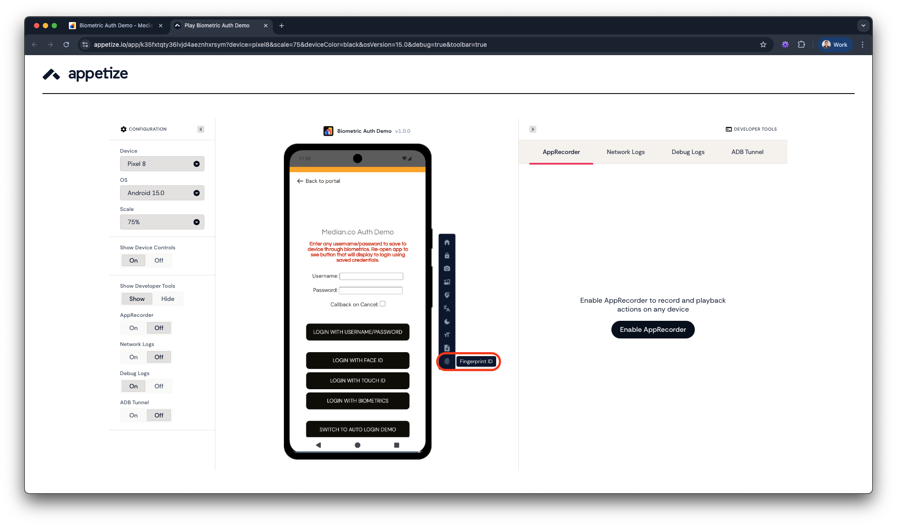
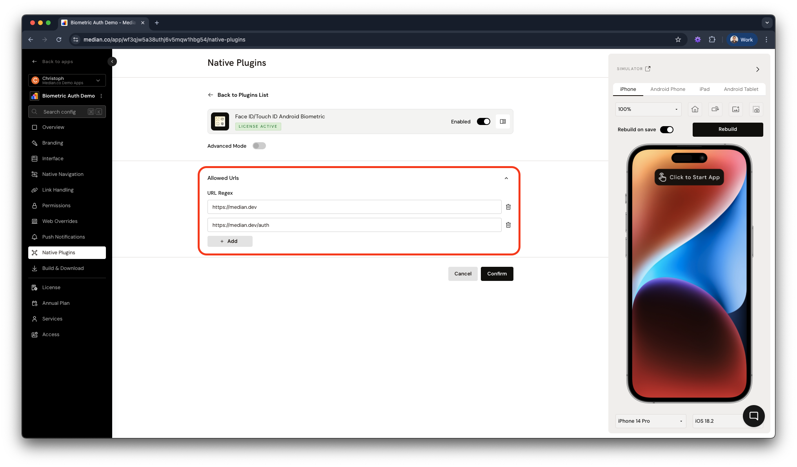

import { MedianLogo } from "/snippets/median-logo.jsx";

Securely authenticate users on Android devices using fingerprint, facial recognition, or other biometric methods with the Median Android Biometric Authentication plugin. This plugin uses the Median JavaScript Bridge to store and retrieve encrypted secrets, enabling biometric sign-in.

The plugin supports both:

- **Strong biometrics**: Fingerprint sensors, infrared facial recognition (hardware-backed)
- **Weak biometrics**: Face unlock via standard camera (software-only)

As the developer, you define the minimum biometric level required (strong or weak) depending on your app’s security needs.

## How it works

1. **Check biometric availability:** First, check whether biometric authentication data is available and biometrics are supported for the device (older models or MDM configurations may disable the support).
2. **Save sign-in secret:** After a user signs in and biometric authentication is available, the website can save a secret using the plugin. The secret is stored using cryptographic hardware to ensure it cannot be retrieved without biometric authentication. Saving the secret does not require user interaction.
3. **Retrieve saved secret:** On future visits, if a saved secret is available, the site can prompt the user to authenticate via Android Biometrics. If authentication succeeds, the secret is returned via the JavaScript callback. If it fails, an error is returned.
4. **Use secret to sign in:** Once the secret is recovered, you can either use it to sign in the user directly or populate the login form on your web app.

<Check>
**Developer Demo**

Display our demo page in your app with the Face ID / Touch ID Android Biometric Native Plugin active to test during development [https://median.dev/auth/](https://median.dev/auth/)

</Check>

## Implementation guide

This guide assumes a working publicly-accessible website (or test site) with a username and password login system.

### Saving a secret after login

After a user successfully signs in to your website with their username and password, check whether the device has biometric capabilities available. If biometrics are available, save a secret for future retrieval. The secret must be a single string, and can be a combination of the username and password or an authentication token. You may specify a minimum biometric level to support, either `strong` or `weak`.

For example, you may embed this JavaScript into your post-login page:

<MedianLogo />
<CodeGroup>
  ```javascript JavaScript
  var username = 'andy';
  var password = 'password';

  median.auth.status({'callbackFunction': median_status_afterlogin}); // returns promise

  function median_status_afterlogin(data) {
    if (data && data.hasTouchId) {
      var secret = JSON.stringify({
        username: username,
        password: password
      });

      median.auth.save({
        'secret': secret,
        'minimumAndroidBiometric': 'strong'
      });
    }
  }
  ```
</CodeGroup>

**Tip:** Some JavaScript Bridge commands return promises. They are usually declared as such through a comment to help you identify them. Learn more about [promises in the JavaScript Bridge](/docs/javascript-bridge#promises).

In this example, we have saved the username and password as the secret. You may choose to save an authentication token instead. We have specified the `minimumAndroidBiometric` as `strong` which is the default biometric level.

### Checking for a saved secret on login page

On the login page, you will need to know whether or not to prompt for biometric sign-in. Start by getting the status:

<MedianLogo />
<CodeGroup>
```javascript JavaScript
median.auth.status({'callbackFunction': median_status_beforelogin}); // returns promise

function median_status_beforelogin(data) {
   if (data && data.hasTouchId && data.hasSecret) {
       // Prompt the user to use biometrics to sign in
       median.auth.get({'callbackFunction': median_secret_callback});
   }
}

function median_secret_callback(data) {
    if (data && data.success && data.secret) {
        var credentials = JSON.parse(data.secret);
        var username = credentials.username;
        var password = credentials.password;

        // Use username and password to sign in here,
        // e.g. an http post or ajax request
    } else {
        // Allow manual entry
    }
}
```
</CodeGroup>

Once the `median_secret_callback` function is called with the previously saved secret, it should perform a request to sign in the user. If the credentials are incorrect, you should delete the secret and allow manual sign-in by running the function:

<MedianLogo />
<CodeGroup>
  ```javascript JavaScript
  // delete secret if credentials are incorrect
  median.auth.delete({'callbackFunction': CALLBACK});
  ```
</CodeGroup>

## Median JavaScript Bridge reference

### Check biometric availability

Run the JavaScript function:

<MedianLogo />
<CodeGroup>
  ```javascript JavaScript
  median.auth.status({
    'minimumAndroidBiometric': 'strong', // optional: 'strong' or 'weak', default is 'strong'
    'callbackFunction': CALLBACK // optional if callback is used rather than promise
  });
  ```
</CodeGroup>

The app will return a promise, or if provided execute CALLBACK, with an object parameter containing the fields:

- `hasTouchId`: `true` or `false`. Set to `true` on Android devices with fingerprints enrolled.
- `hasSecret`: `true` or `false`

### Save a secret

Typically you will want to first check that biometrics are available via the status function above and then save the secret.

Run the JavaScript function:

<MedianLogo />
<CodeGroup>
  ```javascript JavaScript
  median.auth.save({
    'secret': secret,
    'minimumAndroidBiometric': 'strong', // optional: 'strong' or 'weak', default is 'strong'
    'callbackFunction': CALLBACK // optional if callback is used rather than promise
  });
  ```
</CodeGroup>

The app will return a promise, or if provided execute CALLBACK, with an object with a `success` field.

### Retrieving a secret

Run the JavaScript function:

<MedianLogo />
<CodeGroup>
  ```javascript JavaScript
  median.auth.get({
    'callbackFunction': CALLBACK, // optional if callback is used rather than promise
    'minimumAndroidBiometric': 'strong', // optional: 'strong' or 'weak', default is 'strong'
    'prompt': 'PROMPT',
    'callbackOnCancel': 1 // optional: 1 or 0
  });
  ```
</CodeGroup>

**Prompt is only available for iOS and it has been included above to ensure cross-platform compatibility.**

The app will return a promise, or if provided execute CALLBACK, with an object parameter containing the fields:

- `success`: true or false
- `error`: provided success is false (see error codes below)
- `secret`: the previously stored secret
- `callbackOnCancel` is optional. If set to `1` and a `callbackFunction` has been provided, when the user cancels the authentication the callback function will be invoked with `success=false`, `error=userCanceled`. If `callbackOnCancel` is not set (or set to 0), the callback will not be run on cancel.

### Delete a secret

Run the JavaScript function:

<MedianLogo />
<CodeGroup>
  ```javascript JavaScript
  median.auth.delete({
    'callbackFunction': CALLBACK // optional if callback is used rather than promise
  });
  ```
</CodeGroup>

The app will return a promise, or if provided execute CALLBACK, with an object parameter containing the fields:

- `success`: true or false
- `error`: provided if success is false

### Possible error values

In general, you will only need to handle `authenticationFailed` in the "get secret" request.

- `duplicateItem`: Secret already exists
- `itemNotFound`: No secret saved
- `authenticationFailed`: Biometric check failed
- `genericError`: Unexpected failure
- `userCanceled`: User canceled the auth prompt
- `unimplemented`: Plugin not supported

## Testing Android biometric integration

We recommend testing on physical devices to confirm the flow is working as expected for devices with Android Biometric support, as well as older models or more restricted device configurations.

Additionally, you can also test the integration using the Appetize Simulators.

1. Open the demo page in the simulator
2. Click the Fingerprint ID Button (as shown below) to enable biometrics support in the simulator
3. Sign in with credentials
4. Return to the demo page and use the Login with Biometrics button without having to provide username and password again

<Frame caption="Appetize: Fingerprint ID button">
  
</Frame>

## Whitelist domains for plugin access

By default, any page loaded in your app will be able to use Median JavaScript Bridge to retrieve secrets. If you are allowing any domains you do not control to be loaded within your app (see [Link Handling](/docs/link-handling-overview)), we strongly recommend whitelisting only certain domains.

To do so, go to the **Native Plugins** tab in App Studio, click **Settings** for the Face ID/TouchID Android Biometrics plugin and add your whitelisted URLs as shown below.

Regular expressions are supported to allow wildcards in the URL.

<Frame caption="Whitelisting URLs for access">
  
</Frame>