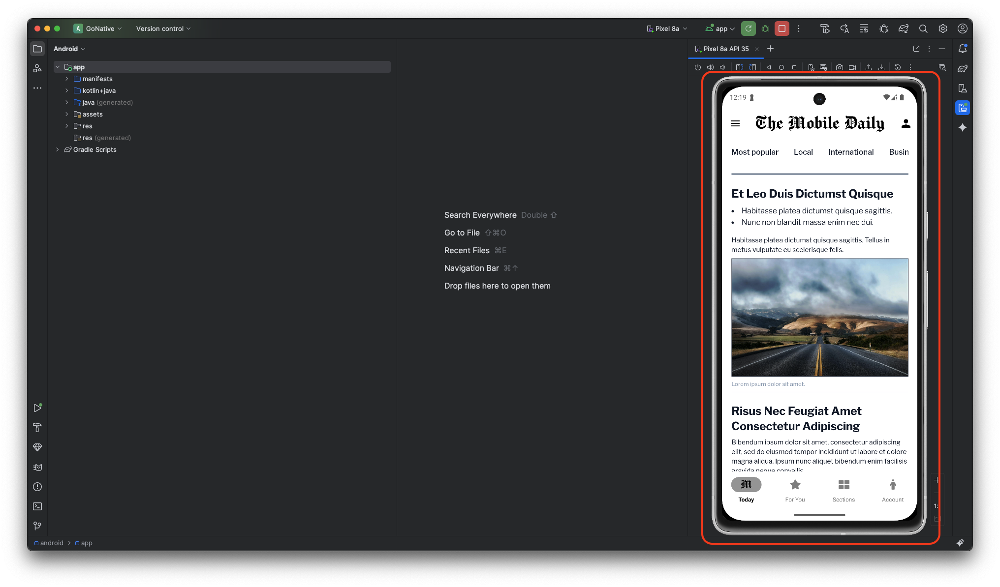
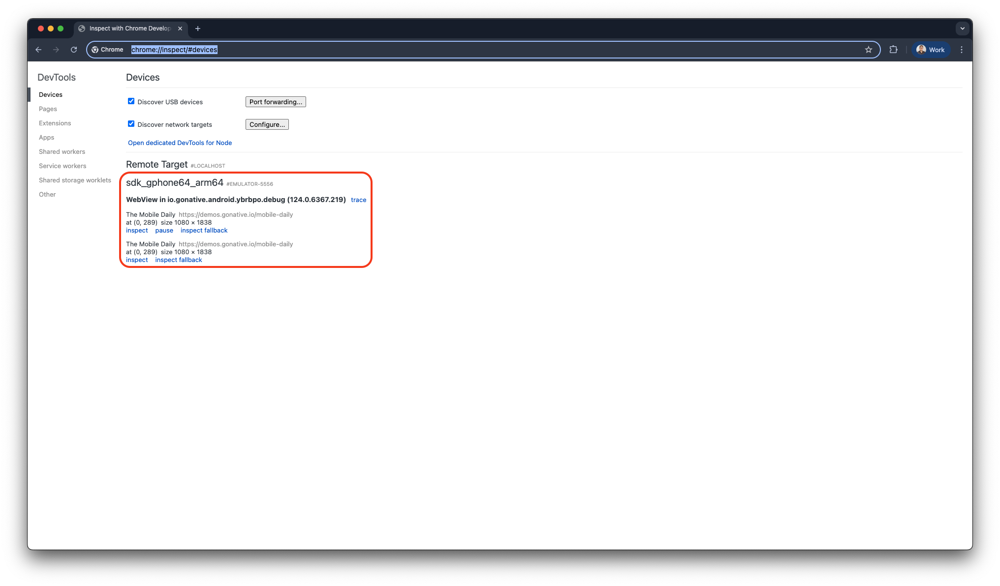

## Android Studio and Chrome (emulator)

1. Follow the steps in [Build Android from source](/docs/build-android-from-source) to build your Android app.

2. Launch the app in the Android Emulator.

   <Frame caption="Android Studio: app running in the Android Emulator">
     
   </Frame>

3. Open Chrome and go to `chrome://inspect/#devices`. Click **Inspect** to open Chrome Developer Tools for the website displayed in the emulator.

   <Frame caption="Google Chrome: inspect with Chrome Developer Tools">
     
   </Frame>

4. You can now use the Elements and Console panels to debug the website and view real-time updates in the Android Emulator.

## Chrome remote debugging (physical device)

1. Follow the steps in [Build Android from source](/docs/build-android-from-source) to build your Android app in Android Studio.

2. Enable Developer Options on your device:
   - Go to **Settings > About Phone**
   - Tap **Build Number** seven times until you see _"You are now a developer"_

3. Go back to:
   - **Settings > System > Developer Options** _(on some devices, this appears directly under Settings)_

4. Toggle **Developer Options** to **On**

5. Enable **USB Debugging**

6. Connect your device to your computer via a cable.

7. When prompted on your device:
   - Tap **Allow USB Debugging**
   - Check **Always allow from this computer**

8. On your computer:
   - Open Chrome
   - Navigate to `chrome://inspect`

9. Under the **Devices** section:
   - Your device should appear
   - If not, confirm USB Debugging is enabled and try a different cable

10. Under your device:
    - Locate your app
    - Click **Inspect**

## What you can do while debugging

- Execute JavaScript commands or view errors and logs generated by your app
- Monitor API calls and resource loading in real-time
- Modify CSS and HTML on the fly to test UI changes
- Inspect cookies, LocalStorage, and IndexedDB data to verify sessions and caching
