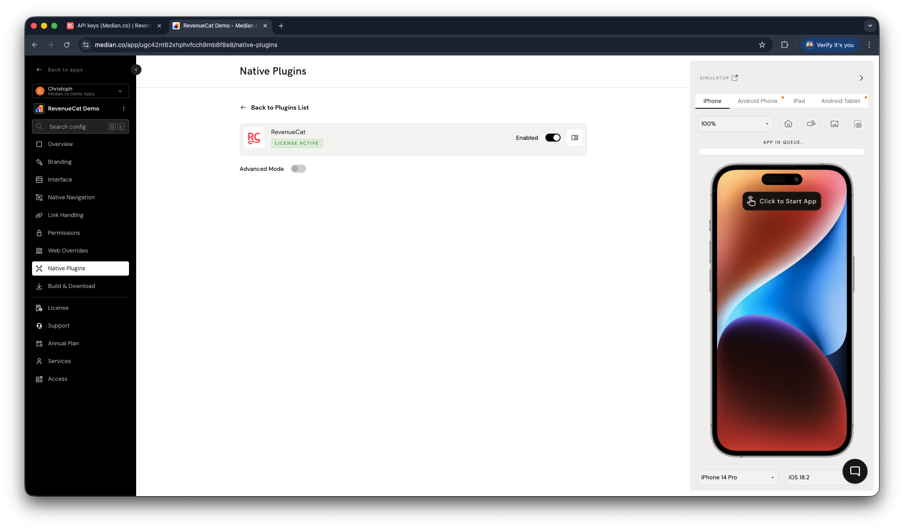

import { MedianLogo } from "/snippets/median-logo.jsx";

Mobile apps have access to one of the most effective monetization channels available: native in-app purchases and subscriptions, processed directly through Apple and Google's payment systems. This guide explains how monetization works in Median apps, what your options are, and how to choose the right approach for your app.

## How in-app purchases work in Median apps

When a user purchases digital content, subscriptions, premium features, or other in-app digital products, the payment must be processed natively by Apple (via StoreKit) or Google (via Play Billing) rather than through your web app's existing payment system.

This requirement applies specifically to digital goods sold within a mobile app. In these cases, Stripe, PayPal, and other web-based payment providers cannot be used to process the transaction. Apple and Google require eligible digital purchases to be sold through their respective in-app purchase (IAP) systems and charge a commission on those sales.

If your app already sells products or services outside the scope of app store billing requirements, those payment flows may continue to use your existing payment infrastructure.

Median provides two ways to implement native in-app purchases and subscriptions.

## Two paths to monetization

<Columns cols={1}>
  <Card
    title="RevenueCat"
    icon="/images/docs/3918c62ac9fae0f57028ab837292c3f1541127395601fd203ef8d6a95ce68786-plugin_revenue-cat.svg"
    href="/docs/revenue-cat"
  >
The RevenueCat Plugin simplifies the integration of in-app purchases and subscriptions by leveraging RevenueCat’s backend and SDKs for iOS and Android. It handles fetching products, processing purchases, and restoring past transactions, reducing the complexity of implementing Apple's StoreKit and Google Play Billing.
  </Card>
  <Card
    title="Native In-App Purchases"
    icon="rectangle-api"
    href="/docs/iap"
  >
Median's Native In-App Purchases (IAP) Plugin provides full support for integrating Apple's StoreKit and Google Play Billing libraries. This allows you to securely offer digital content, subscriptions, and one-time purchases directly within your mobile app.
  </Card>
</Columns>

### Option 1: RevenueCat (recommended)

Median's RevenueCat plugin sits on top of the native IAP layer and handles the complexity for you. RevenueCat is a subscription management platform that unifies iOS and Android purchases behind a single API, manages receipt validation, tracks subscription status across devices, and provides built-in revenue analytics. It also includes a no-code paywall builder.

For most apps, especially those built on AI platforms, RevenueCat is the recommended starting point. It removes the need to manage platform-specific billing logic and significantly reduces the time from decision to first paid user.

### Option 2: In-app purchases (direct)

Median's In-App Purchases plugin gives you direct access to Apple StoreKit and Google Play Billing. You configure your products (subscriptions, one-time purchases, consumables) in App Store Connect and Google Play Console, then call them from your app using Median's JavaScript Bridge.

This is the lower-level path. It gives you full control but requires you to manage products, receipts, and subscription status separately on iOS and Android.

## Understanding the layers

<div className="not-prose my-6 flex flex-col gap-2">
  <div className="rounded-xl border-2 px-5 py-4 text-center" style={{ backgroundColor: "#B5DAFF", borderColor: "#1174D3", color: "#1A100B" }}>
    <p className="font-semibold">RevenueCat Paywalls</p>
    <p className="mt-1 text-sm">No-code paywall UI · A/B testing · App review compliant</p>
  </div>

  <div className="text-center text-xl" style={{ color: "#7D7A77" }} aria-hidden="true">↑</div>

  <div className="rounded-xl border-2 px-5 py-4 text-center" style={{ backgroundColor: "#FEB9FF", borderColor: "#E93EE3", color: "#1A100B" }}>
    <p className="font-semibold">RevenueCat Products & Offerings</p>
    <p className="mt-1 text-sm">Unified subscription management · Cross-platform status · Revenue analytics</p>
  </div>

  <div className="text-center text-xl" style={{ color: "#7D7A77" }} aria-hidden="true">↑</div>

  <div className="rounded-xl border-2 px-5 py-4 text-center" style={{ backgroundColor: "#FFEFB4", borderColor: "#EFAC00", color: "#1A100B" }}>
    <p className="font-semibold">Native In-App Purchases</p>
    <p className="mt-1 text-sm">Apple StoreKit · Google Play Billing · Raw platform payment APIs</p>
  </div>
</div>

**Native In-App Purchases** are the foundation. Every purchase ultimately flows through Apple or Google's payment system. This is a platform requirement, not a Median one.

**RevenueCat Products & Offerings** wrap the native layer. You define your products once in RevenueCat (monthly subscription, annual plan, lifetime access) and RevenueCat handles syncing them across both stores, validating receipts, tracking who has an active subscription, and surfacing revenue data in one dashboard.

**RevenueCat Paywalls** sit on top of that. Instead of building a purchase screen in your app's UI, you design it in RevenueCat's no-code editor and present it with a single JavaScript call. Paywalls can be updated without a new app build and can be A/B tested.

You can use any layer independently, but starting with RevenueCat paywalls gives you the fastest path to a working, scalable monetization setup.

## Getting started with RevenueCat

Here is a condensed path to your first in-app purchase. The full RevenueCat guide covers each step in detail.

### Step 1: Connect your apps in RevenueCat

Sign in to RevenueCat and add both your iOS and Android apps under Apps & Providers. You'll need your iOS Bundle ID and Android Package Name. You can find your Bundle ID and Package Name in App Studio. See [App identifiers](/docs/app-identifiers) for details.

### Step 2: Retrieve your API key

RevenueCat provides a public SDK API key for your project. You'll use this to initialize the plugin at runtime. A test key is available by default so you can validate the purchase flow before going live.

### Step 3: Configure your products

Set up your subscription products (monthly, annual, lifetime) in App Store Connect and Google Play Console, then import them into RevenueCat using their Product Configuration Guide.

### Step 4: Enable the plugin in Median App Studio

In your app configuration, go to **Native Plugins → RevenueCat** and enable the plugin. No configuration is needed here. The SDK initialization happens at runtime via the JavaScript Bridge as shown in Step 5.

<Frame caption="RevenueCat plugin enablement">
  
</Frame>

### Step 5: Initialize and call the bridge

Once your user is authenticated, initialize the SDK with your API key and the (optional) user ID, then use the JavaScript Bridge functions to fetch offerings, trigger purchases, and present your paywall.

<MedianLogo />
<CodeGroup>
  ```javascript JavaScript
  // Initialize once after the user signs in
  await median.revenueCat.configure({
    apiKey: '<your_api_key>',
    appUserID: '<authenticated_user_id>'
  });

  // Show a paywall configured in RevenueCat
  median.revenueCat.presentPaywall();
  ```
</CodeGroup>

See the [full RevenueCat JavaScript Bridge reference](/docs/revenue-cat).

## Choosing your approach

|                                   | Direct In-App Purchases                    | RevenueCat                                       |
| --------------------------------- | ------------------------------------------ | ------------------------------------------------ |
| Setup complexity                  | Higher: manage iOS and Android separately  | Lower: single unified SDK                        |
| Product and subscription management | Manual: you track status yourself        | Automatic: RevenueCat tracks across devices      |
| Receipt validation                | Manual                                     | Built-in                                         |
| Paywall UI                        | You build it in your web app               | No-code editor in RevenueCat dashboard           |
| Revenue analytics                 | Separate dashboards per platform           | Unified MRR, churn, LTV in one place             |
| Best for                          | Apps with existing billing infrastructure  | New apps and AI-built apps starting from scratch |
