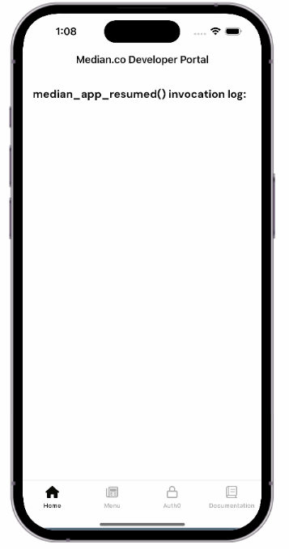

import { DeveloperDemo } from "/snippets/developer-demo.jsx";

<Info>
  **Note**

On Android, `median_app_resumed()` is also triggered after any native permission prompt.

</Info>

You can define `median_app_resumed()` directly on your web page or within your [Custom JavaScript](/docs/custom-js) configuration.

<DeveloperDemo path="app-resumed-callback" />

## Native auto-reload plugin for kiosk and signage apps

For Android apps used in kiosk or digital signage environments, we offer a custom native plugin that reloads app content at predefined intervals, bypassing JavaScript entirely. This ensures consistent and reliable refresh behavior, even in edge cases.

[Contact our team](https://median.co/contact?topic=sales-inquiry) to learn more about implementing this native solution.

## Demo

See the demo below to view the `median_app_resumed` callback log and run custom JavaScript when the app resumes from the background.

<Frame caption="Median app resumed demo">
  
</Frame>
