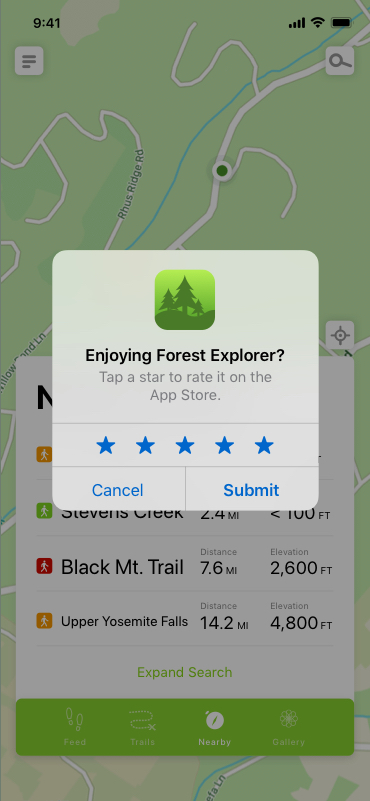
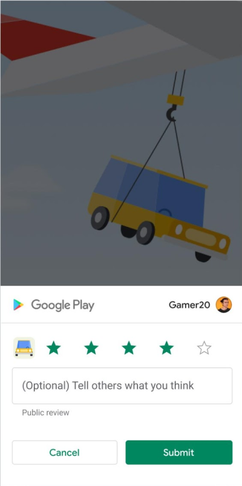

import { DeveloperDemo } from "/snippets/developer-demo.jsx";

import { MedianLogo } from "/snippets/median-logo.jsx";

The App Review Native Plugin enables you to prompt users to leave a rating and review for your app on the Apple App Store or Google Play Store, enhancing your app’s visibility and reputation.

|                                   Apple App Store App Review                                    |                                 Google Play App Review                                  |
| :---------------------------------------------------------------------------------------------: | :-------------------------------------------------------------------------------------: |
|  |  |

<DeveloperDemo path="app-review" />

## Implementation guide

### iOS App Store configuration

For the Apple App Store you will need to configure the plugin with your App Store ID, the numerical component in your app store listing URL idXXXXXXX.

For example, the App Store ID for the YouTube app is **544007664** given the URL is [https://apps.apple.com/us/app/youtube-watch-listen-stream/id544007664](https://apps.apple.com/us/app/youtube-watch-listen-stream/id544007664)

### JavaScript Bridge command

Once the plugin is installed, trigger the in-app review modal using the following command via the Median JavaScript Bridge:

<MedianLogo />
<CodeGroup>
  ```javascript JavaScript
  median.appreview.prompt({ callback: appReviewComplete });
  ```
</CodeGroup>

`callback` is an optional function to run once the app review modal has been closed.

## Platform-specific display considerations

### iOS: App Store review prompt limitations

Apple controls when the review prompt is displayed to avoid spamming users. Even if your code requests a prompt, it may not appear in production. During development, prompts always display for testing, but they will not display when using TestFlight builds.

**Testing guide for in-app reviews**: [Apple's documentation on requesting reviews](<https://developer.apple.com/documentation/storekit/appstore/requestreview(in:)-1q8qs/>)

### Android: Google Play review quota

Google Play enforces a rate-limiting quota on in-app review prompts, restricting how often a user sees them. This quota is time-based and may change over time. Please reference the official Google guidelines below as they may change over time.

**Quota details**: [Google Play In-App Reviews API documentation](https://developer.android.com/guide/playcore/in-app-review#quotas)

**Testing guide for in-app reviews**: [Google Android test in-app reviews documentation](https://developer.android.com/guide/playcore/in-app-review/test)

Best practices for Google Play:

- Avoid triggering reviews via direct call-to-action (CTA) buttons.
- Target natural interaction points (e.g., after completing a task).
- If quota is likely exceeded, consider redirecting users to your app’s Play Store listing instead.

The Apple App Store controls the actual display of prompt so it may not show for some cases. This is to prevent frequent rating prompts which can be irritating for users. While your app is in development mode, a rating and review request is always displayed so you can test the user interface and experience. However, this method has no effect when you call it in an app that you distribute using TestFlight. See more details in [Apple's documentation on display considerations and testing](https://developer.apple.com/documentation/storekit/skstorereviewcontroller/2851536-requestreview?language=objc#discussion).
