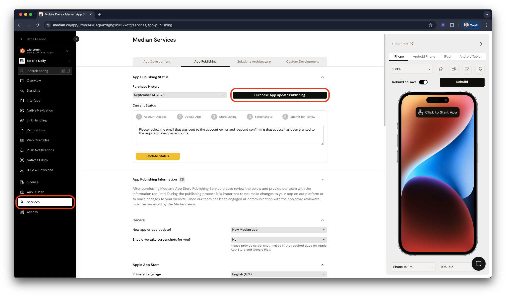

Keeping your app up to date ensures compatibility with the latest operating systems, device models, and app store requirements. Whether you are updating an existing Median app, syncing website content changes, or migrating a live app from another platform to Median, this guide provides the necessary workflows.

## Standard app updates

Median maintains the core iOS and Android codebase so you can deliver native mobile apps without needing dedicated mobile developers.

### How updates work

All new Median app licenses include 6 months of ongoing app updates. During your development and initial launch phases, you can build your app using the latest available code. After this period, an active Support & Updates Plan is required to generate new builds with the latest codebase updates.

### When to update your app

Your app will function indefinitely on the devices supported at the time of its launch. However, we recommend updating your app:

- Annually, or to coincide with major iOS and Android OS releases.
- When new device form factors (e.g., new iPhone screen sizes) are released.
- To take advantage of ongoing performance optimizations and new Median features.
- If you see the warning "App update from Median.co / GoNative.io is required", which indicates Google or Apple have mandated new OS compatibility requirements.

### How to publish an app update

**Step 1: Configuration.** Make required changes to your app in Median App Studio and preview them using the browser-based simulators.

**Step 2: Build.** Go to the **Build & Deploy** tab and generate new iOS and/or Android builds. You must have an active Support & Updates Plan.

**Step 3: Publish.**

**Full-Service Publishing:** Purchase an App Update Publishing service on the **Services** tab. The Median Publishing Team will handle the update process, including TestFlight distribution and App Store submission.

<Frame caption="Median App Studio: app publishing">
  
</Frame>

**Self-publishing:** Use the App Store Connect API workflow in App Studio to upload iOS builds to TestFlight. For Android, follow the [Android build and deployment guide](/docs/android-build-deployment) to submit your APK/AAB.

## Handling website content updates

Because Median natively wraps your web content, changes made to your website reflect immediately in your app just as they do in a standard mobile browser. You do not need to submit an app store update when changing your website's UI, text, or web-based features.

### Troubleshooting caching issues

Median native apps obey the standard cache headers sent by your web server. If website changes are not appearing in your app:

- **Wait and refresh:** Browser caches may have a short delay. Wait a few minutes and refresh the page.

- **Check server headers:** Inspect the cache headers sent by your web server to ensure they aren't forcing the app to cache resources longer than intended.

- **Cache busting:** Use version suffixes on your website's resource files (e.g., `application_v2.js`). This forces the app to retrieve the latest file directly from the server.

- **Clear webview cache command:** Use the Median JavaScript Bridge command to clear the cache via JavaScript.

- **Android auto-clear cache:** For Android, you can configure the app to clear the WebView cache every time it is exited. Add the following to your appConfig.json (or configure it in App Studio):

<CodeGroup>
  ```json JSON
  "general": {
    "androidClearCache": true
  }
  ```
</CodeGroup>

If issues persist, try completely uninstalling and reinstalling the app on your device to wipe all cached data.

## Migrating an existing app to Median

If you already have a live app on the Apple App Store or Google Play Store (whether built natively, with React Native, Flutter, or another web wrapper), you can migrate it to Median. By publishing your Median app as an update to your existing app, you retain your users, download history, reviews, and app store rankings.

Follow these technical requirements to ensure a smooth transition:

### Step 1: Replicate core functionality

Before migrating, verify that your new Median configuration provides the core functionality your users expect:

- **Navigation:** Use Median's top navigation bars, bottom tab bars, and sidebar menus for a native feel without writing native code. You can also use your existing web navigation.

- **Native features:** Enable corresponding Median native plugins (e.g., push notifications, biometrics, QR scanning) in App Studio to replace your old app's native features.

- **User sessions:** Local storage and secure credentials from your old app will not automatically transfer to the Median WebView context. Ensure your web application uses persistent cookies so returning users can sign in easily.

### Step 2: Match app identifiers exactly

To submit your Median app as an update rather than a completely new app, the unique package identifiers must perfectly match your live app. You can learn more in [App identifiers](/docs/app-identifiers).

### Step 3: Increment version codes

App stores require each new upload to have a higher version number sequentially.

### Step 4: Retain app signing keystores

Matching cryptographic signatures is the most critical step, especially for Android.

**Android signing**: Your new Median APK/AAB must be signed with the exact same keystore (`.jks` or `.keystore`) and alias used for the original app. If you use Google Play App Signing, ensure your upload key matches. Configure this directly in App Studio or contact Median support for assistance.

**iOS signing**: Provide your existing Apple Developer account Issuer ID, Key ID, and Private Key (`.p8`) in App Studio for automatic uploads, or manually upload the downloaded IPA via Transporter to your existing App Store Connect record.

### Step 5: Migrate push notification subscribers

If you use push notification providers like OneSignal or Braze, configure the Median push plugin using your existing App ID. Depending on how your previous app handled External User IDs, returning users may generate a new device record when opening the Median app. Refer to your provider's documentation on merging legacy user profiles or cleaning up inactive devices.

We offer a dedicated [push SDK migration guide](/docs/push-notification-migration).

### Step 6: Test the upgrade path

Before launching the upgrade to your users, you should always simulate the update process locally to make sure everything plays nice.

Start by loading the older version of your app onto a physical test device, and then generate your new Median build. Once that is ready, install the new build directly over the legacy app. You can handle this via TestFlight on iOS or by installing the apk on Android.

Finally, open the updated app to verify that it launches smoothly, the UI renders exactly as expected, and all your native features are working.

## Frequently asked questions

<AccordionGroup>
<Accordion title="Can I force an app update?" id="can-i-force-an-app-update">

Although you cannot force users to update the app, you can use the version number returned by `median.deviceInfo()` to conditionally display a page prompting them to install the latest version.

See the [version enforcement example](/docs/device-info#advanced-example-enforce-a-minimum-app-version) for an implementation.

</Accordion>
</AccordionGroup>
