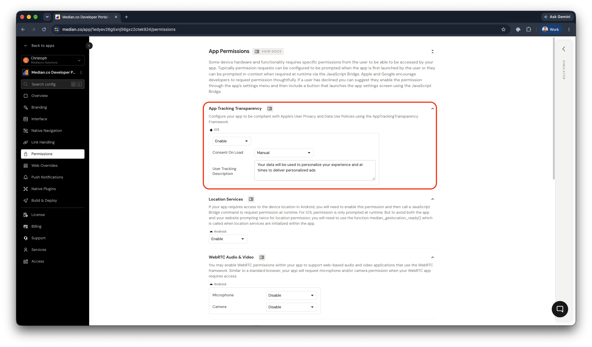

import { MedianLogo } from "/snippets/median-logo.jsx";

To comply with Apple’s User Privacy and Data Use Policy, all iOS apps running on iOS 14.5 and above must request and obtain explicit user consent before tracking users across apps or websites owned by other companies. This is enforced through Apple’s AppTrackingTransparency (ATT) Framework.

If your app collects data for advertising, analytics, or third-party services, you must present the ATT prompt and respect the user's decision.

Fortunately, Median makes it easy for you to configure your app to utilize Apple's AppTrackingTransparency Framework to remain compliant.

## Implementation guide

### Enable ATT in your app configuration

- Open the **Permissions** tab in App Studio.

- Under **App Tracking Transparency**, set the iOS option to **Enable**.

- Use **Consent On Load** to choose how the ATT prompt is displayed:
  - **Automatic**: The prompt is shown automatically on the first app launch.
  - **Manual**: You control when the prompt appears via the JavaScript Bridge (see [below](#prompt-for-user-consent-at-runtime-manual-method)).

- Review the **User Tracking Description**, which sets the message shown in the ATT prompt.

<Frame caption="ATT app configuration">
  
</Frame>

#### User tracking description (`NSUserTrackingUsageDescription`)

When App Tracking Transparency is enabled, Median adds the `NSUserTrackingUsageDescription` key to your app's `Info.plist`. Apple requires this key for any app that requests tracking authorization, and its value is the explanation users see in the ATT system prompt.

By default, Median sets the value to:

> Your data will be used to personalize your experience and at times to deliver personalized ads

You can replace this with your own text in the **User Tracking Description** field. Describe clearly and accurately how your app uses tracking data, since Apple reviews this text during App Review.

<Note>
  Because `NSUserTrackingUsageDescription` is part of your app's `Info.plist`,
  changes to the User Tracking Description take effect in your next build.
</Note>

### Prompt for user consent at runtime (manual method)

If you prefer to trigger the ATT prompt at a specific moment in your app (e.g., after user onboarding or before accessing personalized content), use the following JavaScript function:

<MedianLogo />
<CodeGroup>
  ```javascript JavaScript
  function request() {
    median.ios.attconsent.request()
      .then(function (result) {
        // Handle user's response
        if (result.granted) {
          // Proceed with tracking logic
        } else {
          // Disable tracking
        }
      });
  }
  ```
</CodeGroup>

The `result` object will be `{ granted: true|false }` based on the user's response to the consent prompt. For iOS 14.4 and lower, `result` object will always be `{ granted: true}`

### Check ATT consent status

You can check whether the user has already responded to the ATT prompt using the following function:

<MedianLogo />
<CodeGroup>
  ```javascript JavaScript
  function status() {
    median.ios.attconsent.status()
      .then(function (result) {
        // Use result.granted to determine tracking logic
      });
  }
  ```
</CodeGroup>

The `result` object will be `{ granted: true|false }` based on the user's response to the consent prompt. For iOS 14.4 and lower, `result` object will always be `{ granted: true}`

This is useful for conditional logic. For example, adjusting third-party SDK behavior or disabling analytics for non-consenting users.

## Additional resources

- [Apple's AppTrackingTransparency framework documentation](https://developer.apple.com/documentation/apptrackingtransparency)
- [Median blog: What is App Tracking Transparency for iOS?](https://median.co/blog/what-is-app-tracking-transparency-for-ios)
