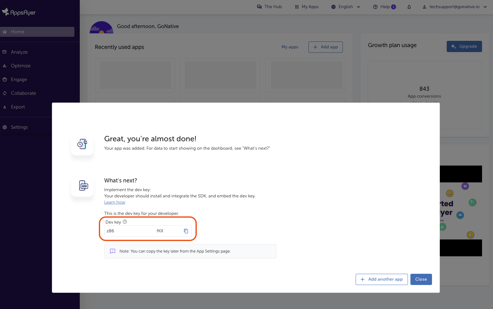
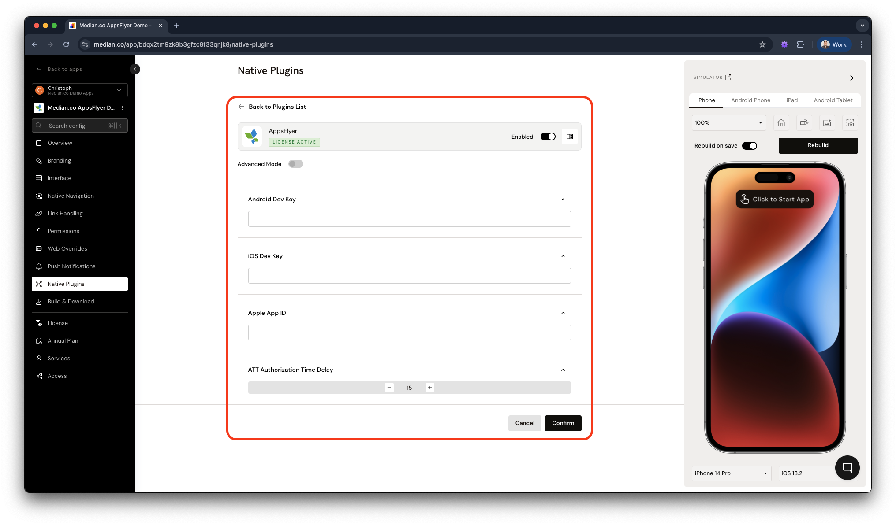

import { DeveloperDemo } from "/snippets/developer-demo.jsx";

import { MedianLogo } from "/snippets/median-logo.jsx";

The AppsFlyer Native Plugin records app installs, updates, and sessions automatically so you can attribute installs, measure campaign performance, and evaluate user quality. Send custom in-app events through the [Median JavaScript Bridge](/docs/javascript-bridge).

The plugin integrates the AppsFlyer SDK in your app and exposes a small JavaScript API for setting a customer user ID, logging custom events, and receiving conversion and deep link data. You configure your app in the **AppsFlyer dashboard** and in **Median App Studio**, then use the bridge for custom logic.

<Warning>
  **iOS 14.5+ App Tracking Transparency requirement**

Requesting user consent through the App Tracking Transparency (ATT) framework is required for iOS 14.5+. See [Apple App Tracking Transparency](/docs/apple-att) in the Median docs and [AppsFlyer – Enabling ATT support](https://dev.appsflyer.com/hc/docs/integrate-ios-sdk#enabling-app-tracking-transparency-att-support) for implementation details.

</Warning>

## Why use AppsFlyer?

- **Attribution and ROI**: Attribute installs to campaigns and measure return on ad spend.
- **Automatic event tracking**: Installs, updates, and sessions are recorded without extra code.
- **Custom in-app events**: Log business events (e.g. signup, purchase) via the JavaScript Bridge.
- **Conversion and deep link data**: Receive install attribution and deep link payloads in your web app via callbacks.

**Key terms**

**Dev Key**: A unique key per app in the AppsFlyer dashboard. You use the Android and Apple dev keys in Median App Studio to link your Median app to AppsFlyer.

**Conversion data**: Data returned by AppsFlyer for an install (e.g. first launch, install time, attribution status). The SDK invokes your callback when the app is launched or brought to the foreground (e.g. after a deep link).

**`af_status`**: A string in the conversion data object indicating whether the install is **Organic** or **Non-organic**. Use it to branch logic (e.g. show different onboarding for paid vs organic users).

**Organic vs non-organic**: _Organic_ = install not attributed to a campaign; _non-organic_ = attributed to a marketing source.

## Prerequisites

- [ ] A Median app with JavaScript Bridge enabled
- [ ] An [AppsFlyer](https://www.appsflyer.com/) account and app(s) created for iOS and Android
- [ ] **Apple App ID** (from [App Store Connect – App Information](https://developer.apple.com/help/app-store-connect/reference/app-information)) or your app’s App Store URL
- [ ] **Android package name** (from [Median App Identifiers](/docs/app-identifiers#android-package-name)) or your app’s Play Store URL
- [ ] For iOS 14.5+: ATT implemented and, if desired, ATT prompt delay configured in the plugin

<DeveloperDemo path="appsflyer" />

## When to use this plugin

AppsFlyer is essential for apps that need to:

| Use case                         | Example                                                                                |
| -------------------------------- | -------------------------------------------------------------------------------------- |
| **Campaign attribution**         | Attribute installs and re-engagement to paid campaigns (e.g. Facebook, Google)         |
| **Install and session tracking** | Measure installs, updates, and sessions automatically without extra code               |
| **Custom in-app events**         | Log signups, purchases, or feature usage for analytics and optimization                |
| **Conversion data**              | Know whether an install is organic or non-organic and use it in your app logic         |
| **Deep link handling**           | React to deferred or direct deep links (e.g. open a specific screen from a push or ad) |
| **ROI measurement**              | Evaluate user quality and campaign performance in the AppsFlyer dashboard              |

## Implementation guide

### AppsFlyer configuration

Before enabling the plugin in Median, create and configure your app in the [AppsFlyer dashboard](https://hq1.appsflyer.com/) using your Apple App ID and Android package name (see [Prerequisites](#prerequisites)). Add one app for **iOS** and one for **Android**; once each is created, you’ll receive a **dev key** for that platform.

| Key                  | Example value            | Source                                                                                                              |
| -------------------- | ------------------------ | ------------------------------------------------------------------------------------------------------------------- |
| Apple App ID         | 123456789                | [App Store Connect – App Information](https://developer.apple.com/help/app-store-connect/reference/app-information) |
| Android package name | co.median.android.dnxqyl | [Median App Studio – App Identifiers](/docs/app-identifiers#android-package-name)                                   |

<Frame caption="AppsFlyer: dev key">
  
</Frame>

You may need to configure additional options in AppsFlyer (e.g. re-engagement attribution, uninstall measurement). See [AppsFlyer App Settings](https://support.appsflyer.com/hc/en-us/articles/211719806-App-Settings) and the [AppsFlyer Help Center](https://support.appsflyer.com/).

### App Studio configuration

#### Enable the plugin

1. **Open Native Plugins**: In [Median App Studio](https://median.co/login), open your app and go to **Native Plugins**.
2. **Open AppsFlyer**: Select **AppsFlyer** and go to **Settings**.
3. **Enter credentials**: Set **Android Dev Key**, **Apple Dev Key**, and **Apple App ID** from your AppsFlyer setup. Optionally set the ATT prompt delay (iOS).

#### Configuration options

| Setting                         | Description                                                                          | Default | Recommended                         |
| ------------------------------- | ------------------------------------------------------------------------------------ | ------- | ----------------------------------- |
| **Android Dev Key**             | AppsFlyer dev key for your Android app                                               | —       | From AppsFlyer dashboard            |
| **Apple Dev Key**               | AppsFlyer dev key for your iOS app                                                   | —       | From AppsFlyer dashboard            |
| **Apple App ID**                | Apple App ID (numeric) for your iOS app                                              | —       | From App Store Connect              |
| **ATT prompt delay** (optional) | Delay in seconds to wait for ATT status before sending data to the AppsFlyer servers | —       | Per your product/legal requirements |

<Frame caption="Median AppsFlyer plugin configuration">
  
</Frame>

<Info>
  **Note**

The configuration above is a sample for the developer demo. AppsFlyer is highly customizable. For production, we recommend consulting AppsFlyer or your marketing team to tailor settings (attribution, uninstall measurement, etc.) to your needs. See the [AppsFlyer Help Center](https://support.appsflyer.com/).

</Info>

After the plugin is configured, use the [JavaScript Bridge functions](#javascript-bridge-functions) below to set a customer user ID, log custom events, and handle conversion or deep link data via callbacks.

### JavaScript Bridge functions

#### Associate a user

Associates your own customer user ID with AppsFlyer so you can cross-reference it with AppsFlyer’s device IDs and your backend.

<MedianLogo />
<CodeGroup>
  ```javascript JavaScript
  try {
    const { success } = await median.appsflyer.setCustomerUserId("user123");
    console.log(success ? "User ID set successfully" : "Failed to set user ID");
  } catch (err) {
    console.error(err.code, err.message);
  }
  ```
</CodeGroup>

**npm package**

<MedianLogo />
<CodeGroup>
  ```javascript JavaScript
  import Median from "median-js-bridge";

try {
const { success } = await Median.appsflyer.setCustomerUserId("user123");
console.log(success ? "User ID set successfully" : "Failed to set user ID");
} catch (err) {
console.error(err.code, err.message);
}

````
</CodeGroup>

**Parameters**

| Parameter | Type     | Required | Description                  |
| --------- | -------- | -------- | ---------------------------- |
| `userId`  | `string` | Yes      | Your unique customer or user |

#### Log a custom in-app event

Logs a custom in-app event with an optional object of values. Use it for signups, purchases, or any business event you want to measure in AppsFlyer.

<MedianLogo />
<CodeGroup>
```javascript JavaScript
try {
const { success } = await median.appsflyer.logEvent("purchase", {
  value: 99.99,
  currency: "USD",
});
console.log(success ? "Event logged successfully" : "Failed to log event");
} catch (err) {
console.error(err.code, err.message);
}
````

</CodeGroup>

**npm package**

<MedianLogo />
<CodeGroup>
  ```javascript JavaScript
  import Median from "median-js-bridge";

try {
const { success } = await Median.appsflyer.logEvent("purchase", {
value: 99.99,
currency: "USD",
});
console.log(success ? "Event logged successfully" : "Failed to log event");
} catch (err) {
console.error(err.code, err.message);
}

````
</CodeGroup>

**Parameters**

| Parameter     | Type     | Required | Description                                                                       |
| ------------- | -------- | -------- | --------------------------------------------------------------------------------- |
| `eventName`   | `string` | Yes      | Event name (e.g. `'purchase'`, `'signup'`)                                        |
| `eventValues` | `object` | No       | Key-value pairs to attach to the event (e.g. `{ amount: 9.99, currency: 'USD' }`) |

#### Read cached conversion or deep link data

Both values are cached natively once the AppsFlyer SDK returns them. These functions read that cache and return immediately. They never wait for the SDK, so on a cold launch they can resolve with `data: null` before the value has arrived. Use the callbacks below to be told the moment it does.

<MedianLogo />
<CodeGroup>
```javascript JavaScript
const conversion = await median.appsflyer.getConversionData();
if (conversion.data) {
console.log("Install attribution:", conversion.data.af_status);
}

const deepLink = await median.appsflyer.getDeepLinkResult();
if (deepLink.data) {
// Navigate using deepLink.data.deeplinkValue
}
````

</CodeGroup>

**Sample response**

<MedianLogo />
<CodeGroup>
  ```json JSON
  {
    "success": true,
    "data": {
      "af_status": "Organic",
      "is_first_launch": false
    }
  }
  ```
</CodeGroup>

When nothing has been cached yet, or the app was not opened from a deep link:

<MedianLogo />
<CodeGroup>
  ```json JSON
  {
    "success": false,
    "data": null
  }
  ```
</CodeGroup>

Requires the AppsFlyer plugin 1.4.0 on iOS and 1.3.0 on Android. Not yet available through the `median-js-bridge` NPM package.

#### Conversion data and deep link callbacks

The app invokes **global callback functions** you define when conversion or deep link data is available (on app launch or when brought to the foreground, e.g. via a deep link). Data is cached after the first call and will be the same on later invocations. To read a cached value at any time instead of waiting for a callback, see [Read cached conversion or deep link data](#read-cached-conversion-or-deep-link-data).

**Legacy conversion (install) data**

Define this function so the app can pass conversion data for the install:

<MedianLogo />
<CodeGroup>
  ```javascript JavaScript
  function median_appsflyer_cd_success(conversionDataMap) {
    // conversionDataMap.af_status is “Organic” or “Non-organic”
    console.log("Install attribution:", conversionDataMap);
  }
  ```
</CodeGroup>

**New conversion data**

<MedianLogo />
<CodeGroup>
  ```javascript JavaScript
  function median_appsflyer_cd(data) {
    console.log("Conversion data:", data);
  }
  ```
</CodeGroup>

**UDL (Unified Deep Linking) / deep link result**

For deep link payloads (e.g. `deeplinkValue`, `campaign`, `mediaSource`):

<MedianLogo />
<CodeGroup>
  ```javascript JavaScript
  function median_appsflyer_deeplink_result(data) {
    console.log("Deep link data:", data);
    if (data.deeplinkValue) {
      // Navigate or handle deep link
    }
  }
  ```
</CodeGroup>

**npm package**

Register listeners using the `median-js-bridge` package. Each listener returns an ID you can use to remove it later.

**Conversion data**

<MedianLogo />
<CodeGroup>
  ```javascript JavaScript
  import Median from "median-js-bridge";

const conversionListenerId = Median.appsflyer.conversionData.addListener(
(data) => {
console.log("Conversion data:", data);
if (data.af_status === "Non-organic") {
// Handle paid attribution
}
},
);

````
</CodeGroup>

**Deep link result**

<MedianLogo />
<CodeGroup>
```javascript JavaScript
const deeplinkListenerId = Median.appsflyer.deeplinkResult.addListener(
(data) => {
  console.log("Deep link data:", data);
  if (data.deeplinkValue) {
    // Navigate or handle deep link
  }
},
);
````

</CodeGroup>

**SDK start**

<MedianLogo />
<CodeGroup>
  ```javascript JavaScript
  const sdkStartListenerId = Median.appsflyer.sdkStart.addListener((data) => {
    console.log("AppsFlyer SDK started:", data.success);
  });
  ```
</CodeGroup>

To remove a listener later, use its ID:

<MedianLogo />
<CodeGroup>
  ```javascript JavaScript
  Median.appsflyer.conversionData.removeListener(conversionListenerId);
  Median.appsflyer.deeplinkResult.removeListener(deeplinkListenerId);
  Median.appsflyer.sdkStart.removeListener(sdkStartListenerId); ```
</CodeGroup>

**Sample response – conversion data**

<MedianLogo />
<CodeGroup>
  ```json JSON
  {
    "is_first_launch": false,
    "install_time": "2026-02-11 10:32:16.951",
    "af_message": "organic install",
    "af_status": "Organic"
  }
  ```
</CodeGroup>

**Sample response – deep link found**

Fields the campaign did not set are returned as empty strings, not omitted. On iOS they arrive at the root:

<MedianLogo />
<CodeGroup>
  ```json JSON
  {
    "afSub1": "",
    "afSub2": "",
    "afSub3": "",
    "afSub4": "",
    "afSub5": "",
    "campaign": "summer_sale",
    "campaignId": "1234567890",
    "clickEvent": {},
    "clickHTTPReferrer": "",
    "deeplinkValue": "product/42",
    "isDeferred": true,
    "matchType": "referrer",
    "mediaSource": "email"
  }
  ```
</CodeGroup>

On Android, from plugin 1.4.0, the same fields are nested under `data` with `success` at the root, matching what `getDeepLinkResult()` returns:

<MedianLogo />
<CodeGroup>
  ```json JSON
  {
    "success": true,
    "data": { "deeplinkValue": "product/42", "campaign": "summer_sale", "...": "" }
  }
  ```
</CodeGroup>

**Sample response – no deep link found**

The payload differs by platform. Read `deeplinkValue` defensively rather than branching on the shape.

<MedianLogo />
<CodeGroup>
  ```json Android
  { "success": false, "data": null, "error": { "message": "not_found" } }
  ```

```json iOS
{}
```

</CodeGroup>

## Testing checklist

Use this checklist to confirm AppsFlyer is working in your app:

### Basic functionality

- [ ] Plugin is enabled and configured in **Native Plugins > AppsFlyer > Settings**
- [ ] `median.appsflyer.setCustomerUserId(id)` runs without errors
- [ ] `median.appsflyer.logEvent(name, values)` runs without errors
- [ ] Conversion callback (`median_appsflyer_cd_success` or `median_appsflyer_cd`) is called on launch or when returning to the app

### Platform testing

- [ ] Behavior verified on a **real Android device** (not only simulator)
- [ ] Behavior verified on a **real iOS device** (not only simulator)
- [ ] On iOS 14.5+, ATT prompt appears when configured and consent affects behavior as expected

### Configuration testing

- [ ] **Android Dev Key**, **Apple Dev Key**, and **Apple App ID** match the AppsFlyer dashboard
- [ ] Global callback function names match exactly (`median_appsflyer_cd_success`, `median_appsflyer_cd`, `median_appsflyer_deeplink_result`)

### User experience

- [ ] No JavaScript errors in the console from the plugin or callbacks
- [ ] Callbacks do not block the UI; navigation or UI updates remain responsive

## Troubleshooting

### AppsFlyer functions are undefined or not working

Ensure the JavaScript Bridge is enabled in your Median app and that you are calling `median.appsflyer` after the app and bridge are ready (e.g. after `median_library_ready()` or when your main app script runs). Confirm the AppsFlyer plugin is enabled under **Native Plugins** in App Studio.

### Conversion callback is never called

Conversion data is provided when the app is launched or brought to the foreground. Ensure you define the global function names exactly: `median_appsflyer_cd_success` (legacy), `median_appsflyer_cd` (new), or `median_appsflyer_deeplink_result` (UDL). The SDK may take a moment to return data; avoid removing or redefining these callbacks during the first launch.

### ATT prompt does not appear on iOS

Confirm [App Tracking Transparency](/docs/apple-att) is implemented in your app and that you have configured the ATT prompt (and optional delay) as required. The simulator may not show the system ATT dialog; test on a real device.

### Events or installs do not show in the AppsFlyer dashboard

Verify **Android Dev Key**, **Apple Dev Key**, and **Apple App ID** in **Native Plugins > AppsFlyer > Settings** match the app in your AppsFlyer dashboard. Ensure you are testing on a real device; the SDK does not fully work in the simulator. Allow some time for data to appear in the dashboard.

### Wrong or missing conversion data

Conversion data is cached after the first callback. For a fresh install, the first launch may have limited data until attribution is resolved. Check [AppsFlyer’s documentation](https://support.appsflyer.com/) on timing and testing.

### Deep link callback not firing

Confirm your deep link URL scheme and link format are configured correctly in AppsFlyer and that the app is opened via that link (not only from the home screen). Use [AppsFlyer's deep link validator](https://support.appsflyer.com/hc/en-us/articles/207032096) and test on a real device.

<Info>
**Still having trouble?**

For SDK-level errors or attribution behavior, refer to the [AppsFlyer SDK documentation](https://dev.appsflyer.com/).

</Info>
