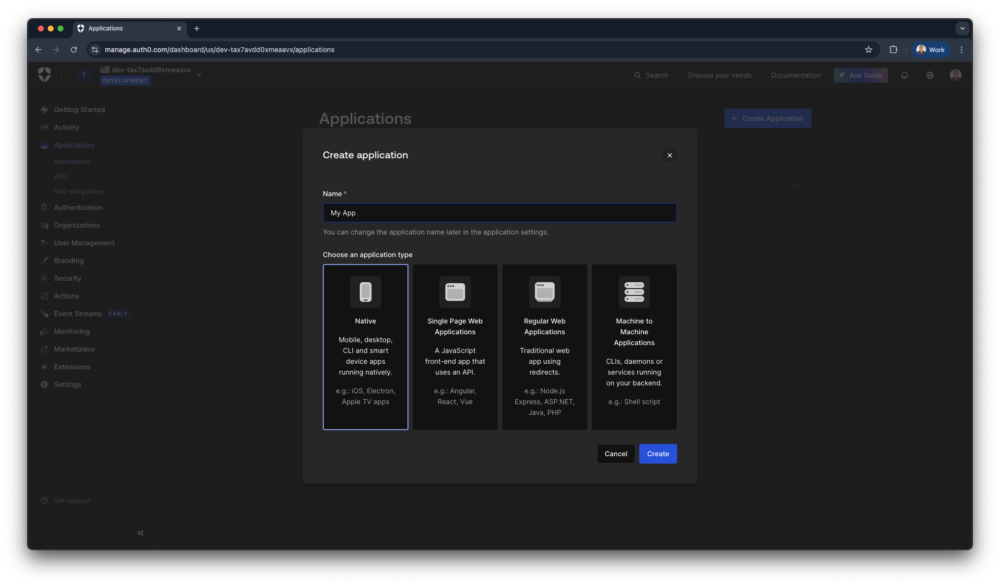
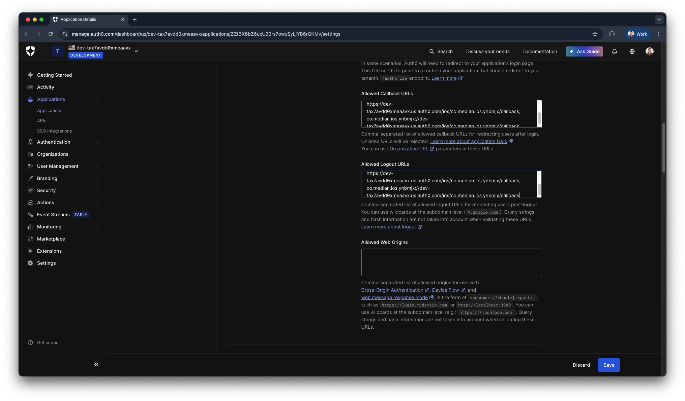
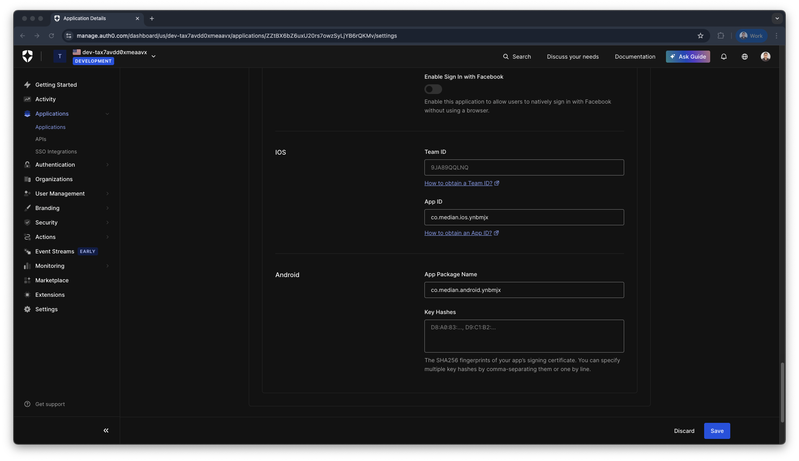
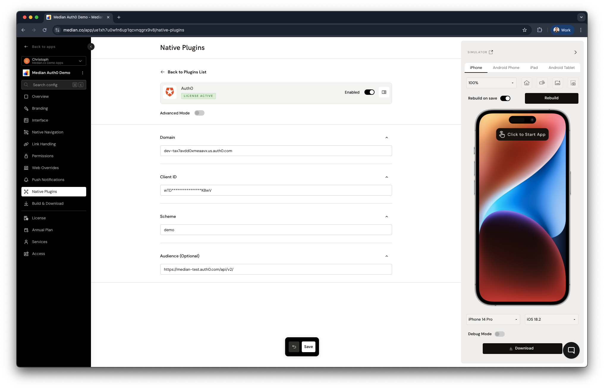
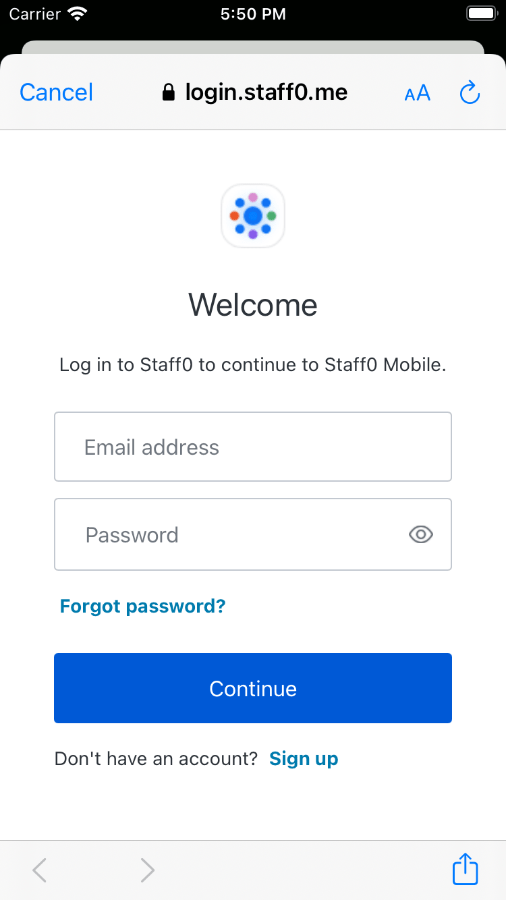

import { MedianLogo } from "/snippets/median-logo.jsx";
import { AppetizeEmbed } from "/snippets/appetize-embed.jsx";

Auth0 is a highly adaptable authentication and authorization platform. Median's Auth0 Native Plugin implements the [Auth0 iOS](https://github.com/auth0/Auth0.swift) and [Android SDK](https://github.com/auth0/Auth0.Android) into your app.

The Auth0 integration allows you to request a login token from Auth0 using Universal Login and a native login UI. It can optionally store a refresh token in secure device storage, so that future sign-ins can use Face ID / Touch ID and Android Biometric. This biometric functionality is similar to our [Face ID / Touch ID Android Biometric](/docs/auth) Native Plugin.

<Check>
**Developer Demo**

Display our demo page in your app to test during development [https://median.dev/auth0](https://median.dev/auth0)

</Check>

## Auth0 and app configuration

### Auth0 configuration

<Warning>
  **Configuration disclaimer**

Please be aware that the following steps provide a sample implementation to demonstrate the configuration for Median's Developer Demo. Auth0 is a highly customizable authentication and authorization service and the configuration below may not be suitable for your production environment. **We strongly recommend consulting with Auth0 experts to review and tailor your production configuration to your needs**.

Additional information on the Auth0 Universal Login configuration for mobile applications can be found in the [Auth0 Native App Quickstart Guide](https://auth0.com/docs/quickstart/native#native).

</Warning>

#### Auth0 application type

Regardless of your existing Applications, Universal Login will require a new Native Application, as the Auth0 Quickstart Guide outlines.

<Frame caption="Auth0 application type">
  
</Frame>

#### Auth0 application URIs

As a next step after creating the application, you will need to configure the callback URIs for your Auth0 application. The configuration requires you to set up at minimum the Allowed Callback URLs and Allowed Logout URLs.

For our example configuration, we assume the following values:

| Key                  | Value                             | Source                                                                                             |
| -------------------- | --------------------------------- | -------------------------------------------------------------------------------------------------- |
| Auth0 Domain         | dev-tax7avdd0xmeaavx.us.auth0.com | Auth0 Dashboard                                                                                    |
| iOS Bundle ID        | co.median.ios.ynbmjx              | Median App Studio ([App Identifiers](/docs/app-identifiers#ios-bundle-id))        |
| Android Package Name | co.median.android.ynbmjx          | Median App Studio ([App Identifiers](/docs/app-identifiers#android-package-name)) |

Based on the parameters above we can add the following three URLs to the Auth0 application configuration as allowed Callback URLs and Allowed Logout URLs:

```text
demo://dev-tax7avdd0xmeaavx.us.auth0.com/android/co.median.android.ynbmjx/callback,
https://dev-tax7avdd0xmeaavx.us.auth0.com/ios/co.median.ios.ynbmjx/callback,
co.median.ios.ynbmjx://dev-tax7avdd0xmeaavx.us.auth0.com/ios/co.median.ios.ynbmjx/callback
```

You can learn more about the application URLs for your target platform (iOS and/or Android) in the respective [Auth0 Native App Quickstart Guide](https://auth0.com/docs/quickstart/native#native).

<Frame caption="Auth0 callback and logout URLs">
  
</Frame>

#### Advanced settings: device settings

Please populate your iOS bundle ID and Android Package name under Advanced Setting > Device Settings in the Auth0 Dashboard.

<Frame caption="Auth0 device settings">
   Device Settings in Auth0" />
</Frame>

### App configuration

#### Link handling

##### Link handling rules

Verify the link handling rules for links to your Auth0 Domain. You can learn more about link handling in our [Link Behavior](/docs/internal-vs-external-links) article.

##### Universal deep links

Verify that [Deep Linking](/docs/deep-linking) is configured properly for all domains listed under Universal Links / Deep Links.

##### URL scheme protocol

Verify a [URL Scheme Protocol](/docs/url-scheme-protocol) is specified for your app. The URL Scheme and all other values including Package Name and Bundle ID must match the parameters set in your Auth0 tenant.

#### Auth0 plugin configuration

The Auth0 Native Plugin requires several parameters to be set in App Studio, on the **Native Plugins** tab under "Advanced Mode". Sample parameters are as follows:

<MedianLogo />
<CodeGroup>
  ```json JSON
  {
    "domain": "dev-tax7avdd0xmeaavx.us.auth0.com",
    "clientId": "wTD****************KBwV",
    "scheme": "demo",
    "audience": "https://median-test.auth0.com/api/v2/"
  }
  ```
</CodeGroup>

Parameter notes:

- `scheme` is based on the URL scheme of your Android Callback URLs.
- `audience` is optional and based on your Auth0 tenant config.

These parameters should match the [Application Settings](https://auth0.com/docs/get-started/applications/application-settings) on your Auth0 Dashboard.

You can find an example configuration based on the parameters below.

<Frame caption="App Studio: Auth0 example configuration">

</Frame>

## Implementation guide

### Sign in with Universal Login

Launch Universal Login via the Median JavaScript Bridge `login` method. Upon completion of Universal Login flow focus is returned to the app webview and a promise/callback function is invoked with the Auth0 tokens as parameters.

To prompt Universal Login and retrieve a token:

<MedianLogo />
<CodeGroup>
```javascript JavaScript
const credentials = await median.auth0.login(
  {
    scope: "email profile offline_access" // optionally pass a scope
  }
);

// credentials object will have the following structure:
// {
//   accessToken: string,
//   idToken: string,
//   scope: string,
//   error: string, // if an error occurred
//   refreshToken: string // with 'offline_access' scope configured
// }
```
</CodeGroup>

<Frame caption="Auth0 Universal Login">
  
</Frame>

### Sign out

To sign out:

<MedianLogo />
<CodeGroup>
  ```javascript JavaScript
  median.auth0.logout().then(function (result) {
    // result.error is set if an error occurred
  });
  ```
</CodeGroup>

### Support for Face ID / Touch ID / Android biometrics

<MedianLogo />
<CodeGroup>
  ```javascript JavaScript
  // Support for Face ID / Touch ID / Android Biometrics is enabled
  // when signing in using the enableBiometrics parameter.

  median.auth0.login({
    enableBiometrics: true,
    callback: median_auth0_post_login
  });

  // To determine if biometrics are enabled and available on the device
  // after sign-in use the status method.

  const auth0Status = await median.auth0.status();

  // status object will have the following structure:
  // hasValidCredentials indicates whether credentials are stored, and that the access token has not expired.
  // {
  //   biometryAvailable: boolean,
  //   biometryType: 'touchId', 'faceId', or 'none',
  //   hasValidCredentials: boolean
  // }
  ```
</CodeGroup>

### Get saved credentials

Credentials are saved in the device secure storage and can be retrieved in later sessions. Retrieving saved credentials will automatically renew the tokens using the `refreshToken` already saved from the previous successful sign-in.

To get credentials saved in secure storage:

<MedianLogo />
<CodeGroup>
```javascript JavaScript
const credentials = await median.auth0.getCredentials();

// credentials object will have the following structure:
// {
//   accessToken: string,
//   idToken: string,
//   scope: string,
//   error: string, // if an error occurred
//   refreshToken: string
// }
```
</CodeGroup>

### Renew credentials

Retrieving the credentials automatically returns renewed credentials if the existing credentials are expired but you can also request to renew the credentials manually.

You can optionally pass a `refreshToken` to be used. By default, the method will use the refresh token saved from the previous successful sign-in.

To renew credentials manually:

<MedianLogo />
<CodeGroup>
  ```javascript JavaScript
  const credentials = await median.auth0.renew({
    refreshToken: '<refresh_token>' // optional
  });
  ```
</CodeGroup>

## Implementation checklist

### Auth0 platform configuration

- [ ] Set up a new Native or Single Page Web Application Auth0 app using the [Auth0 Quickstart Guides](https://auth0.com/docs/quickstart/native).
- [ ] Configure Allowed Callback URLs and Allowed Logout URLs based on your Auth0 tenant domain, iOS Bundle ID, and Android Package Name.
- [ ] Configured the Advanced Settings > Device Settings by providing iOS Team ID, and App ID as well as Android App Package Name and Key Hashes

### Median app and plugin configuration

- [ ] Configure link handling rules based on your Auth0 tenant domain.
- [ ] Add Deep Linking configuration for your Auth0 tenant domain.
- [ ] Verify or add URL Scheme Protocol configuration based on parameters set in your Auth0 tenant.
- [ ] Verify the Auth0 Plugin configuration and add required parameters: "domain," "clientId," "scheme," and (optionally) "audience."

### Website implementation

- [ ] Use `median.auth0.login` to launch the Auth0 plugin and initiate the authentication flow for app users.
- [ ] Use `median.auth0.logout` to provide app users with a sign-out method.
- [ ] Review JavaScript and Auth0 implementation to ensure the use of refresh tokens and enable biometrics.
- [ ] Set up and publicly host `[yourdomain]/.well-known/assetlinks.json` and `[yourdomain]/.well-known/apple-app-site-association` files to enable deep linking.

## Auth0 plugin demo

<Warning>
  **Sample app note**

The following demo details the JSON responses for each JavaScript Bridge function based on the configuration and setup outlined above. Please be aware that biometric functionality cannot be tested using iOS and Android simulators. A video showcasing Face ID/Touch ID and Android Biometrics support is included below for your reference.

</Warning>

<AppetizeEmbed
  iosEmbedCode="c75zesdqxry2sphqi2zxvvyf24"
  androidEmbedCode="ewm66qt3c4hfl5e3s3e7njwtwu"
/>

<iframe
  className="w-full aspect-video rounded-xl"
  src="https://www.youtube.com/embed/AF_lfUog9sg"
  title="Median's Auth0 plugin"
  allow="accelerometer; autoplay; clipboard-write; encrypted-media; gyroscope; picture-in-picture"
  allowFullScreen
></iframe>

## Frequently asked questions

<AccordionGroup>
<Accordion title="Why should I integrate Median's Auth0 plugin and use Auth0 Universal Login?" id="why-should-i-integrate-medians-auth0-plugin-and-use-auth0-universal-login">

Median's Auth0 plugin makes use of the Auth0 iOS and Android native SDKs for the most secure app sign-in experience, consistent with best practices for managing authentication. To learn more about the security benefits of Auth0 Universal Login versus embedded login flows consult the Auth0 documentation discussing [Centralized Universal Login vs. Embedded Login](https://auth0.com/docs/authenticate/login/universal-vs-embedded-login#security-risks).

</Accordion>
<Accordion title="Can I support login on my own web page displayed within the app webview?" id="can-i-support-login-on-my-own-web-page-displayed-within-the-app-webview">

Mobile security policies and the Internet Engineering Task Force (IETF) Best Current Practices (BCP) require that user login only be made in a browser session facilitated through a native app, and not be permitted in an embedded app webview itself. Google Sign-In, Facebook Login, and Auth0 hosted Universal Login make this mandatory.

- [IETF RFC 8252: OAuth 2.0 for Native Apps](https://datatracker.ietf.org/doc/html/rfc8252)
- [Auth0: OAuth 2.0 best practices for native apps](https://auth0.com/blog/oauth-2-best-practices-for-native-apps/)
- [Google: security changes to OAuth 2.0 in embedded webviews](https://developers.googleblog.com/en/upcoming-security-changes-to-googles-oauth-20-authorization-endpoint-in-embedded-webviews/)
- [Meta: deprecating Facebook Login on Android embedded browsers](https://developers.facebook.com/blog/post/2021/06/28/deprecating-support-fb-login-authentication-android-embedded-browsers/)

Our Social Login and Auth0 plugins are the recommended solutions for authentication within your app as they offer the corresponding native SDKs that meet security policies and follow best practices.

</Accordion>
</AccordionGroup>
