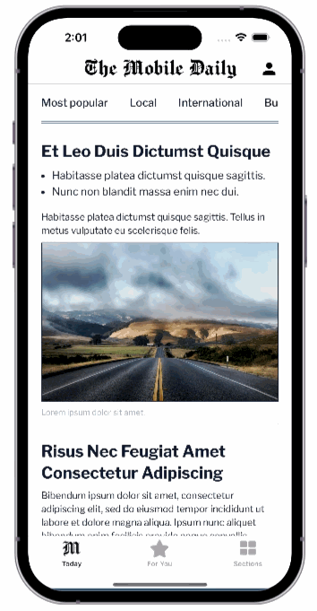

import { MedianLogo } from "/snippets/median-logo.jsx";
import { AppetizeEmbed } from "/snippets/appetize-embed.jsx";

Many widely used apps ranging from news apps to banking apps provide a hierarchical or multi-level navigation experience for users. This allows users to view specific page(s) and easily return to the same place on the prior page by way of a "\< Back" button in the top navigation bar.

For example, a news app may have various categories such as "Local News", "International", "Business", "Sports", "Lifestyle" defined as level 2. When a user clicks a category, they will see news articles in that category which they can open and browse. At any time they can press "\< Back" in the top nav bar to return to the front page.

Median allows you to configure this user experience easily by assigning individual pages or groups of pages to a Level by creating rules. When clicking a link to a page that has been assigned a higher level, the link will open in a new window within the app. The top navigation bar will show a "\< Back" button on the left to allow easy navigation to the lower level page even if the user has navigated elsewhere in that current level. The top navigation bar will show the page name in the center but this can be changed using the [Dynamic Titles](/docs/dynamic-titles) configuration.

See below for an example.

<Frame caption="Auto new windows example">
  
</Frame>

<Warning>
  **Navigation history**

When a page that is assigned a higher level opens in a new window within your app, it will not have the navigation history of the prior page. This means functionality such as swipe gestures will only take the user back to the originally opened URL for that window.

</Warning>

## Defining a navigation hierarchy for auto new windows

You may define the navigation hierarchy for your app at build time within your app configuration or alternatively at run time from your website via the JavaScript Bridge.

### App configuration

Whenever a user navigates to a URL that matches a higher level rule, the page will load in a new window (Android Activity or iOS ViewController). Rules are prioritized top to bottom. If no match is found for a link, the link will open in the current level.

<Warning>
  **Single-page apps**

Auto new windows will load the new page in a new webview, and requires a full page load. For example, if your site is a single-page app driven by AJAX, then you may need to force a full page load using something like: `window.location.href = 'https://my-ajax-site/path';`

</Warning>

### JavaScript Bridge

Auto new windows can be set dynamically from your website using the Median JavaScript Bridge. A default auto new windows setting can be defined in App Studio that is then overwritten dynamically as required. Or alternatively, the configuration can be left blank in App Studio and the auto new windows configuration set by your website.

To configure auto new windows settings, define your navigation levels structure as a JSON object and run the following command:

<MedianLogo />
<CodeGroup>
  ```javascript JavaScript
  var autoNewWindowsRules = {
      active: true,
      persist: true,
      levels: [{
        regex: '.*median.*',
        level: 2
      }, {
        regex: '.*',
        level: 1
      }]
  };

  median.navigationLevels.set(autoNewWindowsRules);
  ```
</CodeGroup>

Setting `persist: true` will save the navigation levels for use the next time the app is launched, otherwise, the changes will only take effect for the current app session.

To revert to the appConfig.json definition built into your app, run the following command:

<MedianLogo />
<CodeGroup>
  ```javascript JavaScript
  median.navigationLevels.set({persist: true});
  ```
</CodeGroup>

## Auto new windows demo app

<AppetizeEmbed
  iosEmbedCode="5j46uecen3c7uxzvrz7gmds2xu"
  androidEmbedCode="zvtbs3zw6iij3c7miqit5mlmlu"
/>

<CodeGroup>
  ```json Auto new windows configuration
  /* Auto new windows configuration */
  [
    {
      "regex": "https://median.dev/auto-new-windows/index.html/?",
      "level": 1
    },
    {
      "regex": "https://median.dev/auto-new-windows/contact.html/?",
      "level": 2
    },
    {
      "regex": "https://median.dev/auto-new-windows/about.html/?",
      "level": 3
    }
  ]
  ```

```javascript Set auto new windows
/* Set auto new windows */
median.navigationLevels.set({
  active: true,
  levels: [{
    regex: "https://median.dev/auto-new-windows/index.html/?",
    level: 1
  }, {
    regex: "https://median.dev/auto-new-windows/contact.html/?",
    level: 1
  }, {
    regex: "https://median.dev/auto-new-windows/about.html/?",
    level: 2
  }],
  persist:true
});
```

```javascript Revert auto new windows
/* Revert auto new windows */
if (navigator.userAgent.indexOf('median') > -1) {
  median.navigationLevels.set({ persist: true });
}
```

</CodeGroup>
