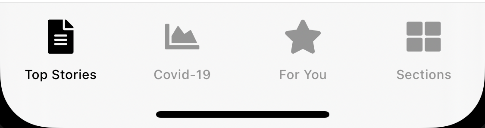
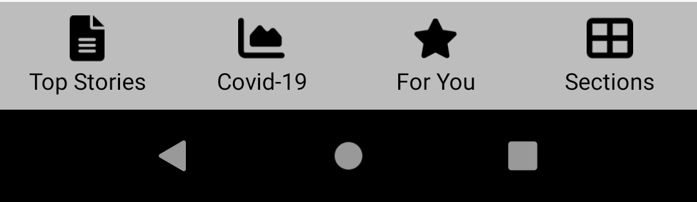

import { DeveloperDemo } from "/snippets/developer-demo.jsx";

<DeveloperDemo path="tab-bar-navigation" />

## iOS

The iOS implementation follows [Apple's Human Interface Guidelines](https://developer.apple.com/design/human-interface-guidelines/components/navigation-and-search/tab-bars).

<Frame caption="iOS bottom tab bar">
  
</Frame>

## Android

The Android implementation follows [Google's Material Design guidelines](https://material.io/components/bottom-navigation).

<Frame caption="Android bottom tab bar">
  
</Frame>
