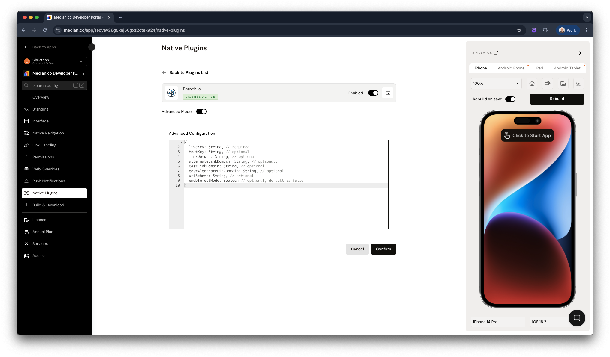

import { DeveloperDemo } from "/snippets/developer-demo.jsx";

import { MedianLogo } from "/snippets/median-logo.jsx";

The **Branch.io plugin** enables **deferred deep linking** within your app, allowing users to navigate directly to specific content even after installing the app. The plugin is built on the **Branch SDK for iOS and Android** ([Branch SDK overview](https://help.branch.io/developers-hub/docs/native-sdks-overview)) and routes users to the right content through deep links.

This guide provides step-by-step instructions for configuring the plugin and utilizing its features through the [Median JavaScript Bridge](/docs/javascript-bridge).

<DeveloperDemo path="branch" />

## Implementation guide

### Plugin configuration

To set up the Branch.io plugin, update the required parameters in the **Native Plugins** tab under **Branch.io**:

<Frame caption="Branch.io plugin configuration">
  
</Frame>

#### Sample JSON

You can copy the following JSON file in the Advanced Configuration and replace the `String` and `Boolean` placeholders by following the instructions below.

<CodeGroup>
  ```json JSON
  {
    liveKey: String, // required
    testKey: String, // optional
    linkDomain: String, // optional
    alternateLinkDomain: String, // optional,
    testLinkDomain: String, // optional
    testAlternateLinkDomain: String, // optional
    uriScheme: String, // optional
    enableTestMode: Boolean // optional, default is false
  }
  ```
</CodeGroup>

#### Retrieving configuration values

Access Branch.io values from the Branch Dashboard ([https://dashboard.branch.io](https://dashboard.branch.io)) and apply them in Median App Studio.

##### Live mode configuration

1. **Branch Key** (Required)

- **Path**: _Account Settings → Profile → Branch Key_
- **Usage**: Set as `liveKey`.

2. **App Link Domains** (Required for deep linking)

- **Path**: _Configuration → General → Link Domain_

- **Usage**:
  - `linkDomain` (Primary domain for deep linking)
  - `alternateLinkDomain` (Required for Journeys/Web SDK and Deepviews)

3. **URI Scheme** (Optional for app redirection)

- **Path**: _Configuration → General → Android Redirects_
- **Usage**: Set as `uriScheme`.

##### Test mode configuration

For testing purposes, **enable Test Mode on the Branch.io Dashboard** and set `enableTestMode` to `true` in the configuration.

1. **Test Branch Key**

- **Path**: _Account Settings → Profile → Branch Key_
- **Usage**: Set as `testKey`.

2. **Test App Link Domains**

- **Path**: _Configuration → General → Link Domain_

- **Usage**:
  - `testLinkDomain` (Test version of the link domain)
  - `testAlternateLinkDomain` (Test version of the alternate domain)

### Branch.io configuration

Enable Android-specific deep linking features in your Branch Dashboard:

1. Navigate to Android Redirects settings.
2. Enable "I have an Android App" and "Enable App Links".
3. Ensure SHA256 Cert Fingerprints are correctly configured.

<Warning>
  **SHA256 Cert Fingerprints**

It’s important to specify the SHA256 Cert Fingerprints for App links to work properly on Android. For details, see [Branch's guide to configuring default link behaviors](https://help.branch.io/using-branch/docs/configure-default-link-behaviors).

</Warning>

### JavaScript Bridge functions

#### Initialized callback

The app calls this callback function when the Branch SDK has finished initializing and returns data from the link that referred the current session.

<MedianLogo />
<CodeGroup>
  ```javascript JavaScript
  median_branch_initialized(data){}
  // Return value:
  {
    'success': Boolean,
    'error': String,
    'data': {}
  }
  ```
</CodeGroup>

#### Get first parameters

Returns the data from the link that first referred the user. This is only set once, the first time the user is referred by a link.

Provide a callback function or otherwise a promise is returned.

<MedianLogo />
<CodeGroup>
  ```javascript JavaScript
  median.branch.getFirstParams({'callback': function})
  // Return value
  // see https://help.branch.io/using-branch/docs/creating-a-deep-link#data-structure
  ```
</CodeGroup>

#### Get latest parameters

Returns the data from the link that referred the current session.

<MedianLogo />
<CodeGroup>
  ```javascript JavaScript
  median.branch.getLatestParams({'callback': function})
  // Return value
  // see https://help.branch.io/using-branch/docs/creating-a-deep-link#data-structure
  ```
</CodeGroup>

### Testing your integration

#### Quick link test

1. Create a Quick Link in the Branch Dashboard.
2. Copy the generated link.
3. Paste the link into a messaging or notes app on your test device.
4. Tap the link to make sure it correctly redirects to your app.

If configured correctly, the user should be redirected into your app, with deep link data accessible through the JavaScript Bridge methods.
