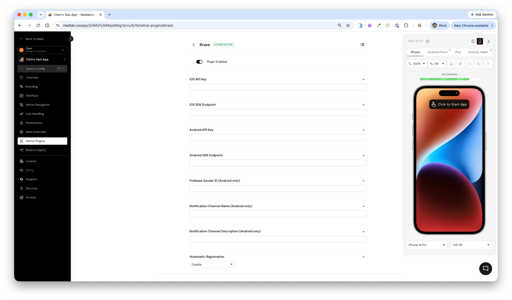

import { MedianLogo } from "/snippets/median-logo.jsx";

The Braze plugin integrates mobile push notifications and in-app event tracking to boost user engagement and strengthen data analytics. It also supports audience segmentation and targeted messaging using the [Braze iOS SDK](https://www.braze.com/docs/developer_guide/sdk_integration/?sdktab=swift) and [Braze Android SDK](https://www.braze.com/docs/developer_guide/sdk_integration?sdktab=android).

<Check>
**Developer Demo**

Display our demo page in your app to test during development [https://median.dev/braze/](https://median.dev/braze/)

</Check>

## Why use this plugin

- **Push notifications**: Enable push messaging workflows in your app.
- **Event tracking**: Send custom events to Braze for analytics and campaign logic.
- **User targeting**: Support segmentation and targeted messaging.
- **Deep linking support**: Open notification links directly in your app when deep linking is configured.

## Prerequisites

- Access to the Braze plugin settings in Median App Studio (**Native Plugins** tab).
- Your Braze API keys and SDK endpoints for iOS and Android, from **Settings → APIs and Identifiers** in your Braze dashboard.
- Your Firebase Cloud Messaging Sender ID and `google-services.json` for Android (see [Google Services](/docs/google-services)).
- If testing with the Median demo page, use `https://median.dev/braze/`.

## Implementation guide

### Braze setup

Enable push notifications through Braze In-App Messaging as documented in the [Braze push primer](https://www.braze.com/docs/user_guide/channels/push/best_practices/push_primer_messages/).

### App configuration

Enable the Braze plugin in the **Native Plugins** tab and fill in its settings.

| Setting | Description |
| --- | --- |
| **iOS API Key** | Braze API key for your iOS app. |
| **iOS SDK Endpoint** | Braze SDK endpoint for your iOS app. |
| **Android API Key** | Braze API key for your Android app. |
| **Android SDK Endpoint** | Braze SDK endpoint for your Android app. |
| **Firebase Sender ID (Android only)** | Firebase Cloud Messaging Sender ID. |
| **Notification Channel Name (Android only)** | Name of the notification channel users see in Android settings. |
| **Notification Channel Description (Android only)** | Description of that notification channel. |
| **Automatic Registration** | When set to **Enable**, push permission is requested automatically. Disabled by default. |

<Warning>
  **`google-services.json` required**

  Braze requires you to upload a `google-services.json` file to App Studio. See [Google Services](/docs/google-services) for the steps.
</Warning>

<Frame caption="App Studio – Braze plugin settings">
  
</Frame>

### Deep linking

Set up [deep linking](/docs/deep-linking) within your app, and notification links will automatically open directly into your app.

### JavaScript Bridge functions

#### Change user

Signs in an existing user or registers a new user in Braze context.

<MedianLogo />
<CodeGroup>
  ```javascript JavaScript
  median.braze.changeUser({ userId: "user_123" });
  ```
</CodeGroup>

**Parameters:**

| Parameter | Type     | Required | Description                                          |
| --------- | -------- | -------- | ---------------------------------------------------- |
| `userId`  | `string` | Yes      | User identifier to associate with the Braze profile. |

#### Prompt for push notification permission

Prompts users to enable push notifications.

<MedianLogo />
<CodeGroup>
  ```javascript JavaScript
  median.braze.promptNotification({'callback': function})
  // Return value:
  {
    "granted": true | false
  }
  ```
</CodeGroup>

**Parameters:**

| Parameter  | Type       | Required | Description                                          |
| ---------- | ---------- | -------- | ---------------------------------------------------- |
| `callback` | `function` | No       | Callback that receives `{ granted: true \| false }`. |

#### Check push notification permission

Checks if push notification permission has been granted.

<MedianLogo />
<CodeGroup>
  ```javascript JavaScript
  median.braze.notificationEnabled({'callback': function})
  // Return value:
  {
    "granted": true | false
  }
  ```
</CodeGroup>

**Parameters:**

| Parameter  | Type       | Required | Description                                          |
| ---------- | ---------- | -------- | ---------------------------------------------------- |
| `callback` | `function` | No       | Callback that receives `{ granted: true \| false }`. |

#### Track custom events

Sends a custom event to Braze.

**Note:** Custom events must be added in the [Braze Dashboard](https://www.braze.com/docs/user_guide/data/activation/events/custom_events/).

<MedianLogo />
<CodeGroup>
  ```javascript JavaScript
  median.braze.logCustomEvent("YOUR-EVENT-NAME", {
    "key1": value1,
    "key2": value2,
    ...
  });
  ```
</CodeGroup>

**Parameters:**

| Parameter    | Type     | Required | Description                                        |
| ------------ | -------- | -------- | -------------------------------------------------- |
| `eventName`  | `string` | Yes      | Custom event name (must exist in Braze dashboard). |
| `properties` | `object` | No       | Event key-value payload.                           |

## Testing checklist

Use this checklist to validate Braze integration:

- [ ] Braze plugin configuration is set (including `active`, platform API keys, and endpoint keys).
- [ ] `median.braze.promptNotification()` returns a permission result.
- [ ] `median.braze.notificationEnabled()` returns current permission state.
- [ ] `median.braze.changeUser({ userId })` is called for the active test user.
- [ ] `median.braze.logCustomEvent()` is called with a known event name.
- [ ] Test notifications are sent to a test user from Braze (Test tab).
- [ ] Notification opens app when configured as **Open App**.

## Troubleshooting

### Test users are not appearing in Braze test send flow

Ensure your app calls `median.braze.changeUser({ userId: "..." })` so the user is identified before sending test notifications.

### Push deep links open incorrectly

Confirm deep linking is set up in your app. Notification links rely on the app’s deep linking configuration.

### Permission prompt behavior differs on Android versions

On Android 13 and above, explicit permission is required. On Android 12 and below, permissions are granted automatically.
