## Step 1: Install Android Studio and required SDKs

Before building your Median Android app, install Android Studio and configure your local development environment.

Download the latest version of [Android Studio](https://developer.android.com/studio#downloads).

Follow the steps in the [Android Studio installation guide](https://developer.android.com/studio/install). Make sure to follow the Setup Wizard and install all recommended SDK packages.

<Info>
  **Tip**

During setup, be sure to install the **Android SDK Platform** and all required components.

</Info>

## Step 2: Download the Android source code

Download the Android source code from your app's private management page by opening the "**Build & Deploy**" tab and clicking the "**Download**" button in the Android SOURCE CODE category.

<Frame caption="Download the Android source in App Studio">
  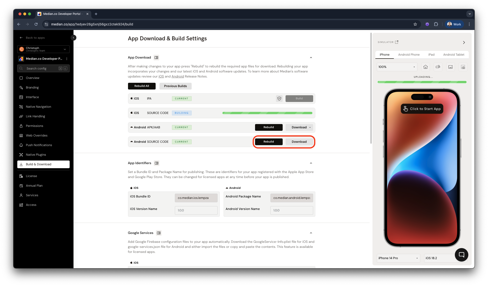
</Frame>

## Step 3: Extract the source archive

Extract the downloaded `android_source.tar.gz` file and open your app using one of the following methods.

1. Double-click the `android_source.tar.gz` file in Windows Explorer or the macOS Finder.
2. Open a command prompt or terminal session and run the command `tar -xzvf android_source.tar.gz`

<Warning>
  **Using tar command**

The `tar` command in method #2 requires Windows 10 or macOS. It extracts the files to a subdirectory named “android”. If a directory with the same name exists, it's overwritten.

You can change this behavior by defining a different output directory `tar -xzvf android_source.tar.gz -C /target/directory`

</Warning>

Once extracted, open the extracted directory and you will see files similar to Figure 2:

<Frame caption="Figure 2: Source archive content">
  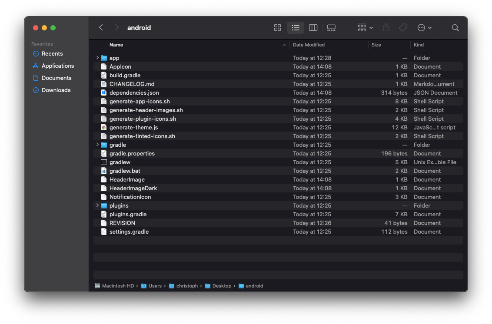
</Frame>

## Step 4: Open the project in Android Studio

Open Android Studio and click the "**Open**" button as seen in Figure 3 to open your app.

<Frame caption="Figure 3: Open a new Android project">
  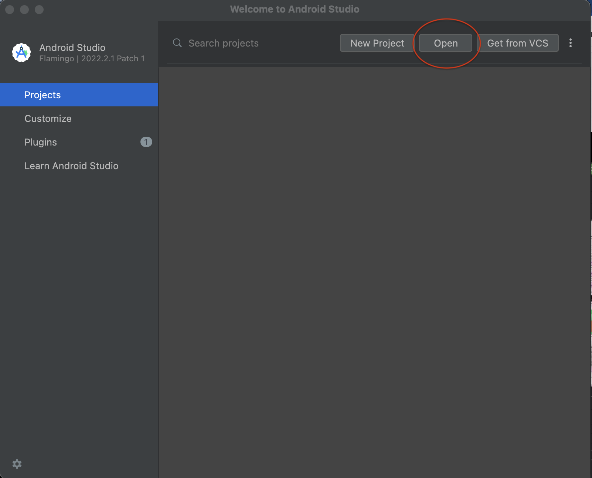
</Frame>

Now, navigate and select the extracted directory and click “**Open**”.

<Frame caption="Figure 4: Open the Android source directory">
  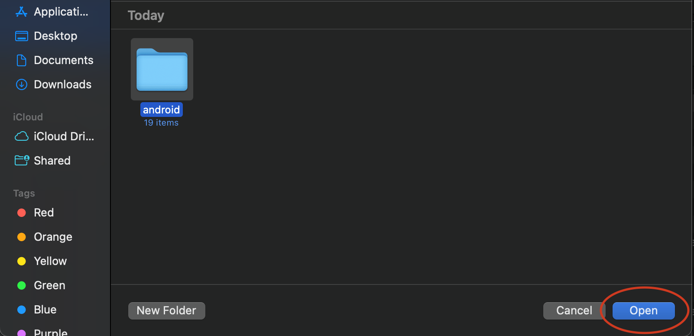
</Frame>

Next, Android Studio will ask you whether to open your project in Safe mode or to trust the project. To build/run/debug your app without [restrictions](https://www.jetbrains.com/help/idea/project-security.html#projects_security), select “**Trust Project**”.

<Frame caption="Figure 5: Trust and open project">
  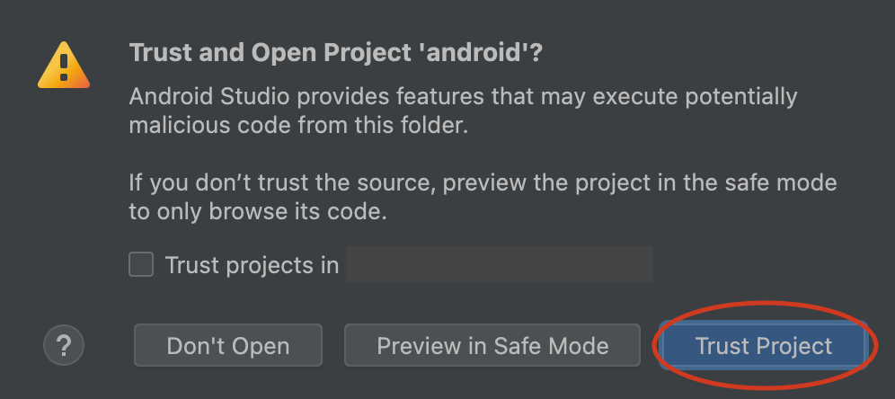
</Frame>

## Step 5: Run or debug your app

Wait for Android Studio to initialize the project, and once finished you will see `BUILD SUCCESSFUL` in the Build Output panel as seen in Figure 6:

<Frame caption="Figure 6: Android Studio debug and console">
  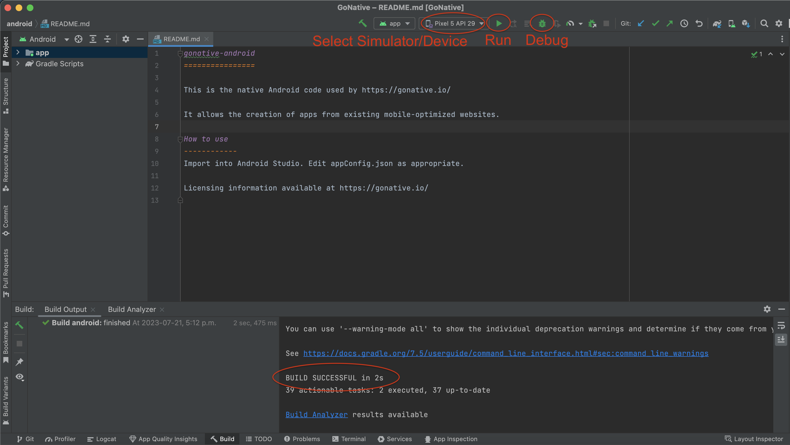
</Frame>

Now, as seen in Figure 6, select an emulator or connect a physical Android device to your computer, and select your device in the drop-down menu.

To run your application, click the run icon. Android Studio builds, installs, and runs your application on the selected emulator or device.

To debug your application, click the debug icon.

## Step 6: Generate a signed APK or app bundle

To create a signed bundle or apk for publishing to Google Play, you need a keystore file, generally named `release.keystore`, that you will use to sign your bundle or apk.

If you would like to use the same keystore that we use for build through our website, please first purchase a license and then contact us.

Once you have your keystore, in Android Studio, select **Build → Generate Signed Bundle / APK**.

<Frame caption="Figure 7: Build menu">
  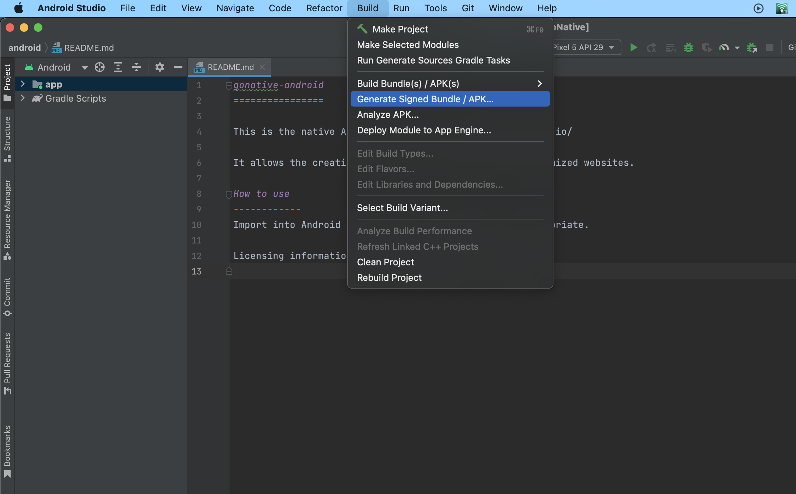
</Frame>

Select Android App Bundle or APK and click “**Next**”.

<Frame caption="Figure 8: Signed bundle or APK dialog">
  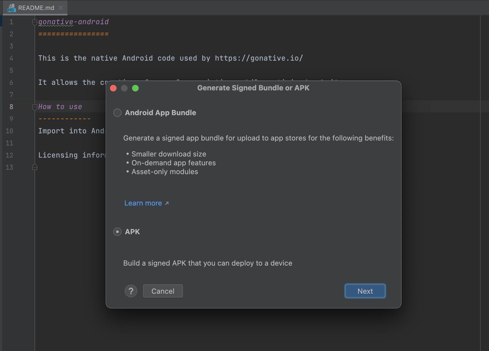
</Frame>

As seen in Figure 9, you will be asked to provide the path of your keystore file and the credentials attached to it.

If you're using the Median-provided keystore, use these credentials:

**Keystore password:** `password` **Key alias:** `release` **Key password:** `password`

<Frame caption="Figure 9: Keystore configuration">
  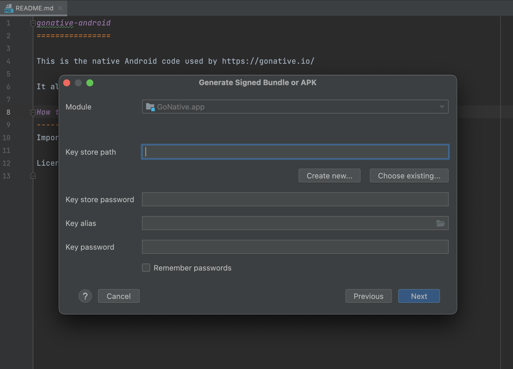
</Frame>

Once you have entered the keystore parameters, click “**Next**”.

As shown in Figure 10, provide the destination path of your generated Bundle / APK, select `normalRelease` and click “**Create**”.

<Frame caption="Figure 10: Release configuration">
  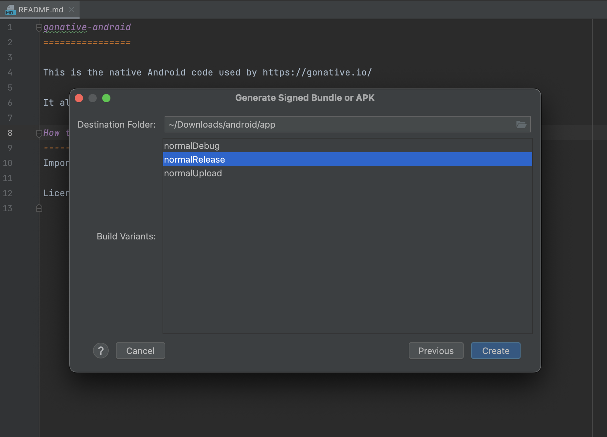
</Frame>

Once Android Studio has finished building the requested file, you will see a success notification at the bottom right corner of Android Studio with a `locate` button, as seen in Figure 11. The `locate` link opens the directory containing your generated file, as shown in Figure 12.

Alternatively, navigate to the `/normal/release` directory to see your generated file.

<Frame caption="Figure 11: APK generation progress">
  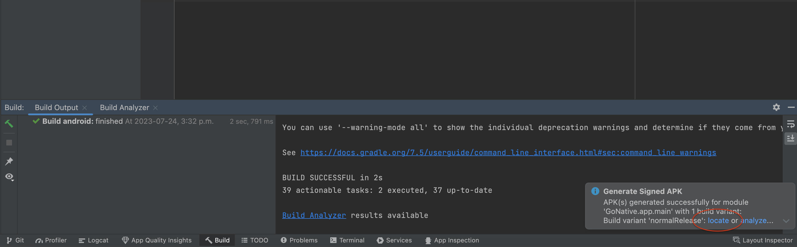
</Frame>

<Frame caption="Figure 12: Generated APK file">
  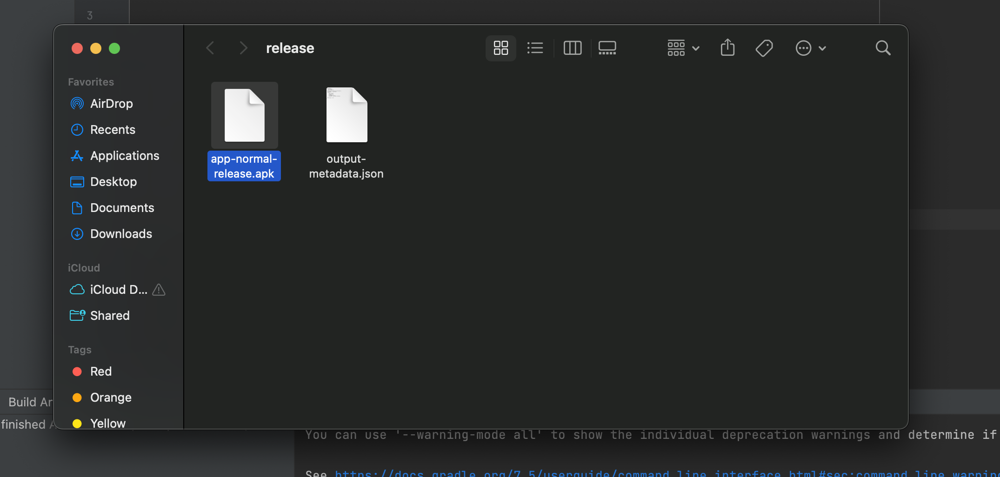
</Frame>
