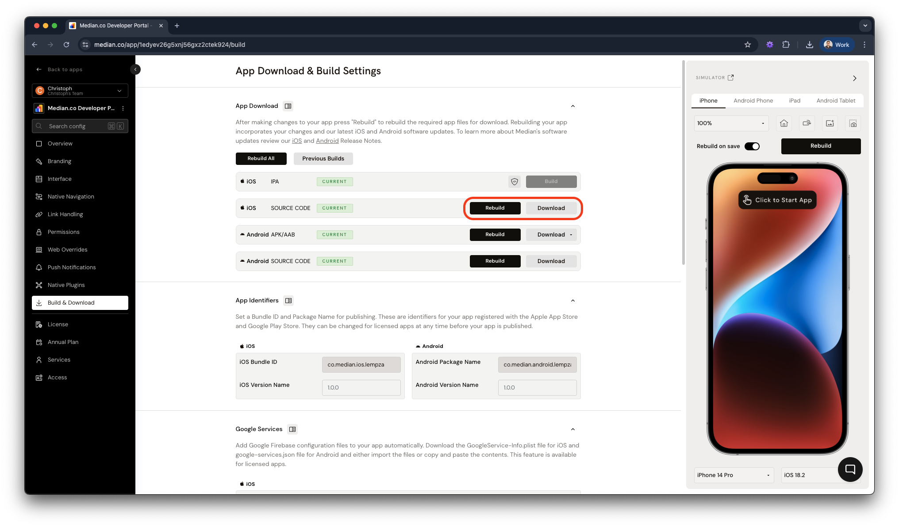
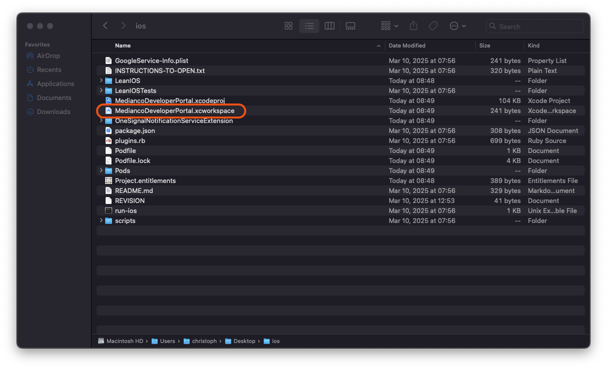
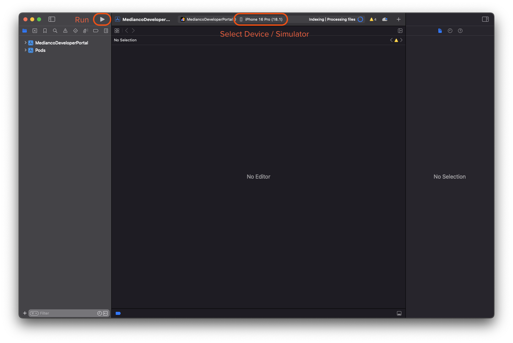
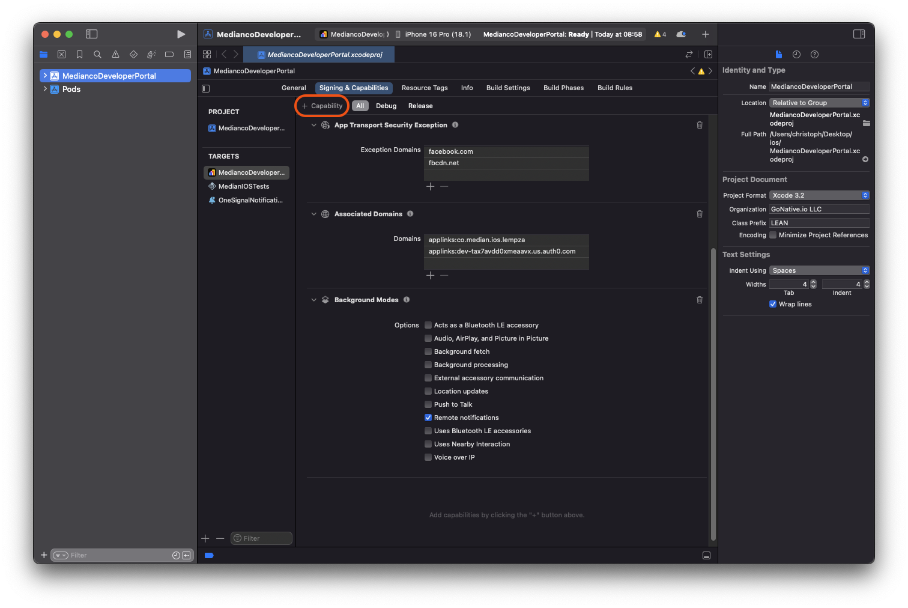
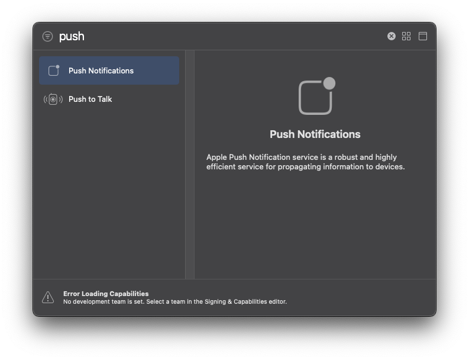
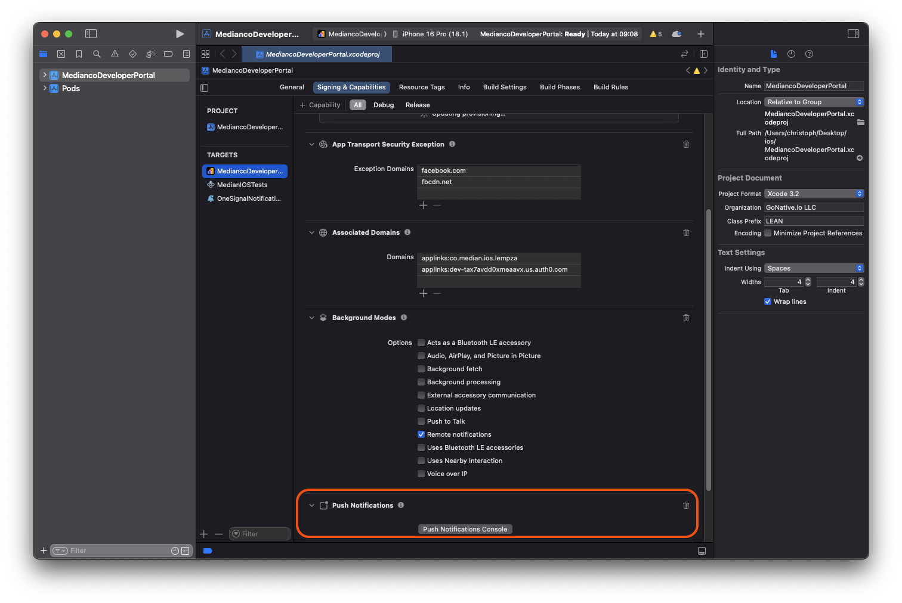
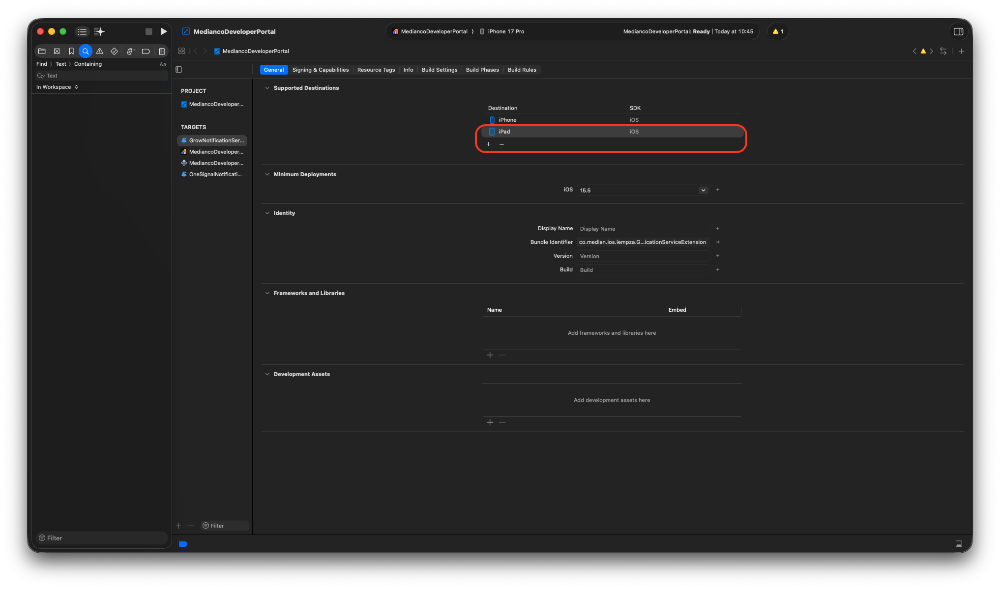

Set up Xcode and build your iOS app locally from the iOS source code downloaded from Median App Studio.

> **Use this guide only if you want a local Xcode-based workflow.** It is an advanced or optional path and not the standard Median Self-Service publishing workflow.

For standard Median Self-Service publishing and use of TestFlight, you do **not** need to build your iOS app from source. Instead, connect your Median organization and Apple Developer account using our App Store Connect API integration:

1. Open your app in App Studio and go to **Build & Deploy**.

2. Click **Configure** in the iOS IPA section.

3. In **Apple Developer API Connection**, enter your **Issuer ID** and **Key ID**, and upload your **Private Key (.p8)** file.

4. In **Bundle ID & App Store Connect App**:
   - Register the **Bundle ID** for your app.
   - Create the **App Store Connect app record** in App Store Connect using that Bundle ID.
   - Verify the **App Store Connect app record** in App Studio.

5. In **Signing & Upload Settings**, select **Distribution Profile** and set **Upload to App Store Connect** to **Automatic**.

6. Build your iOS IPA in App Studio. If automatic upload isn't selected, click **Upload** after the build completes.

7. Wait for Apple to process the uploaded build in App Store Connect.

8. In App Store Connect, open **TestFlight**, resolve any required prompts, and add testers.

9. After testing, submit the build for App Review.

## Install Xcode

Before proceeding, you must first set up your local iOS development environment. This involves installing Xcode on a computer running macOS.

[Download Xcode](https://apps.apple.com/us/app/xcode/id497799835?mt=12)

<Warning>
  **Xcode version**

Use the latest stable (non-beta) version of Xcode to ensure compatibility.

</Warning>

Once installed, proceed with the steps below to download and build your Median app.

## Download iOS source code

Access your app’s private management page to download the iOS source code:

1. Navigate to the **Build & Deploy** tab.
2. In the iOS **Source Code** section, click **Download** (see Figure 1).

<Frame caption="Figure 1: Download iOS source">
  
</Frame>

## Extract and open the source code

After downloading, extract the `ios_source.tar.gz` file using one of the following methods:

**Method 1: Using Finder**

1. Double-click `ios_source.tar.gz` to extract it.
2. Open the extracted folder and double-click `<yourapp>.xcworkspace`.

**Method 2: Using Terminal**

1. Open Terminal and run `tar -xzvf ios_source.tar.gz`. The `tar` command extracts the file to a subdirectory named “ios”. If a directory with the same name exists, it's overwritten.
2. Navigate to the extracted folder and open the workspace: `open <yourapp>.xcworkspace`

<Warning>
  **Open .xcworkspace, not .xcodeproj**

Always open `<yourapp>.xcworkspace`, not `<yourapp>.xcodeproj`, because Median uses CocoaPods for dependency management.

</Warning>

<Frame caption="Figure 2: Open the .xcworkspace file">
  
</Frame>

## Build and run the app in the simulator

1. In Xcode, select a simulator or connected device from the dropdown menu.
2. Click the "Run" play button.
3. Xcode compiles and launches the app in the chosen simulator or device.

<Frame caption="Figure 3: Run the app in the simulator">
  
</Frame>

## CocoaPods dependency management

Median automatically installs all required dependencies when you download the source code. **You do not need to run pod install manually**. If you need to install additional pods not supplied by Median, [contact our team](https://median.co/contact) for assistance.

<Info>
  **Missing files**

If you encounter missing file errors, [clean your build folder and derived data](https://stackoverflow.com/questions/38016143/how-can-i-delete-derived-data-in-xcode-8).

</Info>

## Adding capabilities (e.g., push notifications)

Certain features, such as push notifications, require manually enabling capabilities in Xcode:

### How to enable push notifications in Xcode

1. Open Xcode and select your app in the left panel.
2. Navigate to "Signing & Capabilities" in the right panel.
3. Click the "+ Capability" button.

<Frame caption="Figure 4: Adding capabilities">
  
</Frame>

4. Search for and select "Push Notifications."

<Frame caption="Figure 5: Search for the Push Notifications capability">
  
</Frame>

5. The capability will appear under "Signing & Capabilities."

<Frame caption="Figure 6: Confirm that the capability has been added">
  
</Frame>

### Plugin capability matrix

Some plugins require specific capabilities or entitlements. These are automatically added when building your app in App Studio but may need to be added manually if you build from downloaded source code.

| Plugin                                                                                   | Required capabilities / entitlements |
| ---------------------------------------------------------------------------------------- | ------------------------------------ |
| [All push notification plugins](/docs/push-notifications-overview) | Push Notifications                   |
| [AgeSafety](/docs/age-safety)                                      | Age Range                            |
| [Health Bridge](/docs/health-bridge)                               | HealthKit                            |
| [Intent Edge](/docs/intent-edge)                                   | Wi-Fi, Push Notifications            |
| [In-App Purchases](/docs/iap)                                      | In-app Purchases                     |
| [Reader Modal](/docs/reader-modal)                                 | External Link Account                |
| [RevenueCat](/docs/revenue-cat)                                     | In-app Purchases                     |
| [Share plugin](/docs/share-into-app)                               | App Groups                           |

## Frequently asked questions

<AccordionGroup>
<Accordion title="How do I fix the ITMS-90078: Missing Push Notification Entitlement error when submitting my app to App Store Connect?" id="how-do-i-fix-the-itms-90078-missing-push-notification-entitlement-error-when-submitting-my-app-to-app-store-connect">

This warning indicates that your code includes methods for registering a push token, suggesting that the app intends to use push notifications. However, since the required entitlement is missing, push notification functionality will not work.

If your app does not use push notifications, you can safely ignore this warning.

</Accordion>
<Accordion title="Can I turn off iPad support?" id="can-i-turn-off-ipad-support">

Yes. iPhone-only apps run on an iPad in a phone-sized view. It is worth putting in some effort to make your app work on iPads in that mode even if you don't want to support iPads natively.

To disable iPad support you can exclude iPad as a destination in Xcode as shown in the image below.

<Frame caption="Xcode: disable iPad support">
  
</Frame>

</Accordion>
</AccordionGroup>
