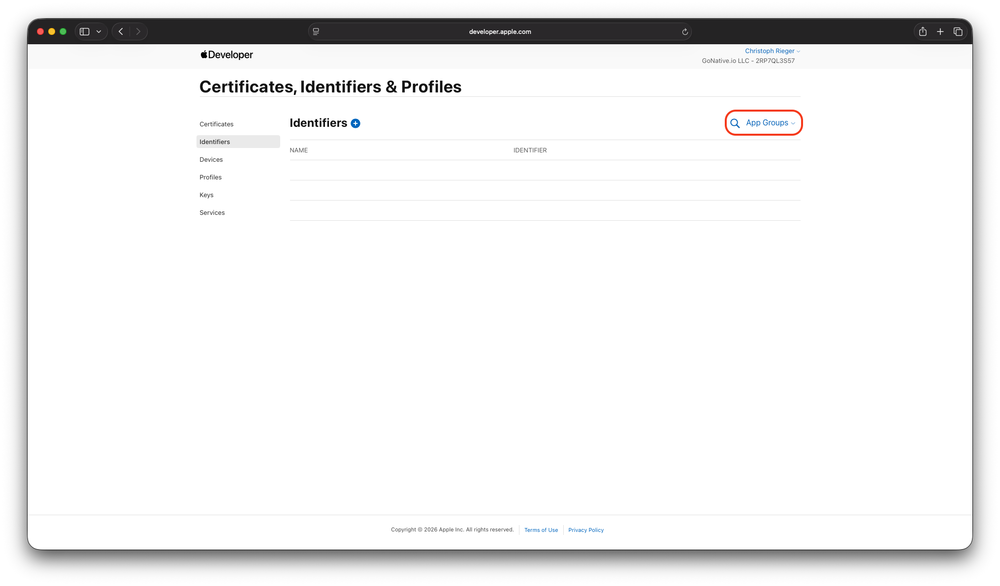
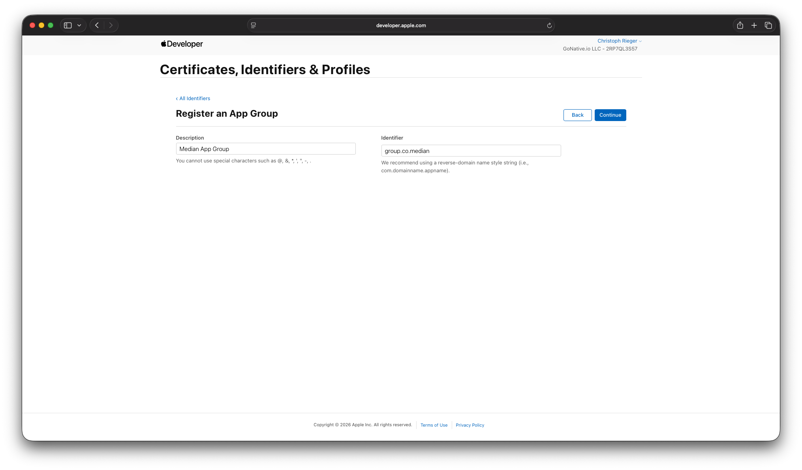
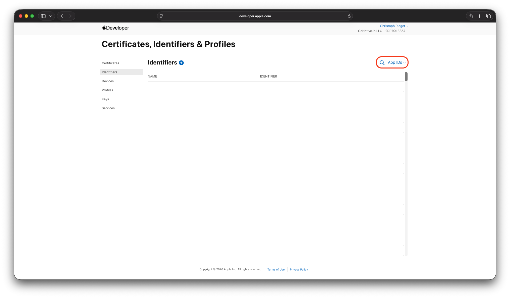
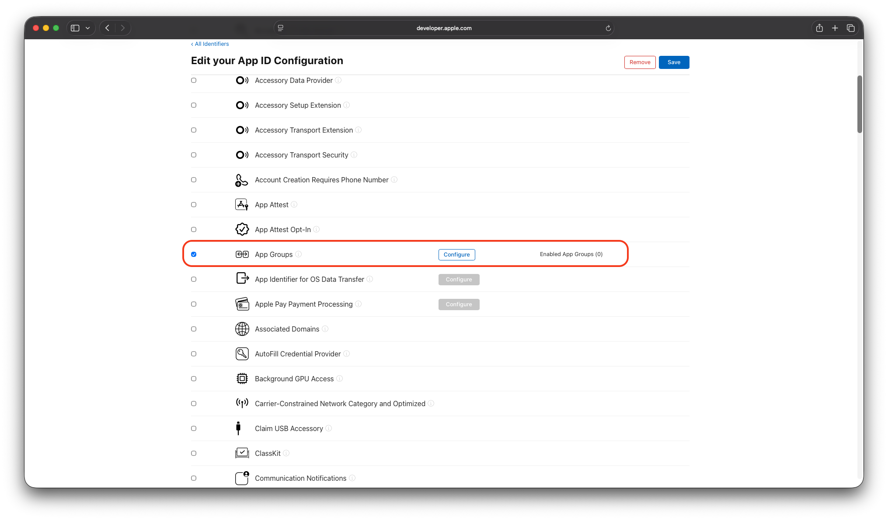
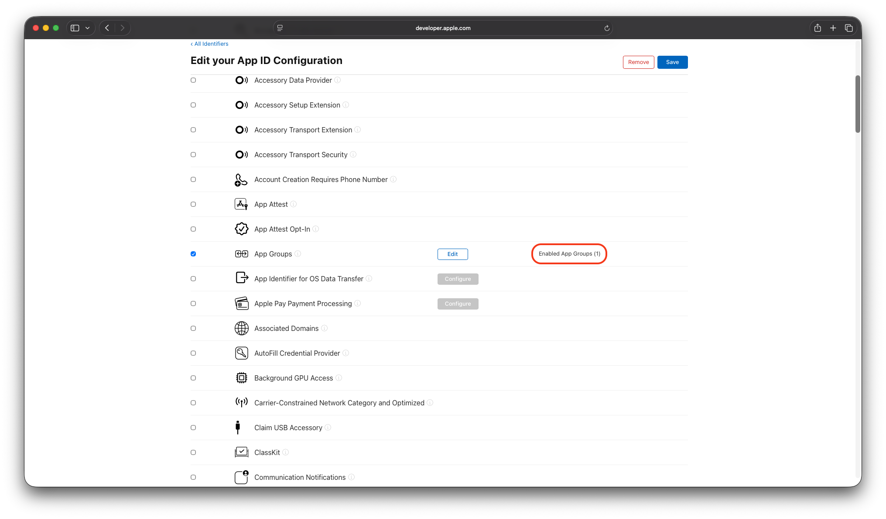
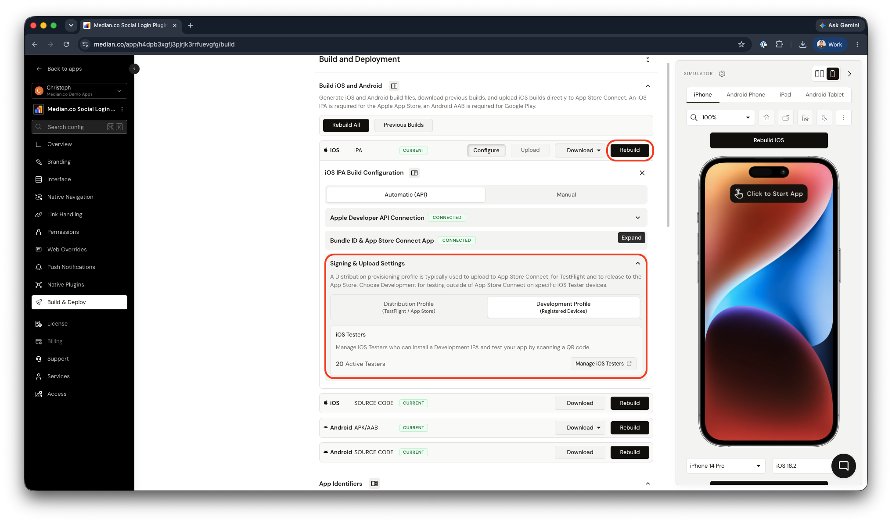

An App Group lets your main app share a common data container with its extensions: for example, a Share Extension, a Today widget, or an App Clip that needs access to the same data as the main app.

If your app includes any of these, you'll need to enable the App Groups entitlement before building. All configuration in this article is performed in the Apple Developer Portal, not in Median directly.

## Prerequisites

- Your Bundle ID must already be registered (see [Configure signing for your app](/docs/configure-signing-for-your-app))
- Admin or App Manager access to your Apple Developer account

## App group configuration

### Step 1: Create an app group

1. Sign in to [Apple Developer → Identifiers](https://developer.apple.com/account/resources/identifiers/list) in Apple Developer (not App Store Connect).
2. Change the filter at the top from App IDs to App Groups.
3. Click + to create a new App Group.

<Frame caption="Apple Developer: Identifiers">
  
</Frame>

4. Enter a **Description** and an **Identifier**. The identifier must start with `group.` (for example, `group.com.company.app`).
5. Click **Continue**, then **Register**.

<Frame caption="App Group registration">
  
</Frame>

### Step 2: Enable app groups for the main application

1. Still under Identifiers, switch the filter back to App IDs and select your app's existing Bundle ID.

<Frame caption="Apple Developer Portal: App IDs">
  
</Frame>

2. Locate and select the main application’s bundle identifier (for example, `com.example.app`).
3. Scroll to the Capabilities section and enable App Groups.

<Frame caption="App Group enablement">
  
</Frame>

4. Click **Configure** and select the App Group created in Step 1.

<Frame caption="App Group addition">
  
</Frame>

### Step 3: Regenerate your provisioning profile

1. Repeat the steps in Step 2 for each extension that requires access to the shared container (for example, `com.example.app.ShareExtension`).

2. Edit the profile (or create a new one if editing isn't available) so it regenerates against the updated Bundle ID. The App Groups entitlement is only included in profiles created after the capability was enabled.

    **Important**: Every target that uses shared data must have the same App Group enabled in its App ID configuration.

### Step 4: Rebuild

After enabling the App Group capability:

1. In Median App Studio, go to your app's iOS IPA Build Configuration panel and rebuild the app so Median adds the updated entitlement.

<Frame caption="Provisioning profile regeneration">
  
</Frame>

2. Distribute the iOS binary.

## Verification checklist

Before distributing the app or reporting an issue, please confirm:

- [ ] The App Group identifier begins with `group.`

- [ ] App Groups is enabled on the main app's Bundle ID

- [ ] App Groups is enabled on every extension's Bundle ID that needs shared access

- [ ] The provisioning profile was regenerated after enabling App Groups (not just re-downloaded)

- [ ] Median's build used the newly regenerated profile, not a cached one
