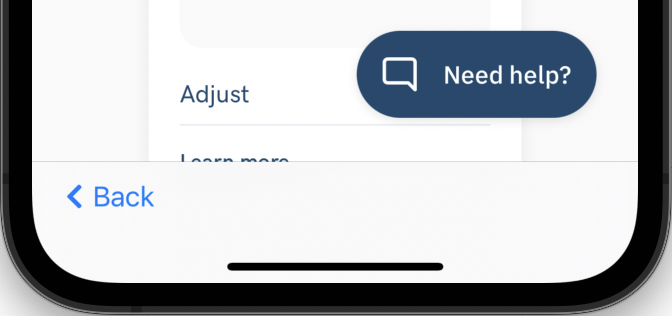
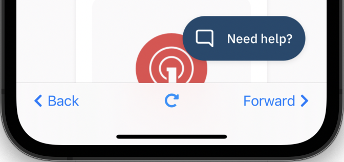

import { MedianLogo } from "/snippets/median-logo.jsx";

<Warning>
  **iOS-only feature**

The iOS Contextual Navigation Toolbar is an iOS-specific feature and is **not supported on Android**.

</Warning>

Unlike Android devices, iPhones and iPads do not have a built-in back button, which can make web navigation within an app challenging. The Contextual Navigation Toolbar provides a native toolbar at the bottom of the screen, enabling users to navigate more easily based on their browsing history and the current page URL.

## Key features

- **Back button**: Returns to the previous page.
- **Forward button (optional)**: Moves forward in browsing history.
- **Refresh button (optional)**: Reloads the current page.
- **Customizable visibility (optional)**: Configure when and where the toolbar appears.

By default, the toolbar appears whenever a page exists in the webview history. This matches the back navigation users expect from a website.

## Visual toolbar example

|                                       |                                                       |
| ------------------------------------- | ----------------------------------------------------- |
|  |  |
| Back button                           | Back, Refresh, and Forward buttons                    |

## Configuration

### Default configuration

By default, the toolbar includes a Back button with a text label (\< Back). You can modify this behavior by updating the `navigation` configuration object in `appConfig.json`.

### Configuration options

- Add buttons:
  - Add a Forward button
  - Add a Refresh button

- Change toolbar visibility:
  - Show only when there is a page in history (Default): `"visibilityByBackButton": "backButtonActive"`
  - Always show regardless of history: `"visibilityByBackButton": "always"`

- Set page-specific visibility:
  - Show on all pages: `"visibilityByPages": "allPages"`
  - Show only on specific pages (using URL patterns): `"visibilityByPages": "specificPages"`

- Customize button labels and appearance:
  - Hide text labels for Back and Forward buttons
  - Use custom text labels

### Dynamic visibility

The iOS Contextual Navigation Toolbar can be dynamically enabled or disabled using the Median JavaScript Bridge.

Conditions for toolbar display:

- `enabled: true`: The toolbar appears if any of the following conditions are met:
  - The webview has back history.
  - The forward button is enabled and the webview has forward history.
  - The refresh button is enabled.

- `enabled: false`: The toolbar remains hidden regardless of other conditions.

<MedianLogo />
<CodeGroup>
  ```javascript JavaScript
  // Show the contextual navigation toolbar, if conditions are met
  median.ios.contextualNavToolbar.set({"enabled":true});
  // Hide the contextual navigation toolbar
  median.ios.contextualNavToolbar.set({"enabled":false});
  ```
</CodeGroup>

## Implementation examples

<CodeGroup>
  ```json Default toolbar
  /* Default toolbar */
  "toolbarNavigation": {
    "enabled": true,
    "visibilityByPages": "allPages",
    "visibilityByBackButton": "backButtonActive",
    "regexes": [
      {
      "enabled": true,
      "regex": ".*"
      }
    ],
    "items": [
      {
        "system": "back",
        "titleType": "defaultText",
        "visibility": "allPages",
        "urlRegex": [{ "enabled": true, "regex": ".*" }]
      },
      {
        "system": "refresh",
        "enabled": false,
        "visibility": "allPages",
        "urlRegex": [{ "enabled": true, "regex": ".*" }]
      },
      {
        "system": "forward",
        "enabled": false,
        "titleType": "defaultText",
        "visibility": "allPages",
        "urlRegex": [{ "enabled": true, "regex": ".*" }]
      }
    ]
  }
  ```

```json All options
/* All options */
"toolbarNavigation": {
  "enabled": true,
  "visibilityByPages": "allPages" | "specificPages",
  "visibilityByBackButton": "backButtonActive" | "always",
  "regexes": [
    {
      "enabled": true | false,
      "regex": ".*"
    }
  ],
  "items": [
    {
      "system": "back",
      "title": "Back",
      "titleType": "noText" | "defaultText" | "customText",
      "visibility": "allPages" | "specificPages",
      "urlRegex": [
        {
          "enabled": true | false,
          "regex": ".*"
        }
      ]
    },
    {
      "system": "refresh",
      "enabled": false,
      "visibility": "allPages" | "specificPages",
      "urlRegex": [
        {
          "enabled": true | false,
          "regex": ".*"
        }
      ]
    },
    {
      "system": "forward",
      "enabled": false,
      "title": "Forward",
      "titleType": "noText" | "defaultText" | "customText",
      "visibility": "allPages" | "specificPages",
      "urlRegex": [
        {
          "enabled": true | false,
          "regex": ".*"
        }
      ]
    }
  ]
}
```

```json Custom text labels
/* Example: Custom text labels */
"toolbarNavigation": {
  "enabled": true,
  "visibilityByPages": "allPages",
  "visibilityByBackButton": "backButtonActive",
  "regexes": [
    {
      "enabled": true,
      "regex": ".*"
    }
  ],
  "items": [
    {
      "system": "back",
      "title": "背部",
      "titleType": "customText",
      "visibility": "allPages",
      "urlRegex": [
        {
          "enabled": true | false,
          "regex": ".*"
        }
      ]
    },
    {
      "system": "refresh",
      "enabled": false,
      "visibility": "allPages",
      "urlRegex": [
        {
          "enabled": true | false,
          "regex": ".*"
        }
      ]
    },
    {
      "system": "forward",
      "enabled": false,
      "title": "向前",
      "titleType": "customText",
      "visibility": "allPages",
      "urlRegex": [
        {
          "enabled": true | false,
          "regex": ".*"
        }
      ]
    }
  ]
}
```

```json Visible on specific pages
/* Example: Visible on specific pages */
/* Visibility based on the first matched regex */
/* Example: For the URLs matching the first regex (FAQ page),
	 the toolbar will be hidden (because "enabled": false), while for the URLs
   matching the second regex (all Median webpages), the toolbar will be
   visible and so on.
*/
"toolbarNavigation": {
  "enabled": true,
  "visibilityByPages": "specificPages",
  "visibilityByBackButton": "always",
  "regexes": [
    {
      "regex": "https://median.co/faq.*",
      "enabled": false
    },
    {
      "regex": "https://median.co/.*",
      "enabled": true
    },
    {
      "regex": ".*",
      "enabled": false
    }
  ],
  "items": [
    {
      "system": "back",
      "titleType": "defaultText",
      "visibility": "allPages",
      "urlRegex": [{ "enabled": true, "regex": ".*" }]
    },
    {
      "system": "refresh",
      "enabled": false,
      "visibility": "allPages",
      "urlRegex": [{ "enabled": true, "regex": ".*" }]
    },
    {
      "system": "forward",
      "enabled": false,
      "titleType": "defaultText",
      "visibility": "allPages",
      "urlRegex": [{ "enabled": true, "regex": ".*" }]
    }
  ]
}
```

</CodeGroup>
