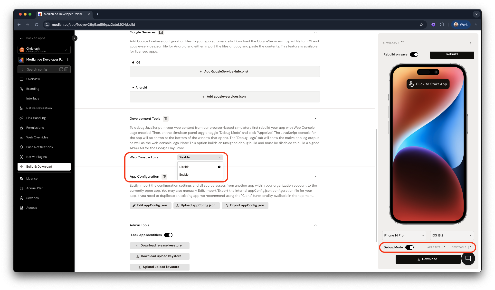
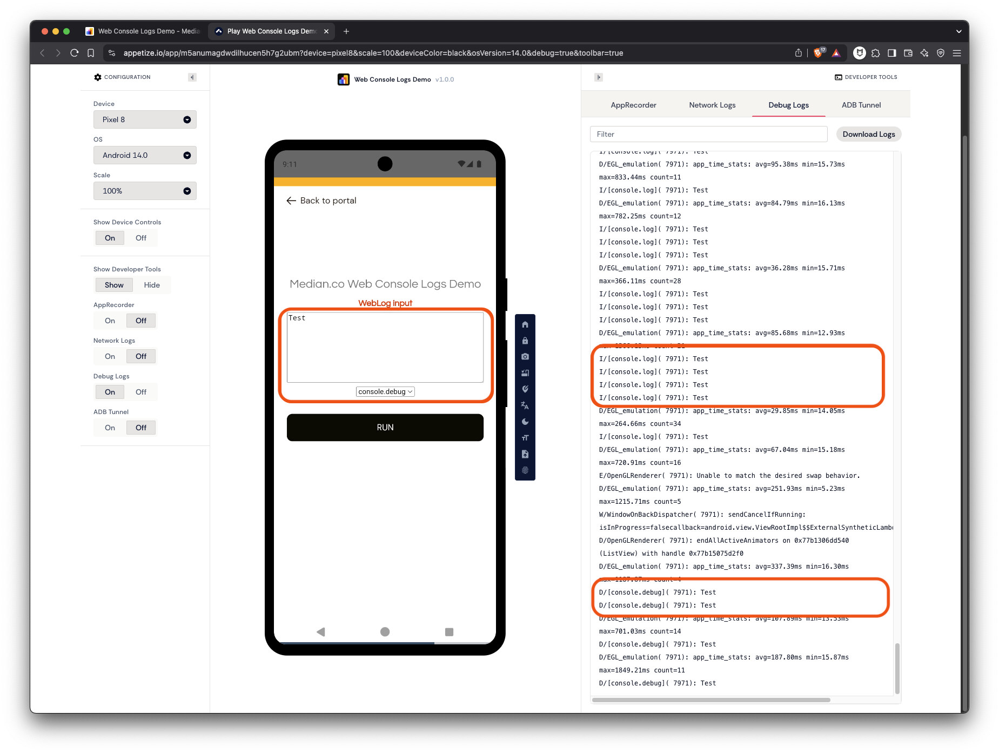

import { DeveloperDemo } from "/snippets/developer-demo.jsx";

Accessing web logs in a WebView-based mobile app presents unique challenges. Since WebViews function as embedded browsers within an app, they lack built-in developer tools, making it difficult to inspect network activity. Additionally, mobile environments impose restrictions on logging and debugging, further complicating the process.

To overcome these limitations, developers can inspect network logs using Appetize.io simulators by enabling debug logs and accessing the console output in the Appetize environment.

<DeveloperDemo path="web-console-logs" />

## Enable debug logs

To debug JavaScript in WebView content using our browser-based simulators, follow these steps:

1. Rebuild your app with Web Console Logs enabled.
2. Open the simulator panel.
3. Toggle **Debug Mode** and click **Appetize** to enable logging.

<Frame caption="App Studio: Development Tools">
  
</Frame>

## Connecting local builds to a browser

When debugging JavaScript functions, objects, or web console messages, you may want to use browser developer tools while running a locally built app. The following walkthroughs explain how developers can use Chrome and Safari with an active simulator to inspect the website’s structure, elements, and JavaScript output.

## Appetize

The **Debug Logs** tab in Appetize displays both native app logs and web console logs. This tool provides insights into network requests, JavaScript errors, and other debugging information. However, note the following:

- This feature requires an unsigned debug build and must be disabled before generating a signed APK/AAB for the Google Play Store.
- Console output includes `console.log()`, `console.warn()`, `console.error()`, and `console.debug()`, each prefixed accordingly (for example, `[console.log]` or `[console.debug]`).
- Native app logs will also be displayed, so filtering by prefix is recommended.

<Frame caption="Viewing JavaScript console via Appetize">
  
</Frame>

## Frequently asked questions

<AccordionGroup>
<Accordion title="Why am I receiving the 'Android App Bundle' error?" id="why-am-i-receiving-the-android-app-bundle-error">

When Development Tools/Web Console Logs are enabled, the Median build platform generates an unsigned Android debug build (AAB). If you attempt to publish this AAB to Google Play, you will receive the error: `The Android App Bundle was not signed`. To resolve this, disable web console logs before generating a signed Android app.

</Accordion>
</AccordionGroup>
