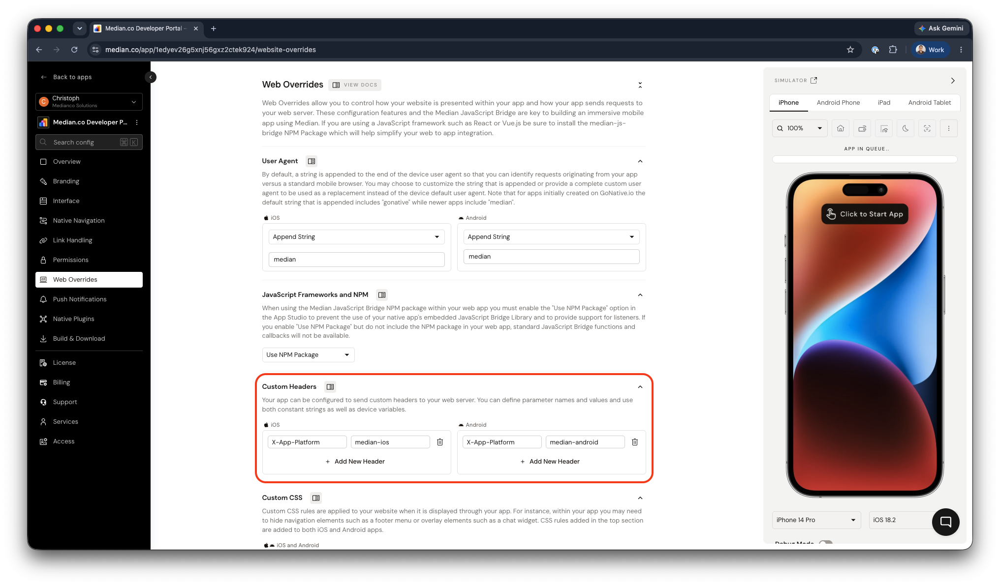

import { MedianLogo } from "/snippets/median-logo.jsx";

When your website runs inside a Median-built native app, it behaves differently than it does in a standard browser. Detecting whether a user is on the native app or a browser lets you:

- Enable JavaScript Bridge commands (which are only available inside the app)
- Customize your UI and UX (for example, hiding a website nav bar in favor of a native navigation menu, or hiding a footer to create a cleaner app interface)
- Track analytics separately for app vs. browser sessions
- Restrict which pages or features are accessible within the app

Median supports three detection strategies. Use whichever best suits your architecture, or combine them.

## Detection strategies

### Strategy 1: Detect the custom user agent

Every HTTP request made by your Median app appends a custom string to the device's default user agent. This is the most common detection method and works on both the frontend and backend.

#### Default user-agent strings

| Platform    | User agent string          | Legacy user agent string       |
| ----------- | -------------------------- | ------------------------------ |
| iOS app     | `MedianIOS/1.0 median`     | `GoNativeIOS/1.0 gonative`     |
| Android app | `MedianAndroid/1.0 median` | `GoNativeAndroid/1.0 gonative` |

You can change this string in the **Web Overrides** tab. See [Custom user agent](/docs/custom-user-agent) for details, and confirm the configured user agent using the [device info](/docs/device-info) function in your live app.

**Detecting the user agent: frontend (JavaScript)**

Use `navigator.userAgent` to check for the `median` string on the client side.

<MedianLogo />
<CodeGroup>
  ```javascript JavaScript
  if (navigator.userAgent.indexOf('median') > -1) {
      // Running inside the Median app

      // Safe to call JavaScript Bridge commands
      median.module.command({ 'parameter': 'value' });

      // Adjust UI for the native app experience
      document.querySelector('.webNav').style.display = 'none';
      document.querySelector('.appOnly').style.display = 'block';

}

```
</CodeGroup>

**Detecting the user agent: backend (for example, Node.js)**

You can read the `User-Agent` header on the server to serve different content or responses based on context.

<CodeGroup>
```javascript JavaScript
app.get('/', (req, res) => {
    if (req.header('User-Agent').indexOf('median') > -1) {
        res.send('App version of the website');
    } else {
        res.send('Browser version of the website');
    }
});
```

</CodeGroup>

This pattern works in any server-side language. Look for the `median` string in the `User-Agent` HTTP header.

#### JavaScript helper functions

We recommend creating helper functions to simplify complex integrations and to reduce the code that needs to be added throughout your web environment. In the examples below, you call `logAnalyticsEvent()` and the event would be transmitted as either a web analytics event or app analytics event by way of the helper function.

Analytics using the [Google Firebase Analytics plugin](/docs/firebase-analytics) for native app analytics:

<MedianLogo />
<CodeGroup>
  ```javascript JavaScript
  function logAnalyticsEvent(eventName, eventProperties){
    if (navigator.userAgent.indexOf('median') > -1) { // web content is being displayed in app
        // send event using Firebase Google Analytics Native Plugin
        median.firebaseAnalytics.event.logEvent({
          'event':eventName, 
          'data': eventProperties
         });
     }
     else { // web content is being displayed in a standard browser
        // send event using gtag.js
        gtag('event', eventName, eventProperties);
     }
  }
  ```
</CodeGroup>

Analytics using only web-based Google Analytics, with an additional parameter to filter web versus app events:

<CodeGroup>
  ```javascript JavaScript
  function logAnalyticsEvent(eventName, eventProperties){
    if (navigator.userAgent.indexOf('MedianIOS') > -1) { // iOS app
        eventProperties.analyticsSource = 'ios';
     }
    else if (navigator.userAgent.indexOf('MedianAndroid') > -1) { // Android app
        eventProperties.analyticsSource = 'android';
     }
     else { // standard browser
        eventProperties.analyticsSource = 'web';
     }
     // send event using gtag.js
     gtag('event', eventName, eventProperties);
  }
  ```
</CodeGroup>

### Strategy 2: Set custom HTTP headers

Instead of (or in addition to) user-agent detection, you can configure your app to send a custom HTTP header with every request. This can be a cleaner signal than parsing the user-agent string, especially on the backend. Configure custom headers in App Studio under **Web Overrides → Custom Headers**.

<Frame caption="Web Overrides → Custom Headers">
  
</Frame>

Example: adding an `X-App-Platform: median-ios` header on the iOS app, then reading it server-side:

<CodeGroup>
  ```javascript JavaScript
  // Node.js / Express
  app.get('/', (req, res) => {
      const platform = req.header('X-App-Platform');
      if (platform) {
          res.send(`Request from app: ${platform}`);
      } else {
          res.send('Request from browser');
      }
  });
  ```
</CodeGroup>

See [Custom headers](/docs/custom-headers) for full configuration details.

### Strategy 3: Use a dedicated app URL

The simplest approach is to serve a completely separate version of your site at a dedicated subdomain configured as your app's URL:

`https://app.yoursite.com`

Because only your Median app points to this URL, any request to it is by definition from the app. No user-agent parsing or header inspection is required.

This strategy works well when the app and browser experiences differ significantly. It is recommended when the app version omits marketing pages, sign-up flows, or navigation elements that only make sense in a browser context.

## Choosing a strategy

| Strategy                      | Best for                                   | Complexity |
| ----------------------------- | ------------------------------------------ | ---------- |
| User-agent detection (JS)     | Frontend UI changes, gating JavaScript Bridge calls | Low        |
| User-agent detection (server) | Serving different HTML, API responses      | Low        |
| Custom HTTP headers           | Clean server-side detection, backend APIs  | Low–Medium |
| Dedicated app URL             | Fully separate app vs. browser experiences | Medium     |

For most projects, user-agent detection in JavaScript is the quickest starting point. Add a helper function early so detection logic stays centralized as your codebase grows.
