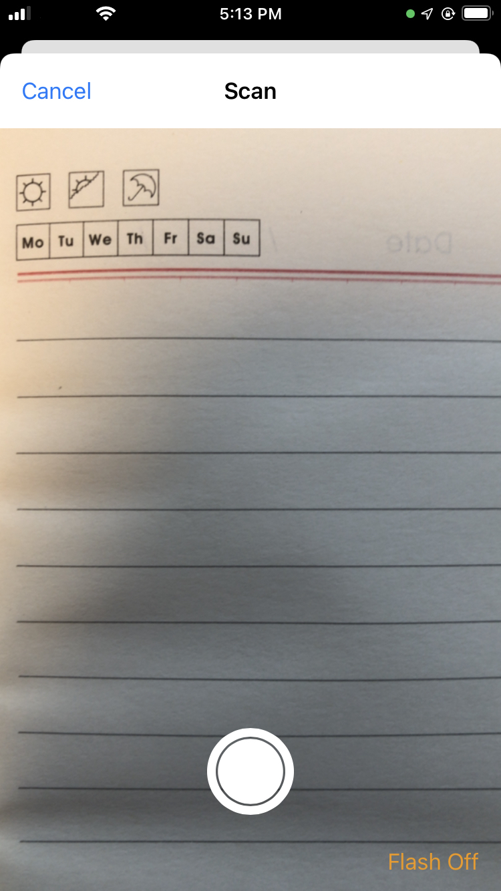
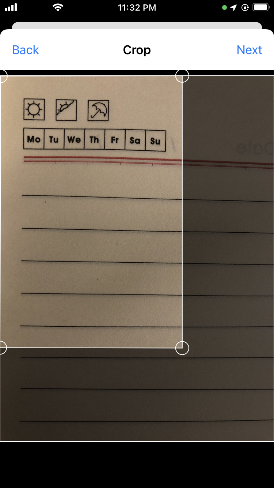
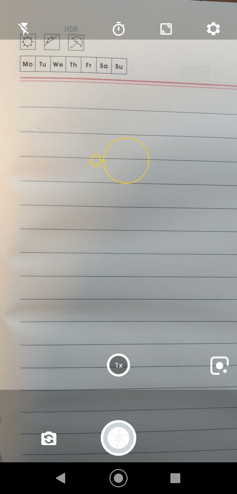
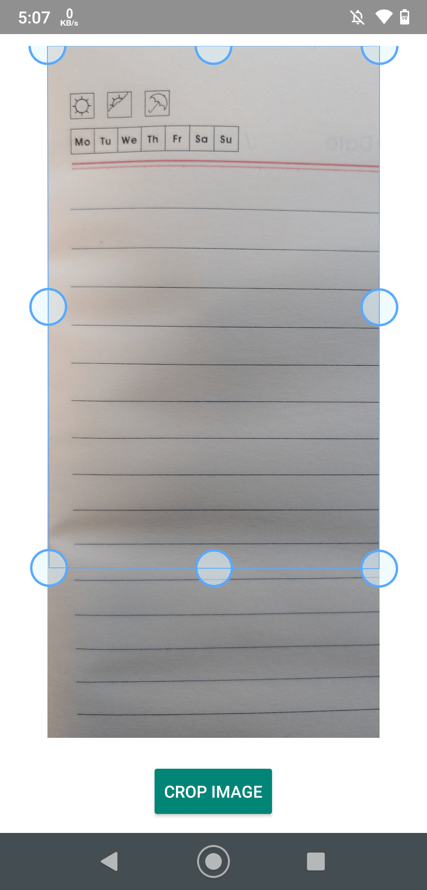

import { MedianLogo } from "/snippets/median-logo.jsx";


Easily scan documents using the device camera with automatic image enhancement and cropping. The Median Document Scanner Plugin enables document uploads and improves scan quality by leveraging native image processing.

## Key Features

- Detects document edges and outlines in real time
- Automatically corrects angle, perspective, and aspect ratio
- Enhances text clarity and sharpness
- Crops and exports the document as a clean final scan
- Supports JPEG output in base64 format

The scanned image is made available as a base64 jpeg file through the Median JavaScript Bridge where it can be attached to a form or uploaded to your server asynchronously.

<Check>
**Developer Demo**

Display our demo page in your app to test during development [https://median.dev/document-scanner/](https://median.dev/document-scanner/)

</Check>

## iOS Scan and Crop Preview

|               iOS - Scan               |               iOS - Crop               |
| :------------------------------------: | :------------------------------------: |
|  |  |

## Android Scan and Crop Preview

|              Android - Scan               |              Android - Crop               |
| :---------------------------------------: | :---------------------------------------: |
|  |  |

## Implementation Guide

### Initiate a Document Scan

<MedianLogo />
<CodeGroup>
  ```JSON JSON
  median.documentScanner.scanPage({'callback':CALLBACKFUNCTION});
  ```
</CodeGroup>

**Note:** Replace `CALLBACKFUNCTION` with your JavaScript function name.

### Handle the Scanned Image

Your callback function will receive an object with the following structure:

<CodeGroup>
  ```JSON JSON
  {
    image: "base64-encoded string", // Scanned JPEG image
    mimeType: "image/jpeg",
    encoding: "base64"
  }
  ```
</CodeGroup>

#### Example Implementation

Here's a sample code snippet that displays the scanned image output.

<MedianLogo />
<CodeGroup>
  ```HTML HTML
  <html>
  <head>
  <meta name="viewport" content="width=device-width, initial-scale=1">
  <title>Document Scanner Test</title>
  <script>
    function cb(data) {
      document.getElementById('page').setAttribute('src', 'data:' + data.mimeType +
      ';' + data.encoding + ', ' + data.image);
    }
  </script>
    <style>
    img
    {
        max-width: 100%;
        min-width: 300px;
        height: auto;
    }
    </style>
  </head>
    <body>

      <h1>Document Scanner test</h1>

      <p>
        <a onclick="median.documentScanner.scanPage({'callback':cb});">Scan page</a>
      </p>

      <p>
        
      </p>

    </body> 
  </html>
  ```
</CodeGroup>
