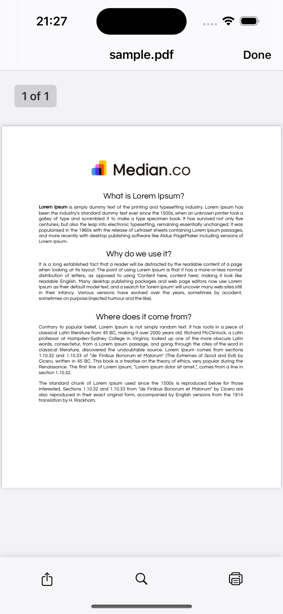
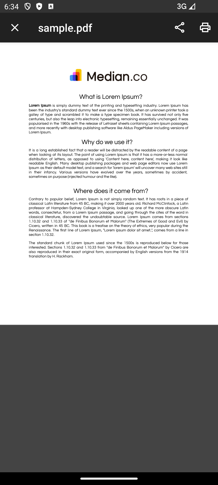

import { MedianLogo } from "/snippets/median-logo.jsx";

Your app can handle file downloads and inline viewing by following the header set by your server. This allows you to control whether files are displayed within the app's webview or downloaded to the user's device.

## Supported content-disposition headers

### `Content-Disposition: inline`

Files with this header will be displayed directly in the app's webview, similar to how HTML content is rendered.

- Ideal for PDFs and other media intended to be viewed in-app.
- You may need to use [Native Navigation](/docs/native-navigation-overview) to provide navigation options for users to return to other parts of your app.

### `Content-Disposition: attachment`

Files with this header will be automatically downloaded to the user's device:

- iOS: Triggers the native “Share” dialog, allowing the user to open the file in the Files app or compatible apps.
- Android: Prompts the user with an “Open with” dialog after download.

## Implementation guide

If you are not able to set the `Content-Disposition` header you may use the JavaScript Bridge downloadFile function to download (and open) a file on a user's device. Should you chose to open the file, the user is presented with a the native iOS or Android 'Open with' dialog.

URLs need to be publicly available. Localhost URLs are **not supported**

<Check>
**Developer Demo**

You can see the PDF viewer in action on our demo page [https://median.dev/pdf-download](https://median.dev/pdf-download)

</Check>

### Download file at specified URL

Use the following command to download a file via the Median JavaScript Bridge:

To download a file:

<MedianLogo />
<CodeGroup>
  ```JavaScript JavaScript
  median.share.downloadFile({url: 'https://yoursite.com/file.pdf', open: true|false})
  // Note: 'open' is an Android-only parameter, refer to below
  ```
</CodeGroup>

**iOS Behavior**

- The file is downloaded and passed to the native “Open with” system dialog.

**Android Behavior**

- Downloads Folder Enabled (Permissions tab): Downloads silently. If open: true is set, the "Open with" dialog is displayed.
- Private to App Enabled (Permissions tab): Always shows the "Open with" dialog after download.

On iOS, the file is downloaded and passed to the "open with" system dialog.

You can learn more about the permissions in [Downloads Directory](https://median.co/docs/downloads-directory).

### Save image to photos

To download and save an image to the user’s photo gallery (iOS Photos or Android Gallery), use:

<MedianLogo />
<CodeGroup>
  ```JavaScript JavaScript
  median.share.downloadImage({url: 'https://yoursite.com/file.jpg'})
  ```
</CodeGroup>

<Check>
**Developer Demo**

Display our demo page in your app to test during development [https://median.dev/download-functions/](https://median.dev/download-functions/)

</Check>

### Viewing PDF files in the app

You can view PDF files directly within your app using one of the following methods:

**Option 1: Open via URL**


<CodeGroup>
  ```JavaScript JavaScript 
  // Navigate to the PDF file's url window.location.href = 'https://yoursite.com/file.pdf' 
  ```
</CodeGroup>

**Option 2: Use JavaScript Bridge**

<MedianLogo />
<CodeGroup>
  ```JavaScript JavaScript
  // Use the downloadFile function
  median.share.downloadFile({url: 'https://yoursite.com/file.pdf', open: true})
  ```
</CodeGroup>

For iOS, we utilize the built-in PDFKit framework provided by Apple. For Android we are using the PDFViewer library [https://github.com/afreakyelf/Pdf-Viewer](https://github.com/afreakyelf/Pdf-Viewer)

|                         iOS                          |                         Android                          |
| :--------------------------------------------------: | :------------------------------------------------------: |
|  |  |

### Printing PDF files

If the device supports printing services, users can print PDF files directly from the viewer:

- iOS: Tap the Print icon in the bottom-right corner of the PDF viewer.
- Android: Tap the Print icon in the top-right corner.
