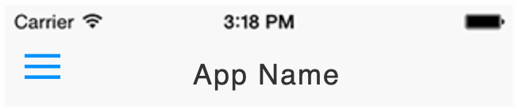

import { MedianLogo } from "/snippets/median-logo.jsx";

Configure the text that shows in the top navigation bar, either at build time through your app configuration or at run time through the JavaScript Bridge.

<Frame caption="iOS navigation bar example">
  
</Frame>

## Implementation guide

### App configuration

You may specify text titles or set image display for different URLs in the **Dynamic Titles** options within the **Native Top Navigation Bar** section of App Studio.

For a given URL rule, if "Text" is selected the text provided will be displayed. Otherwise, if "Image" is selected the top nav bar image will be displayed.

Rules are prioritized from top to bottom. If no match is found, your app name will be shown.

An example JSON formatting for BooyaFitness.com is provided below:

<CodeGroup>
  ```json JSON
  [
      {
          "regex": "https://www.booyafitness.com/",
          "showImage": true
      },
      {
          "regex": "https://www.booyafitness.com/dashboard",
          "title": "Dashboard"
      },
      {
          "regex": "https://www.booyafitness.com/edit",
          "title": "Account"
      },
      {
          "regex": "https://www.booyafitness.com/password/new",
          "title": "Recover Password"
      },
      {
          "regex": "https://www.booyafitness.com/workouts/browse",
          "title": "Workouts"
      },
      {
          "regex": "https://www.booyafitness.com/partners/browse",
          "title": "Partners"
      },
      {
          "regex": "https://www.booyafitness.com/pricing",
          "title": "Pricing"
      }
  ]
  ```
</CodeGroup>

A default navigation title can be defined in the app configuration that is then overwritten dynamically as required. Or alternatively, the configuration can be left blank and all titles set at runtime by your website.

### JavaScript Bridge

Create your navigation title structure, and then run the `median.navigationTitles.set()` JavaScript Bridge function to set the values. To set the example navigation title run the following:

<MedianLogo />
<CodeGroup>
  ```javascript JavaScript
  var menuItems = {
      active: true,
      titles: [{
        showImage: true,
        regex: '/home'
     },{
        title: 'my title',
        regex: '.*'
     }]
  }
  median.navigationTitles.set({
    'persist':true,
    'data': menuItems});
  ```
</CodeGroup>

Setting `persist: true` saves the navigation titles for the next time the app launches. Otherwise, they only take effect for the current session.

To revert the navigation titles to the configuration set at build time, run the following command:

<MedianLogo />
<CodeGroup>
  ```javascript JavaScript
  if (navigator.userAgent.indexOf('median') > -1) {
      median.navigationTitles.set({'persist':true});
  }
  ```
</CodeGroup>

For a one-off setting of the current page's title, URL encode the desired title and run the following command:

<MedianLogo />
<CodeGroup>
  ```javascript JavaScript
  if (navigator.userAgent.indexOf('median') > -1) {
      median.navigationTitles.setCurrent({'title':'Hello%20World'})
  }
  ```

```html HTML
<a onclick="gonative.navigationTitles.setCurrent({'title':'Hello%20World'})">Set Current Page's Title</a>
```
</CodeGroup>

### Set a title image at runtime

Show an image in place of the title, such as a logo for the signed-in user's organization. Pass either:

| Parameter | Description |
| --------- | ----------- |
| `url` | Image URL. The app downloads it, so the server doesn't need to allow cross-origin requests. Relative URLs are resolved against the current page. |
| `image` | Image data from your page: a `Blob`, a data URL, or a base64 string. |

Use a PNG, JPEG, or WebP image. SVG images aren't supported.

The image is scaled to the same height as the top navigation bar image set in App Studio, and keeps its aspect ratio. It replaces any title or image already showing.

The image applies to the [navigation instance](/docs/navigation-instances) that matches the current page, and shows again whenever the user returns to a page of that instance. If your app doesn't use instances, it applies to every page. It stays until you reset it or the app restarts.

<Check>
  **Developer Demo**

Display our demo page in your app to test during development [https://median.dev/title-image <Icon icon="arrow-up-right-from-square" size={12} />](https://median.dev/title-image)

</Check>

<MedianLogo />

<CodeGroup>

```javascript URL
median.navigation
  .setTitleImage({ url: "https://example.com/images/logo.png" })
  .catch((error) => console.log(error.code, error.message));
```

```javascript Blob
const response = await fetch("/images/logo.png");
const blob = await response.blob();

median.navigation
  .setTitleImage({ image: blob })
  .catch((error) => console.log(error.code, error.message));
```

```javascript Reset
median.navigation.resetTitleImage();
```

</CodeGroup>

`resetTitleImage()` goes back to the title or image configured at build time.

Both methods return a promise that resolves with `{ success: true }`. If setting the image fails, the promise rejects with an error object:

```json JSON
{
  "code": "NETWORK_ERROR",
  "message": "Download failed with HTTP 404"
}
```

If you pass a `callback` function instead, it receives `{ success: false, error: { code, message } }` on failure.

| Error code | Cause |
| ---------- | ----- |
| `INVALID_PARAMETERS` | Neither `url` nor `image` was passed, or `url` isn't a valid URL. |
| `NETWORK_ERROR` | The image couldn't be downloaded. |
| `INVALID_IMAGE` | The data isn't valid base64 or isn't an image the device can display. |
