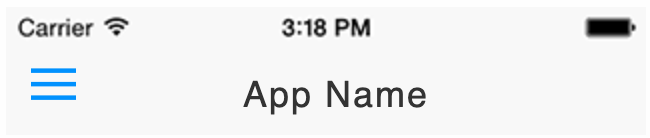

import { MedianLogo } from "/snippets/median-logo.jsx";

Configure the text that shows in the Top Navigation Bar either at build time through your app configuration or at run time through the JavaScript Bridge.

<Frame caption="iOS NavigationBar example">
  
</Frame>

## Implementation Guide

### App Configuration

You may specify text titles or set image display for different URLs in the Dynamic Titles options within the Native Top Navigation Bar section of the App Studio interface.

For a given URL rule, if "Text" is selected the text provided will be displayed. Otherwise, if "Image" is selected the top nav bar image will be displayed.

Rules are prioritized from top to bottom. If no match is found, your app name will be shown.

An example JSON formatting for BooyaFitness.com is provided below:

<CodeGroup>
  ```JSON JSON
  [
      {
          "regex": "https://www.booyafitness.com/",
          "showImage": true
      },
      {
          "regex": "https://www.booyafitness.com/dashboard",
          "title": "Dashboard"
      },
      {
          "regex": "https://www.booyafitness.com/edit",
          "title": "Account"
      },
      {
          "regex": "https://www.booyafitness.com/password/new",
          "title": "Recover Password"
      },
      {
          "regex": "https://www.booyafitness.com/workouts/browse",
          "title": "Workouts"
      },
      {
          "regex": "https://www.booyafitness.com/partners/browse",
          "title": "Partners"
      },
      {
          "regex": "https://www.booyafitness.com/pricing",
          "title": "Pricing"
      }
  ]
  ```
</CodeGroup>

A default navigation title can be defined in the app configuration that is then overwritten dynamically as required. Or alternatively, the configuration can be left blank and all titles set at runtime by your website.

### JavaScript Bridge

Create your navigation title structure, and then run the `median.navigationTitles.set()` Javascript Bridge function to set the values. To set the example navigation title run the following:

<MedianLogo />
<CodeGroup>
  ```JavaScript JavaScript
  var menuItems = {
      active: true,
      titles: [{
        showImage: true,
        regex: '/home'
     },{
        title: 'my title',
        regex: '.*'
     }]
  }
  median.navigationTitles.set({
    'persist':true,
    'data': menuItems});
  ```
</CodeGroup>

Setting `persist=true` will save the navigation titles for use the next time the app is launched, otherwise, it will only take effect for the current session.

To revert the navigation titles to the configuration set at build time, run the following command:

<MedianLogo />
<CodeGroup>
  ```JavaScript JavaScript
  if (navigator.userAgent.indexOf('median') > -1) {
      median.navigationTitles.set({'persist':true});
  }
  ```
</CodeGroup>

For a one-off setting of the current page's title, URL encode the desired title and run the following command:

<MedianLogo />
<CodeGroup>
  ```JavaScript JavaScript
  if (navigator.userAgent.indexOf('median') > -1) {
      median.navigationTitles.setCurrent({'title':'Hello%20World'})
  }
  ```

```HTML HTML
<a onclick="gonative.navigationTitles.setCurrent({'title':'Hello%20World'})">Set Current Page's Title</a>
```
</CodeGroup>
