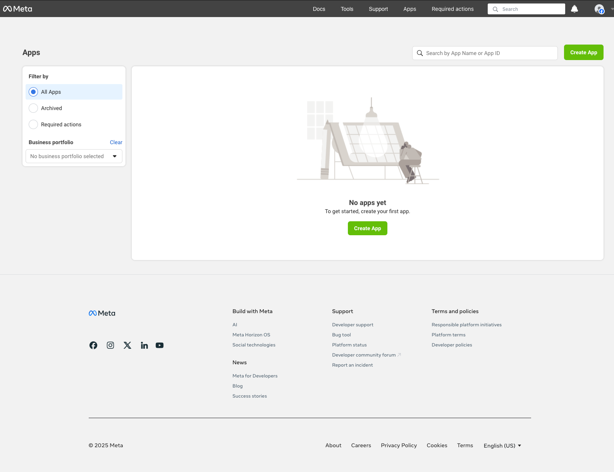
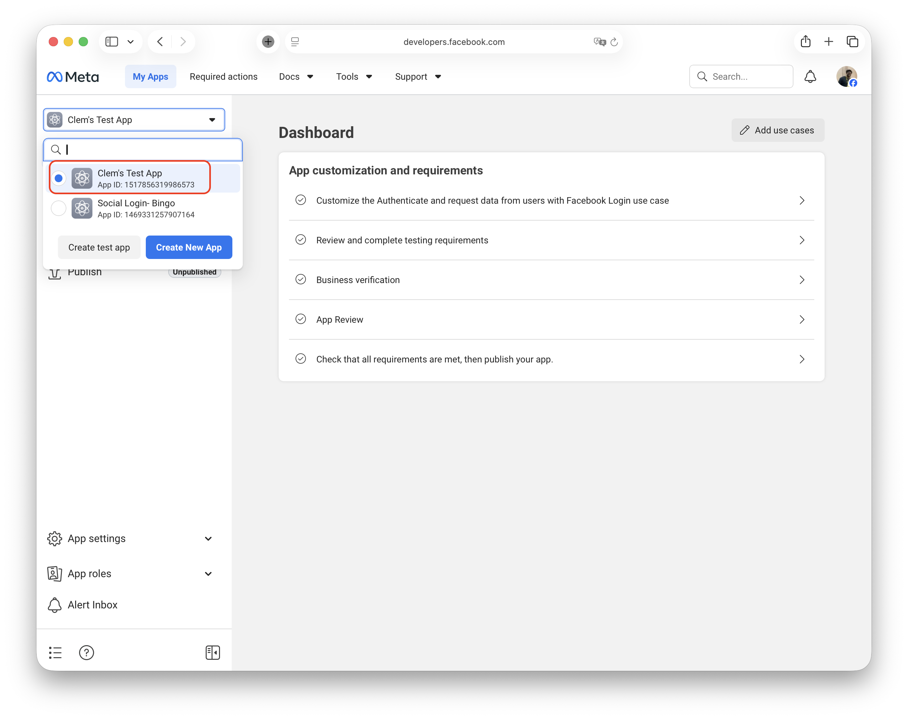
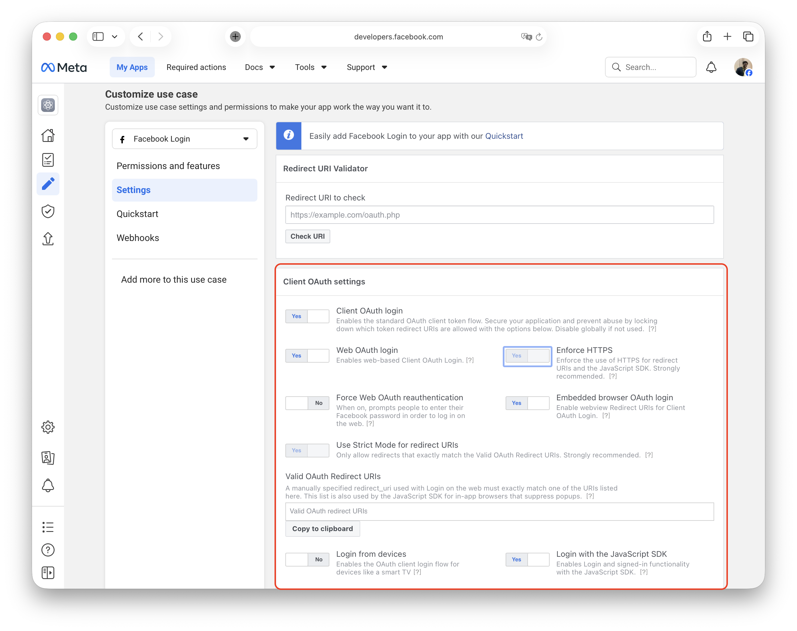
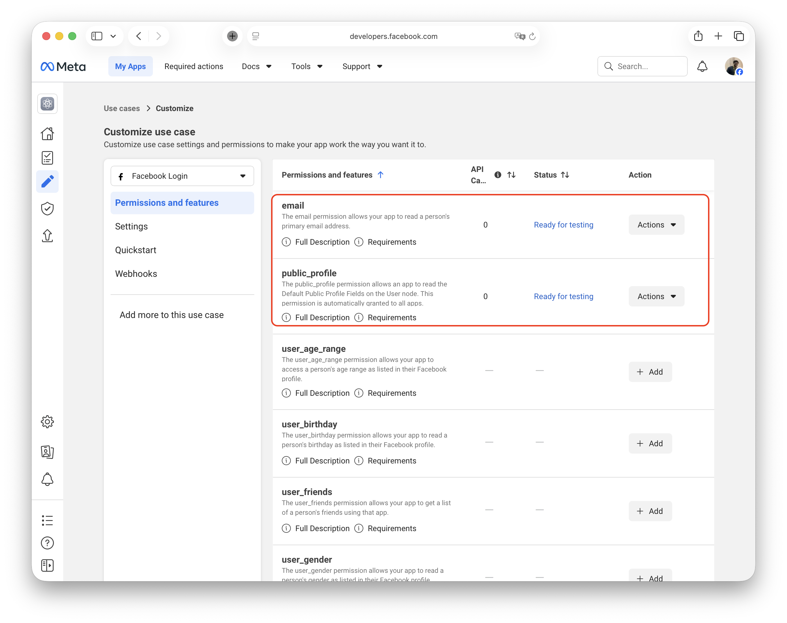
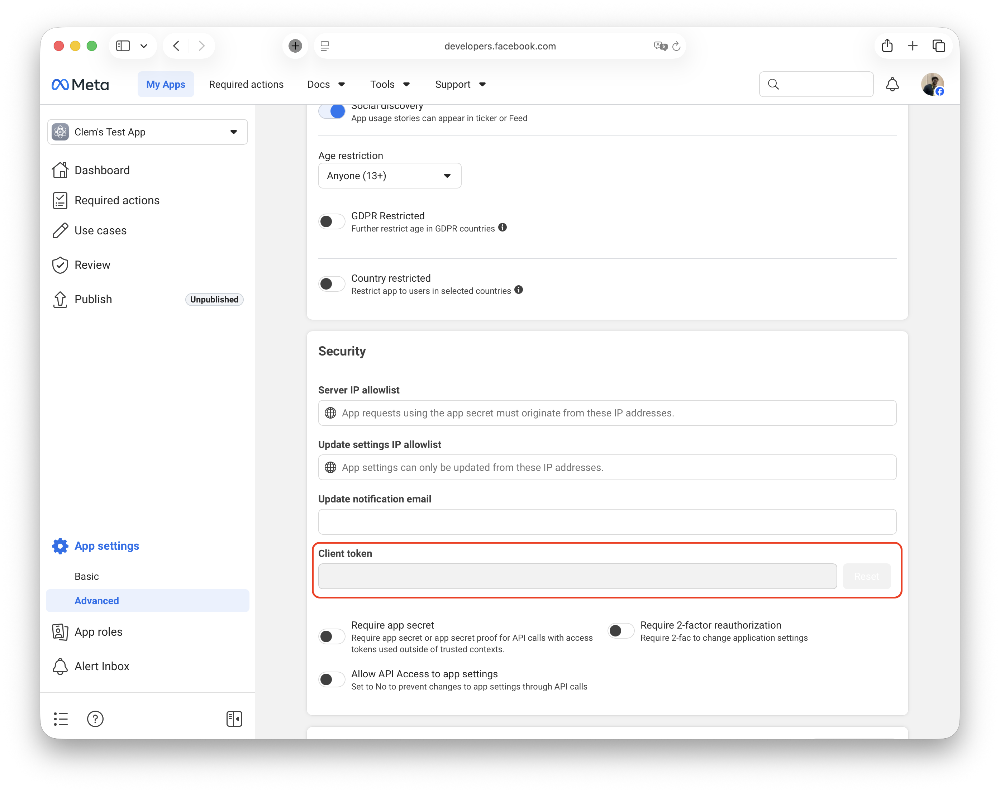
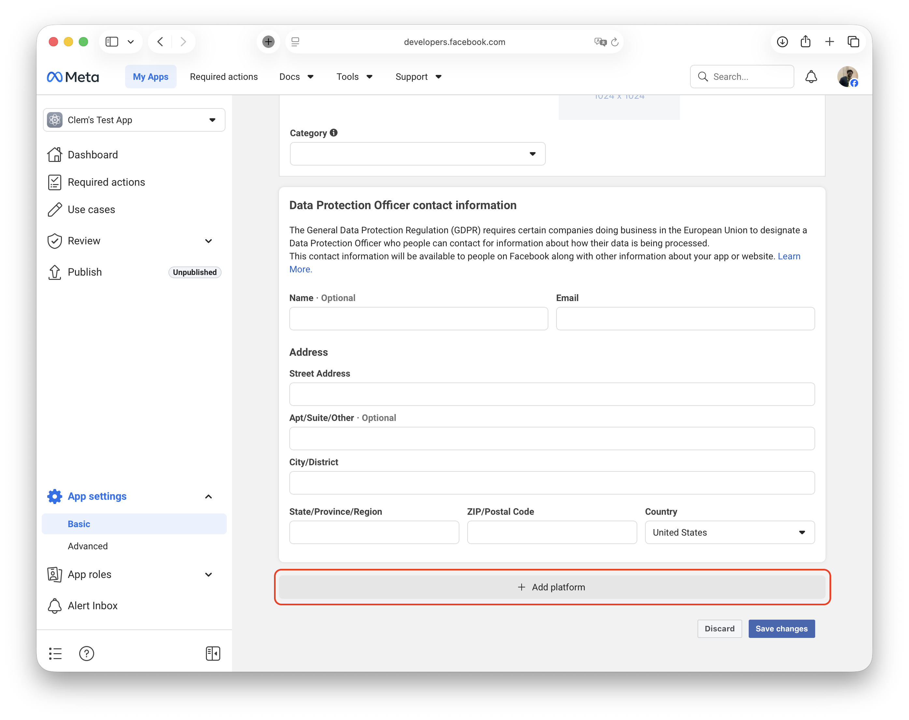
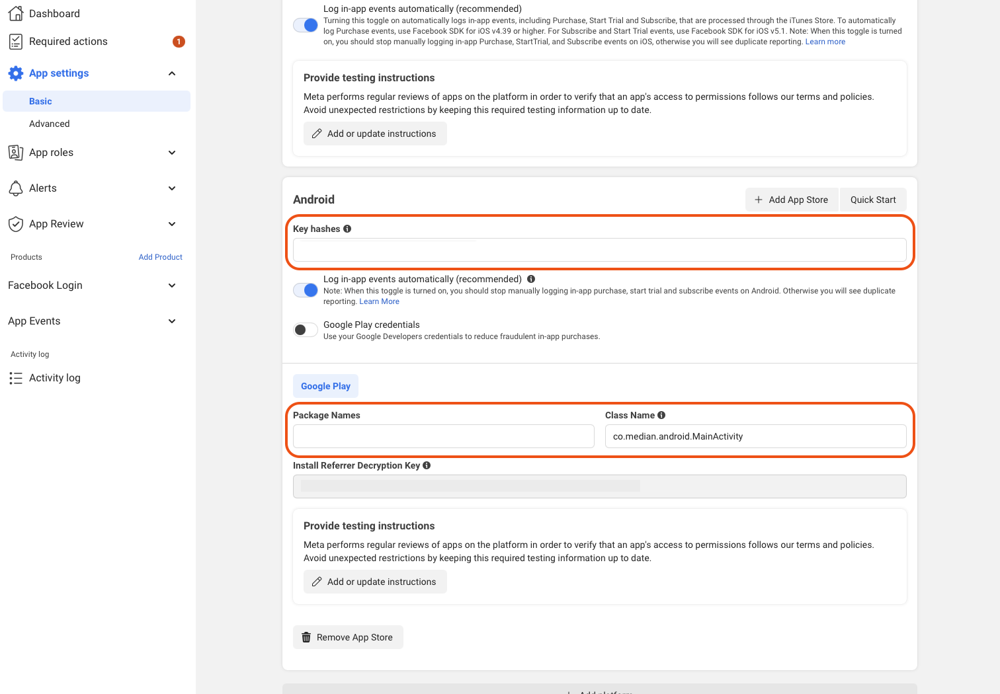
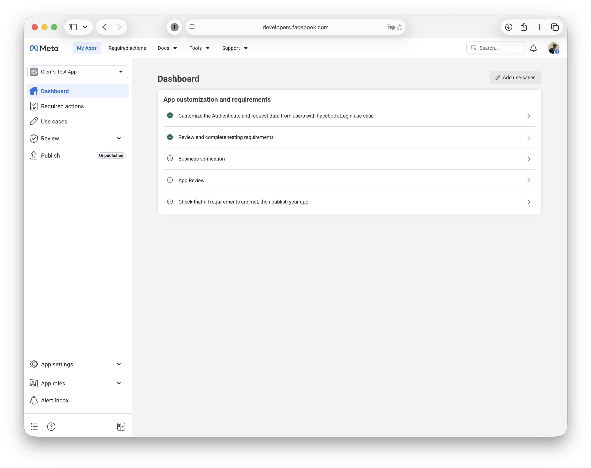
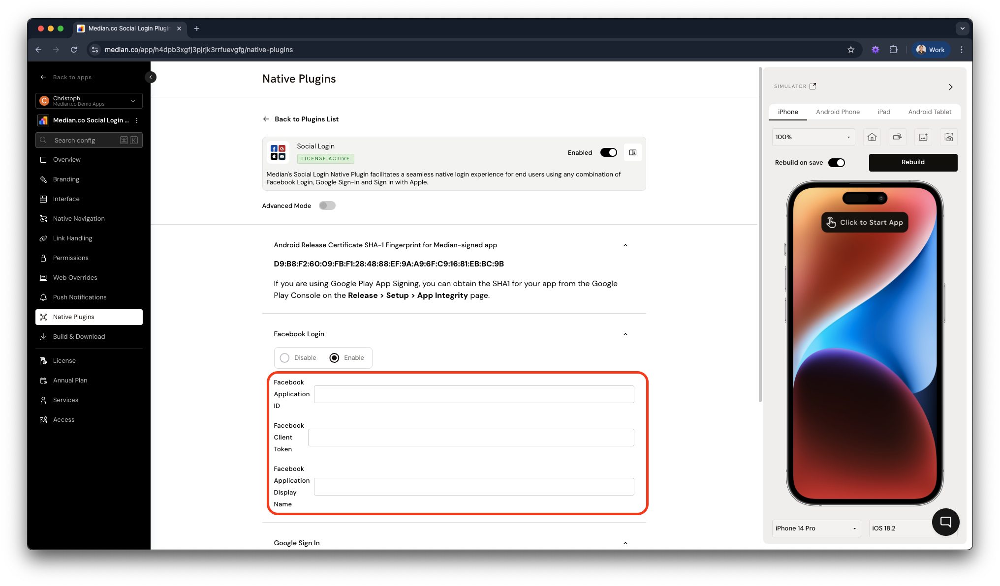

This guide walks you through creating and configuring a Facebook app to enable Facebook Login. You'll configure settings in Meta's Developer Portal and gather the credentials needed for Median App Studio.

## Before you begin

Make sure you have:

* A [Facebook Developer account](https://developers.facebook.com/)
* Your app's **iOS Bundle ID** (example: `co.median.ios.soclogin`)
* Your app's **Android Package Name** (example: `co.median.android.soclogin`)
* Your app's **Android Key Hash** (available from [`median.deviceInfo()`](/docs/device-info#example-deviceinfo-payload) or from the Social Login plugin page in App Studio)
* An Admin or Developer role in your Facebook account
* A verified Business in Meta Business Manager

## Step 1: Create your Facebook app

### 1.1 Start a new app

1. Sign in to [Facebook Developers](https://developers.facebook.com/).
2. Click **My Apps** → **Create App**.

<Frame caption="Click 'Create App'">
  
</Frame>

3. Select **Authenticate and request data from users with Facebook Login**.
4. Click **Next**.

### 1.2 Add app details

1. **App Name**: Enter a user-friendly name (shown to users during sign-in)
2. **App Contact Email**: Enter a valid contact email
3. Click **Create App**.

**Save your App ID and Display Name**: After creation, you'll see your **App ID** and **Display Name** in the top-left corner. Copy these values. You'll need them later for Median App Studio configuration.

<Frame caption="Display Name (for example, 'Test App') and App ID (for example, 845xxxxxxxx5)">
  
</Frame>

## Step 2: Configure basic settings

### 2.1 Configure OAuth settings

1. In the left sidebar click on **Use cases**
2. For **Authenticate and request data from users with Facebook Login**, click on **Customize**
3. Go to the **Settings** section
4. Enable **"Login with the JavaScript SDK"** (toggle on)
5. Add your **Valid OAuth Redirect URIs**:
   * Example: `https://yourdomain.com/auth/callback`
6. Add your **Allowed Domains for the JavaScript SDK**:
   * Example: `yourdomain.com`
7. Click **Save Changes**.

<Frame caption="Client OAuth Settings, JavaScript SDK, Redirect URLs & Domains">
  
</Frame>

### 2.2 Configure permissions

1. In the left sidebar: **App Review** → **Permissions and Features**.

2. Add

   * `email` (required for user identification)
   * `public_profile` (required for basic user info)

<Frame caption="App Permission & Features">
  
</Frame>

<Warning>
  **App Review required**

  Some permissions require Facebook's approval before going live. [Learn about Facebook App Review](https://developers.facebook.com/docs/app-review).
</Warning>

### 2.3 Get your client token

1. In the left sidebar: **Settings** → **Advanced**.
2. Scroll to the **Security** section.
3. Click **Show** next to **Client Token**.
4. **Copy and save** this token. You'll need it for Median App Studio configuration.

<Frame caption="Facebook Client Token">
  
</Frame>

## Step 3: Add platform configurations

You need to configure **both iOS and Android** platforms (these are separate, parallel steps).

### 3.1 iOS configuration

1. In left sidebar: **Settings** → **Basic**.
2. Scroll to bottom → Click **"+ Add Platform"**.

<Frame caption="Add Platform">
  
</Frame>

3. Select **iOS**.

4. Fill in:

   * **Bundle ID**: Your iOS Bundle ID (example: `co.median.ios.soclogin`)
   * Add any **test/development Bundle IDs** if applicable.

5. Click **Save Changes**.

**Testing tip:** If you have multiple development builds, add each Bundle ID variant (for example, `com.yourapp.debug`).

**Website configuration:**

1. Same screen: Click **"+ Add Platform"** again
2. Select **Website**
3. **Site URL**: Enter your website URL (example: `https://yourdomain.com`)
4. Click **Save Changes**

<Warning>
  **Meta portal instability**

  If you encounter saving issues, try: different browser, incognito mode, or VPN connection. You can skip the "iPhone Store ID" field during initial setup.
</Warning>

### 3.2 Android configuration

1. In left sidebar: **Settings** → **Basic**.
2. Scroll to bottom → Click **"+ Add Platform"**.

<Frame caption="Add Platform">
  
</Frame>

3. Select **Android**.

4. Select **Google Play** store.

5. Click **Next**.

**Fill in the required fields:**

1. **Package Name:** Your Android app's unique identifier. Example: `co.median.android.soclogin`

2. **Class Name:** Use this exact value: `co.median.android.MainActivity`

3. **Key Hash:** Your Android signing certificate hash. If you are using Median to sign your Android app, contact our team to obtain this value.

<Frame caption="Android configuration">
  
</Frame>

### 3.3 Google Play App Signing

1. Go to Google Play Console → **Release** → **Setup** → **App Integrity**.
2. Copy your **SHA-1 certificate fingerprint**.
3. Convert it using this command:

<CodeGroup>
  ```bash bash
  echo YOUR_SHA1_VALUE | xxd -r -p | openssl base64
  ```
</CodeGroup>

### 3.4 Local debugging

For a local development keystore:

<CodeGroup>
  ```bash bash
  keytool -keystore <path-to-keystore> -list -v
  ```
</CodeGroup>

*Default password: `android`*

<Info>
  **Multiple development machines**

  Create a separate OAuth client for each developer's machine using their local SHA-1 fingerprint.
</Info>

**For debug builds:**

If building debug variants, append `.debug` to your Package Name:

* **Production**: `co.median.android.soclogin`
* **Debug**: `co.median.android.soclogin.debug`

Create separate Facebook platform configurations for production and debug builds.

## Step 4: Review and publish your app

Follow the prompts in the Meta for Developers dashboard to:

1. Complete Facebook's Business verification
2. Complete the App Review Submission
3. Complete all requirements and publish the app.

<Frame caption="Meta for Developers dashboard">
  
</Frame>

## Step 5: Add credentials to Median App Studio

Now that your Facebook app is configured, add these credentials to App Studio:

1. Sign in to [App Studio](https://median.co/app).
2. Navigate to: **Native Plugins** → **Social Login** → **Settings**.
3. Enter your **Facebook Configuration**:

| App Studio field   | Value from Facebook   | Where you found it                        |
| ------------------ | --------------------- | ----------------------------------------- |
| **Application ID** | Your App ID           | Dashboard top-left (Step 1.2)             |
| **Client Token**   | Your Client Token     | Settings → Advanced → Security (Step 2.3) |
| **Display Name**   | Your App Display Name | Dashboard top-left (Step 1.2)             |

<Frame caption="Social Login plugin configuration">
  
</Frame>

4. Click **Confirm** and **Save**.
5. **Rebuild your app** for changes to take effect.

## Step 6: Test your configuration

Before going live:

* [ ] Test sign-in in your development app
* [ ] Verify token exchange works
* [ ] Test with multiple Facebook accounts
* [ ] Test on both iOS and Android devices
* [ ] Verify that the user profile data is returned correctly

## Important notes

### Facebook Limited Login (iOS)

On iOS, if users decline App Tracking Transparency (ATT) permission, Facebook automatically uses a "Limited Login" method.

**Key differences with Limited Login:**

* Returns a JWT token instead of an access token
* Graph API endpoints are unavailable
* Requires different token validation

### App Tracking Transparency

App Tracking Transparency permission is required to use standard Facebook Login on iOS. If users decline ATT, Limited Login is used automatically.

**Implementation:**

1. Request ATT permission in your app.
2. If the user allows, the standard Facebook Login opens.
3. If the user declines, the Limited Login version opens automatically.

You can also force Limited Login by setting `forceLimitedLogin: true` in your JavaScript Bridge call.