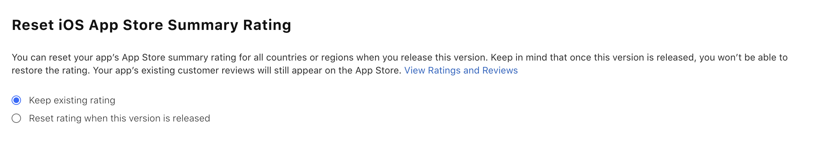

## Will I be able to publish my app to the Apple App Store and Google Play?

Yes! You can publish your app yourself, or have our team complete the publishing end to end with Median's Publishing Service.

Both the Apple App Store and Google Play Store require specific criteria for all apps that are submitted. Our [publishing guide](/docs/publishing-guide) includes all of the information you will need to self-publish your app.

If you choose to have the Median team manage the publishing process on your behalf, we provide a 100% guarantee of app store acceptance. For future publishing of app updates after we've published an initial release we charge a 50% reduced fee for our services.

Whether you self-publish or have our team publish on your behalf, you need an Apple Developer Account and a Google Play Developer Account. You can apply for both accounts using the links below.

- Apple Developer Account: [https://developer.apple.com/programs/enroll](https://developer.apple.com/programs/enroll)
- Google Play Developer Account: [https://play.google.com/apps/publish/signup](https://play.google.com/apps/publish/signup)

## Do I need Xcode, a Mac, or Apple Transporter to publish my iOS app?

No. For standard self-service publishing with Median, you can follow these steps:

1. Open your app in Median App Studio and go to **Build & Deploy**.

2. Click **Configure** in the iOS IPA section.

3. In **Apple Developer API Connection**, enter your **Issuer ID** and **Key ID**, and upload your **Private Key (.p8)** file.

4. In **Bundle ID & App Store Connect App**:
   - Register the **Bundle ID** for your app.
   - Create the **App Store Connect app record** in App Store Connect using that Bundle ID.
   - Verify the **App Store Connect app record** in App Studio.

5. In **Signing & Upload Settings**, select **Distribution Profile** and set **Upload to App Store Connect** to **Automatic**.

6. Build your iOS IPA in App Studio. If automatic upload isn't selected, click **Upload** after the build is complete.

7. Wait for Apple to process the uploaded build in App Store Connect.

8. In App Store Connect, open **TestFlight**, resolve any required prompts, and add testers.

9. Before App Review, complete the App Store listing in App Store Connect, including metadata such as app name, subtitle, description, keywords, category, support URLs, app privacy details, age rating, review contact information, compliance questions, and screenshots for the required device sizes.

10. After testing and completing the App Store listing, select the processed build and submit it for App Review.

Xcode, macOS, and Apple Transporter are only needed if you intentionally choose a manual workflow.

## What do I need to do in App Store Connect after Median uploads the build?

Median's automatic upload sends the signed iOS build to your App Store Connect app record. It does not complete the App Store submission for you.

You still use App Store Connect to:

- create the app record before upload
- complete listing details, metadata, screenshots, and privacy information
- add TestFlight testers
- answer Apple compliance questions
- select the processed build
- submit the app for App Review

## How long will it take to publish my app?

Apple's review and approval process is typically completed within 3–5 days, while the Google Play approval process is usually complete within a day.

However, it is important to be very attentive to detail when self-publishing as both App Stores have specific criteria for approval. See our [publishing guide](/docs/publishing-guide) for complete details.

Median also offers a Publishing Service that can publish your app to both the App Store and Google Play. Learn more about the [Publishing Service](/docs/publishing-service).

## How do I publish an internal employee-only app?

The Apple App Store and Google Play Store are intended for public apps that can be downloaded and used by anyone. Apps that provide public content and also include a signed-in area for employees are typically acceptable. As are apps that are intended to be used by a wide variety of external partners and contractors. However, strictly internal corporate apps such as scheduling, timesheet, or employee portal/intranet type apps may need to be published to a private app store or distributed via an MDM solution. [Contact our team](https://median.co/contact?topic=sales-inquiry) to discuss your specific requirements.

## How do I improve search results for my app?

Apple and Google provide suggestions for optimizing your App Store and Play Store listings.

[Optimizing for Apple App Store search](https://developer.apple.com/app-store/search/)

[Get discovered on Google Play search](https://support.google.com/googleplay/android-developer/answer/4448378?hl=en)

## How can I accept payments within my app?

Any payment or checkout functionality that you build into your website will continue to work within your Median apps.

For Android apps, you may continue to use your web-based payments flow in your apps without any issues. You may optionally add our In-App Purchases plugin to streamline the payment process and provide support for premium features and subscriptions. Review the [Google Play Billing Overview](https://play.google.com/console/about/in-appproductssetup/), [Google Play Billing Technical Details](https://developer.android.com/google/play/billing) and review our [Google In-App Purchases plugin documentation](/docs/google-iap).

Apple makes a distinction between "physical" and "digital" goods sold within your app, and requires use of their in-app purchase ("IAP") APIs for selling "digital" goods. Learn more about [Apple's Payment Guidelines](https://developer.apple.com/app-store/review/guidelines/#payments). The advantage of using Apple IAP is ease of use for end users who can purchase via their Apple Account with a quick tap. However, Apple charges a processing fee. Review the [Apple Small Business Program](https://developer.apple.com/app-store/small-business-program/) and consult Apple for the current fees in your region.

A "physical" good is something delivered or consumed outside of your app. For example, the Amazon.com app sells physical goods and thus does not need to use Apple's in-app purchase APIs. These purchases can go through standard web checkout flow like Stripe, PayPal, etc.

A "digital" good is something like a new weapon in a game, or a workout video delivered as part of a premium membership in your app. Digital goods are delivered or consumed within your app, and payments are required to go through Apple's in-app purchase APIs.

There are two main strategies to manage this requirement:

1. Remove the ability for people to make digital purchases within your app. Users can use your app in the same way as your website but simply cannot make digital purchases within it. Many widely-used apps such as Audible employ this approach. To configure your website to remove these payment links see our guide on [detecting app usage](/docs/detecting-app-usage) and review [Apple's Payment Guidelines](https://developer.apple.com/app-store/review/guidelines/#other-purchase-methods).

2. Purchase our In-App Purchases plugin and integrate within your website following our documentation. Learn more about [Apple In-App Purchases](https://developer.apple.com/in-app-purchase/) and review our [Apple In-App Purchases plugin documentation](/docs/apple-iap).

## Why isn't my app in the App Store?

Both the Apple App Store and Google Play Store have submission and approval processes you will need to go through before your app or app update is available for public download in the app stores.

### iOS: Apple App Store

To publish your iOS app to the Apple App Store, you need an active Apple Developer Program account and access to [App Store Connect](https://appstoreconnect.apple.com).

We recommend configuring an [App Store Connect API](https://appstoreconnect.apple.com/access/api) connection in Median App Studio. This allows Median to generate and manage the required signing certificates and provisioning profiles for your app, and upload new iOS builds directly to App Store Connect. With this workflow, you do not need a Mac computer, Xcode, or Apple Transporter for standard self-service publishing.

You still need to create your App Store Connect app record, complete your App Store listing, configure any required Apple settings, and submit your app for App Review in App Store Connect.

Alternatively, you can manually build a signed IPA in Median App Studio and upload it with Apple Transporter, or download the iOS source code and build locally using Xcode.

For more information about publishing your iOS app self-serve, see [Apple App Store](/docs/apple-app-store).

Median also offers a Publishing Service, where our team publishes your iOS app on your behalf using your Apple Developer Program account. Our experts create your App Store listing, including required screenshots, and help you navigate the Apple App Review process. Learn more: [Publishing Service](/docs/publishing-service).

### Android: Google Play Store

To publish your Android app to Google Play, you need a Google Play Developer account and access to the [Google Play Console](https://play.google.com/apps/publish).

We recommend building an Android App Bundle (AAB) in Median App Studio and uploading it to the Google Play Console using your Google Play Developer account.

Alternatively, you can download the Android source code and build locally using Android Studio, or from the command line using Median’s provided Gradle script.

For more information about publishing your Android app self-serve, see [Google Play Store](/docs/google-play-store).

Median also offers a Publishing Service, where our team publishes your Android app on your behalf using your Google Play Developer account. Our experts create your Google Play listing, including required screenshots, and help you navigate the Google Play review process. Learn more: [Publishing Service](/docs/publishing-service).

## Can I reset my app's ratings and reviews?

Whether you migrate an existing app to a new platform or release a new feature that may impact the user experience for your users you may want to reset the ratings and reviews of your existing app. This is possible in the App Store but not in Google Play.

### Reset ratings on the Apple App Store

Apple allows you to reset the ratings of your existing app when a new version is published.

<Frame caption="App Store rating reset">
  
</Frame>

### Reset ratings on Google Play

The Google Play Store does not allow you to reset the ratings and reviews of your app. Once a review is submitted, it's permanent for that version of the app.

## Can I migrate my existing app to the Median platform?

Yes! Our team can help you publish a new app version in your App Store and Play Store accounts to replace your existing app.
