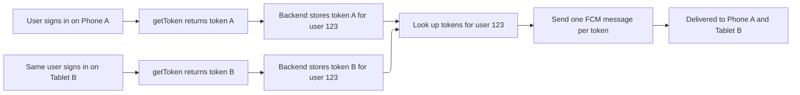

import { MedianLogo } from "/snippets/median-logo.jsx";

Firebase Cloud Messaging (FCM) delivers to devices, not to people. To send a notification to one specific user, your backend needs to know which devices that user is signed in on.

This guide explains how to link registration tokens to your user accounts, keep that link accurate through login, logout, and token rotation, and send to a single user or a segment.

## How FCM targeting works

Each installation of your app receives a unique **registration token** from Firebase. The token identifies _one app install on one device_. It carries no information about who is using the app, and Firebase has no concept of a user account or a login call.

That makes the user-to-device mapping your responsibility:

1. Your web app reads the token through the Median JavaScript Bridge.
2. Your backend stores it against the signed-in user.
3. When you want to reach that user, your backend looks up their tokens and sends to each one.

A user with a phone and a tablet has two tokens. A user who reinstalls the app gets a new one.



### What a push provider would normally handle for you

Customer engagement platforms built on top of FCM and APNs hide this work behind a user model. You call a login function with your user ID, and the platform's SDK collects the device token in the background. From then on, you send to "user 123," and the platform resolves that to the right devices, notices when tokens change, and discards the ones that stop working.

FCM is the transport layer underneath those platforms. Using it directly gives you full control of the pipeline and no per-user platform costs, but the bookkeeping moves to your backend:

| Responsibility                | With an engagement platform | With FCM directly                                                    |
| ----------------------------- | --------------------------- | -------------------------------------------------------------------- |
| Collecting the device token   | Done by the platform SDK    | Your web app calls `getToken()` and posts the result to your backend |
| Linking a device to a user    | One login call              | Your backend stores each token against a user ID                     |
| One user, several devices     | Resolved by the platform    | You store one row per token and send to each                         |
| Token rotation                | Tracked automatically       | Your app reports the token on every launch                           |
| Uninstalls and expired tokens | Cleaned up automatically    | You remove tokens when Firebase rejects them                         |
| Logout and shared devices     | One logout call             | You delete the row and call `deleteToken()`                          |
| Segments and audiences        | Tags and dashboard filters  | Topics, or queries against your own user data                        |
| Delivery and opt-in reporting | Built-in dashboard          | Your own logging                                                     |

The rest of this guide covers each of these responsibilities. None of them is complicated on its own, but all of them need to be in place before per-user targeting is reliable.

## Link a device to a user at login

Once the user has signed in, read the device's token and post it to your backend together with your own user ID.

<MedianLogo />

<CodeGroup>

```javascript Link device
function linkDeviceToUser(userId) {
  median.firebaseMessaging.getToken({
    callback: function (result) {
      if (!result.token) return; // not registered yet, see below

      fetch("/api/push/devices", {
        method: "POST",
        headers: { "Content-Type": "application/json" },
        credentials: "include",
        body: JSON.stringify({
          userId: userId,
          fcmToken: result.token,
        }),
      });
    },
  });
}
```

</CodeGroup>

Replace `/api/push/devices` with your own endpoint. On the server, take the user ID from the authenticated session instead of trusting the value in the request body, so one user can't register a device under another user's account.

If **Automatic Registration** is turned off in your plugin settings, no token exists until you request one. Request permission first, then register:

<MedianLogo />

<CodeGroup>

```javascript Request permission and register
median.firebaseMessaging.requestPermission({
  callback: function (permission) {
    if (!permission.granted) return;

    median.firebaseMessaging.register({
      callback: function (result) {
        console.log("Registered, token:", result.token);
        // Post result.token to your backend as shown above
      },
    });
  },
});
```

</CodeGroup>

<Info>
  **When to link the device**

Link the device on every app launch where the user is signed in, not only on your login page. Tokens can change without notice, and a returning user who is already signed in never goes through your login flow.

</Info>

### Store tokens on your backend

Store tokens in their own table instead of a single column on the user record, since one user can have several devices. For example:

| Column       | Purpose                                                     |
| ------------ | ----------------------------------------------------------- |
| `user_id`    | Your app's user identifier                                  |
| `fcm_token`  | The registration token. Make this unique across the table.  |
| `platform`   | `ios` or `android`, useful for platform-specific payloads   |
| `updated_at` | The last time the app reported this token, used for pruning |

Make the insert an upsert keyed on `fcm_token`. If a token arrives that's already stored for a _different_ user, reassign it to the new user. That happens when two people share a device, and reassigning the token stops the first user's notifications from reaching the second.


## Unlink a device at logout

When a user signs out, remove the link in both places: delete the token from your backend, then delete it on the device.

<MedianLogo />

<CodeGroup>

```javascript Unlink device
function unlinkDeviceFromUser() {
  median.firebaseMessaging.getToken({
    callback: function (result) {
      // 1. Tell your backend to forget this token
      fetch("/api/push/devices", {
        method: "DELETE",
        headers: { "Content-Type": "application/json" },
        credentials: "include",
        body: JSON.stringify({ fcmToken: result.token }),
      }).finally(function () {
        // 2. Invalidate the token on the device
        median.firebaseMessaging.deleteToken({
          callback: function (deleted) {
            console.log("Token deleted:", deleted.success);
          },
        });
      });
    },
  });
}
```

</CodeGroup>

Read the token _before_ you delete it, because your backend needs the value to find the row.

<Warning>
  **Delete the token on shared devices**

Removing the row from your backend stops your own targeted sends. Calling `deleteToken()` as well makes sure Firebase rejects anything still addressed to the old token. After `deleteToken()`, call `register()` the next time a user signs in to get a new token.

</Warning>

## Manage the token lifecycle

A registration token stays the same for long periods, but it isn't permanent, and Firebase doesn't tell your server when one changes. Your token table drifts out of date unless both the app and the backend keep it current. Plan for these events:

| Event                                           | What happens to the token                            | What you need to do                                          |
| ----------------------------------------------- | ---------------------------------------------------- | ------------------------------------------------------------ |
| First launch, or first `register()` call        | A token is issued                                    | Store it once the user is signed in                          |
| User signs in                                   | Unchanged                                            | Link the token to the user                                   |
| User signs out                                  | Unchanged until you call `deleteToken()`             | Remove the row, then delete the token                        |
| A different user signs in on the same device    | Unchanged, unless it was deleted at logout           | Reassign the token to the new user                           |
| App reinstalled, or app data cleared            | A new token is issued, and the old one stops working | Store the new token, and prune the old one when a send fails |
| App restored onto a new device                  | A new token is issued                                | Store the new token                                          |
| App uninstalled                                 | The token stops working                              | Prune it when a send fails                                   |
| Long inactivity                                 | Firebase eventually expires the token                | Prune tokens that haven't been reported recently             |
| User turns off notifications in device settings | Unchanged                                            | Nothing to prune. Sends are accepted but not shown.          |

Two patterns in this table matter most:

- Your backend only learns about a _new_ token when the app reports it, so the app has to report its token regularly.
- Your backend only learns that an _old_ token is invalid when a send to it fails, so your sending code has to clean up after itself.

### Report the token on every launch

Run the same link call whenever the app starts with a signed-in user. If the token hasn't changed, your backend only updates `updated_at`. If it has changed, the new token is stored, and the old one is pruned the next time a send to it fails.

<MedianLogo />

<CodeGroup>

```javascript Report token on launch
function median_library_ready() {
  // linkDeviceToUser() is the function defined above. It isn't part of
  // the JavaScript Bridge, so adapt it to your backend.
  if (window.currentUserId) {
    linkDeviceToUser(window.currentUserId);
  }
}
```

</CodeGroup>

### Remove tokens that Firebase rejects

When you send to a token that's no longer valid, the FCM API returns an error instead of a message ID:

```json Error response
{
  "error": {
    "code": 404,
    "message": "Requested entity was not found.",
    "status": "NOT_FOUND",
    "details": [
      {
        "@type": "type.googleapis.com/google.firebase.fcm.v1.FcmError",
        "errorCode": "UNREGISTERED"
      }
    ]
  }
}
```

Check the response of every send and act on the error code:

| Error code                                  | HTTP status   | Meaning                                                                                      | Action                                                      |
| ------------------------------------------- | ------------- | -------------------------------------------------------------------------------------------- | ----------------------------------------------------------- |
| `UNREGISTERED`                              | 404           | The token is no longer valid. The app was uninstalled, the token was deleted, or it expired. | Delete the token                                            |
| `INVALID_ARGUMENT`                          | 400           | The token is malformed, or the payload is invalid                                            | Delete the token if you know the payload is valid           |
| `SENDER_ID_MISMATCH`                        | 403           | The token belongs to a different Firebase project                                            | Delete the token and check your app's Google Services files |
| `QUOTA_EXCEEDED`, `UNAVAILABLE`, `INTERNAL` | 429, 503, 500 | A temporary problem                                                                          | Keep the token and retry with backoff                       |

### Expire tokens you haven't seen in a while

A device that never opens your app again never reports a new token, and you may not send to it often enough to see it fail. Firebase considers a token stale after 270 days of inactivity and starts rejecting it. Use the `updated_at` column to delete tokens older than a window that suits your app. Reporting on every launch keeps active devices well inside that window.

### A token isn't the same as permission

A device can have a valid token while the user has notifications turned off. Firebase accepts the message, but the device doesn't display it. If you need to know who can actually see your notifications, call `checkPermission()` when you report the token and store the result with it:

<MedianLogo />

<CodeGroup>

```javascript Report permission with token
median.firebaseMessaging.checkPermission({
  callback: function (permission) {
    median.firebaseMessaging.getToken({
      callback: function (result) {
        // Post result.token and permission.granted to your backend
      },
    });
  },
});
```

</CodeGroup>


## Send to a specific user

Send from your server with the [FCM HTTP v1 API](https://firebase.google.com/docs/cloud-messaging/send/v1-api). Look up the user's tokens in your database and send one request per token.

Each request is authorized with a short-lived OAuth 2.0 access token. Get it from a service account in your Firebase project, with the `https://www.googleapis.com/auth/firebase.messaging` scope. Access tokens last one hour, so cache and reuse them instead of requesting a new one for each send.

```bash Send to one device
curl -X POST \
  "https://fcm.googleapis.com/v1/projects/YOUR_PROJECT_ID/messages:send" \
  -H "Authorization: Bearer $ACCESS_TOKEN" \
  -H "Content-Type: application/json" \
  -d '{
    "message": {
      "token": "DEVICE_REGISTRATION_TOKEN",
      "notification": {
        "title": "Your order has shipped",
        "body": "Tap to track your delivery."
      }
    }
  }'
```

A successful send returns the message ID:

```json Success response
{
  "name": "projects/YOUR_PROJECT_ID/messages/0:1700000000000000%abc123"
}
```

The HTTP v1 API accepts one target per request, so a user with three devices needs three requests. Handle each response separately. One device may succeed while another returns `UNREGISTERED`. In that case, remove only that token, as described in [Manage the token lifecycle](#manage-the-token-lifecycle).

<Tip>
  **Test a single-device send first**

Before writing server code, confirm delivery with the [Test Sender](https://median.dev/firebase-messaging/sender):

1. Open the [demo page](https://median.dev/firebase-messaging) in your app, tap **Get Token**, then tap **Copy Token**.
2. On your computer, open the Test Sender, set **Send to** to **A single device (registration token)**, and paste the token.

The **Payload** panel shows the exact JSON the Test Sender sends, including fields for target URL, image, channel ID, and badge. Use **Copy JSON** as a starting point for your server payload.

</Tip>

<Warning>
  **Keep service account keys off the client**

A service account key can send to every user of your Firebase project. Only use it on your server. Never include it in your website or app, and only load a test project's key into the Test Sender.

</Warning>


## When to use each target

| Target                      | Use it when                                                                                                                                                                           |
| --------------------------- | ------------------------------------------------------------------------------------------------------------------------------------------------------------------------------------- |
| Registration token          | You want to reach one specific user or device. Your backend owns the user-to-token mapping. Use it for anything personal, such as order updates, direct messages, and account alerts. |
| Topic                       | You want to reach everyone interested in a subject, such as `breaking_news` or `team_updates`. Firebase maintains the subscriber list, so you never handle tokens.                    |
| Condition (combined topics) | You want an audience built from several topics in one send, for example `'sports' in topics && 'premium' in topics`.                                                                  |

For most apps, use tokens for personal notifications and topics for broadcasts.

<Warning>
  **Don't use topics for private messages**

A topic such as `user_123` can look like a shortcut for reaching one user on all their devices without storing tokens. But topic subscriptions are requested by the app, so any app install can subscribe to any topic name. Only use topics for content you'd be comfortable with any user receiving.

</Warning>


## Segment users with topics

Topics let you group users into segments for broadcasts, such as users who follow sports, users on the free plan, or users in a certain region. A device can subscribe to as many topics as you like, and subscriptions are stored per device.

Build the subscription controls in your web UI and connect them to the Median JavaScript Bridge.

<MedianLogo />

<CodeGroup>

```javascript Subscribe
median.firebaseMessaging.subscribeToTopic({
  topic: "sports",
  callback: function (result) {
    console.log("Subscribed:", result.success);
  },
});
```

```javascript Unsubscribe
median.firebaseMessaging.unsubscribeFromTopic({
  topic: "sports",
  callback: function (result) {
    console.log("Unsubscribed:", result.success);
  },
});
```

```javascript List topics
// Use this to set the initial state of toggles on a preferences page
median.firebaseMessaging.getSubscribedTopics({
  callback: function (result) {
    console.log("Subscribed topics:", result.topics); // e.g. ["sports"]
  },
});
```

</CodeGroup>

Topic names can only contain letters, numbers, and the characters `-_.~%`.

### Keep topics in sync with the user's account

Subscriptions belong to the device, so they stay when a user signs out, and they don't carry over to a second device. For segments based on account data, such as plan or region, sync subscriptions when you link and unlink the device:

<MedianLogo />

<CodeGroup>

```javascript Sync account topics
// After login: subscribe to the segments this account belongs to
function syncAccountTopics(user) {
  median.firebaseMessaging.subscribeToTopic({ topic: "plan_" + user.plan });
  median.firebaseMessaging.subscribeToTopic({ topic: "region_" + user.region });
}

// Before logout: remove every subscription from this device
function clearTopics() {
  median.firebaseMessaging.getSubscribedTopics({
    callback: function (result) {
      (result.topics || []).forEach(function (topic) {
        median.firebaseMessaging.unsubscribeFromTopic({ topic: topic });
      });
    },
  });
}
```

</CodeGroup>

### Send to a topic

Replace `token` with `topic` in the message. In the Test Sender, set **Send to** to **A topic** and enter the topic name.

```json Topic message
{
  "message": {
    "topic": "sports",
    "notification": {
      "title": "Full time",
      "body": "Catch up on tonight's results."
    }
  }
}
```
