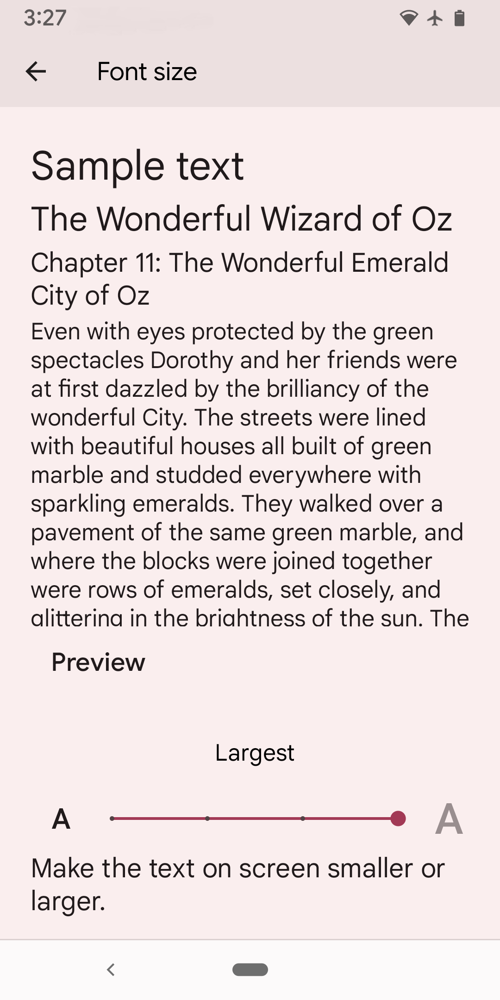

Users can set a font size on their Android device, which is then reflected when your website is displayed within your Android app (as well as in a standard browser, such as mobile Chrome). CSS rules that use relative units like `em`, `rem`, or `%` will be scaled according to the device setting. However, if you use absolute units such as `px` for font sizes, they generally won't scale based on the device's font size settings in Android.

The Font Scaling setting applies a specific scale to your app, independent of the device’s system settings. To force a default or unscaled version, set the Font Scaling setting to 100%.

<Frame caption="Android font size device setting showing a &#x22;Largest&#x22; setting">
  
</Frame>
