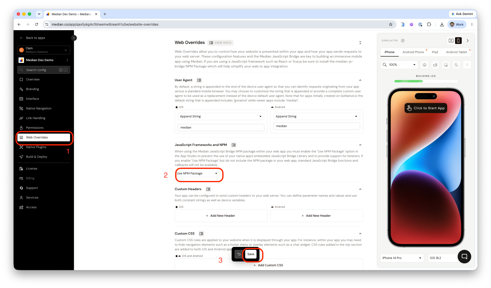
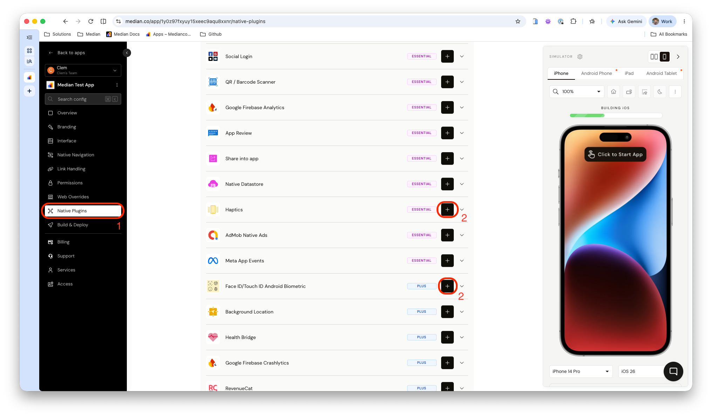
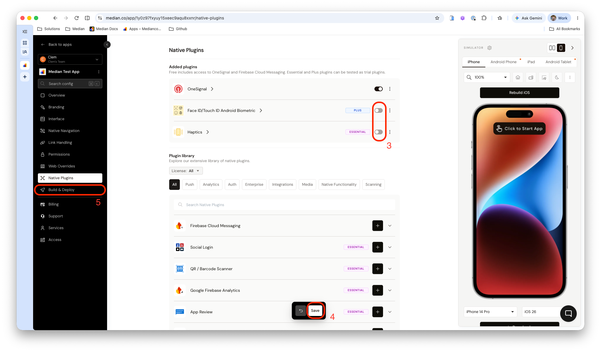
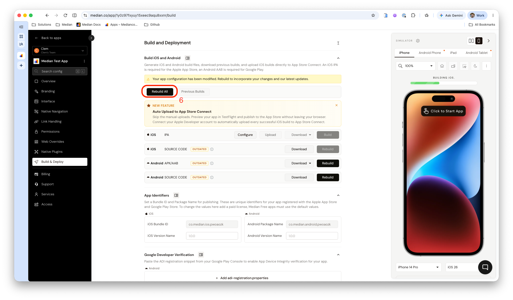

import { InstantPreviewCTAInline } from "/snippets/instant-preview-cta-inline.jsx";

Follow this guide to build a mobile password vault app with Replit and Median. You unlock the vault with a 4-digit code or with Face ID / Touch ID, and you get haptic feedback when you unlock the vault or copy a password.

The guide includes a Replit prompt you can paste as is or adapt to your own app.

<Info>
  **Replit credits**

  Building apps in Replit uses credits. Replit's **Free** plan includes daily agent credits that reset every day. See [Replit's credits and usage <Icon icon="arrow-up-right-from-square" size={12} />](https://docs.replit.com/billing/managing-spend#view-usage) for details.
</Info>

<Check>
  **Developer Demo**

  Try the Vault app [in the simulator <Icon icon="arrow-up-right-from-square" size={12} />](https://median.co/share/wexwyql) or [clone it into your App Studio organization <Icon icon="arrow-up-right-from-square" size={12} />](https://median.co/clone/wexwyql).

  The demo app is a proof of concept. It stores passwords unencrypted on the device (UserDefaults on iOS, SharedPreferences on Android), so don't use it for real passwords.
</Check>

## Build the Vault app in Replit

### Prompt Replit

1. Go to [Replit <Icon icon="arrow-up-right-from-square" size={12} />](https://replit.com) and create an account.
2. Follow the prompts to finish the account setup.
3. Prompt Replit Agent to build the app. You can use or modify this prompt:

<Prompt description="Build a mobile-first password vault app named Vault.">
Build a mobile-first password vault app named "Vault" with React, Vite, Tailwind CSS, and shadcn/ui.

This web app will later be converted to a mobile app using Median.co to enable Face ID / Touch ID, Copy to Clipboard, Haptic Feedback. The vault will be unlocked using a 4 digit code or Face ID / Touch ID. Do not add Sign up / Sign in, email, social login, or recovery email.

## On the user's first session
1. Two onboarding pages (no kickers):
   - Title: Your Vault. Body: Securely access your passwords.
   - Title: Simple and secure access. Body: Unlock the vault with your 4-digit code or using Face ID / Touch ID.
2. Enter your code: 4-digit number pad; confirm title "One more time". No Continue button — advance when user enters 4th digit. Code must exist before biometric enrollment.
3. Biometrics page — Enable and Not now only (no Open my vault):
   - Title: Unlock with [Face ID|Touch ID|Biometrics] from `biometryType`. Body: You can set this up later in the vault settings.
   - Enable: auth.status + auth.save(\{ secret: code \}) then enter the empty vault (no Face ID sheet on save).
   - Not now: enter the empty vault with code-only unlock.
4. Land on an empty vault list. User can enable biometrics later in Settings. Do not ask again.

## Return visits
- Lock screen: If biometrics are enabled, primary button Unlock with [Face ID|Touch ID|Biometrics]; secondary Unlock with code. Do NOT auto-prompt on load.
- Code pad appears after Unlock with code (or biometric failure). Submit on the 4th digit.
- Forgot code → Settings → Reset demo.

## Vault list
- Header: Lock + Settings (gear). No marketing hero.
- Empty state: "Add your first password" CTA only.
- Each row: site, username, masked password, Reveal, Copy.
- Reveal toggles the mask with NO re-auth. Copy uses Median clipboard + haptic + toast, NO re-auth.

## Add / Edit
- Full-page single-column form (no nested card): Domain, username, password, notes (optional, max 200). Confirm before delete.

## Settings
- Enable / disable biometrics (label from `biometryType`)
- Change code (verify current code, then set a new 4-digit code)
- Theme: System / Light / Dark
- Reset demo: confirm, wipe vault data + biometric secret, go to onboarding page 1

## Browser (not inside Median)
- Top banner: open in the Median app for Face ID, clipboard, and on-device vault.
- Disable native actions. Show three read-only samples: GitHub / demo@median.co, Wi-Fi / home-network, Bank / ****1234.
- User can still add passwords and copy passwords to clipboard
- Do not fake successful Face ID.

## Median JavaScript Bridge (required)
- Install median-js-bridge and import: import Median from 'median-js-bridge'.
- See official median docs for usage https://docs.median.co/docs/npm-package
- Detect native with Median.isNativeApp() ONLY. Never use the user agent. Poll isNativeApp() (or Median.onReady) up to ~3 seconds before the first native call.
- Fire-and-forget (return undefined): clipboard.set, haptics.trigger. A resolved await is not success.
- Callback-backed (return a promise that never rejects): auth.status, auth.save, auth.get, auth.delete. Timeout them (~5s; ~60s for auth.get).
- Auth status: available if `result.hasTouchId === true`. Use `result.biometryType` for labels (`faceId` / `touchId` / else Biometrics).
- Auth save: await Median.auth.save(\{ secret: String \}) — no biometric UI.
- Auth get (button tap only): await Median.auth.get(\{ prompt: 'Unlock Vault', callbackOnCancel: 1 \}). Success if result.success && result.secret.
- Auth delete on disable Face ID or Reset demo.
- Clipboard: Median.clipboard.set(\{ data: passwordString \}).
- Haptics: `Median.haptics.trigger({ style: 'notificationSuccess' })` on unlock and copy only.
- If the Median shell is present but isNativeApp() never becomes true, show: "Median JavaScript Bridge not detected — enable JavaScript Bridge / NPM in App Studio, then rebuild."
</Prompt>

4. Replit Agent builds the app and shows a preview in the browser.

<Warning>
  **Testing native features**

  You can test Face ID / Touch ID and copying to the clipboard on a physical device or in Median's browser-based simulators. Haptic feedback only works on a physical device.
</Warning>

### Review the Replit app

1. Go through the onboarding pages, create a 4-digit code, and choose **Not now** on the biometrics page.
2. On the **Vault** page, add a password.
3. Review the rest of the app, and prompt Replit Agent to make any changes you need.
4. Click **Publish** in the top-right corner to open the publishing panel, and publish your app.
5. Copy the public URL. It ends in `.replit.app`.
6. Open the URL in a private or incognito window to check that it's reachable. If it isn't, describe the page you see to Replit Agent so it can troubleshoot.

## Create your app in Median App Studio

1. Enter your Replit public URL below and click **Build Now**.

<InstantPreviewCTAInline articleType="replit" />

2. Follow the prompts to create the app.
3. Click the simulator to open your app.

To configure and customize your app further, see the [Quickstart](/docs/quickstart).

## Configure the Median JavaScript Bridge and enable app plugins

The Median JavaScript Bridge connects your website (the Replit app) to your mobile app. In this guide, the Replit app uses it to trigger Face ID / Touch ID, the clipboard, and haptic feedback.

### Update the JavaScript frameworks and NPM setting

1. In App Studio, go to **Web Overrides**.
2. Under **JavaScript Frameworks and NPM**, select **Use NPM Package**.
3. Save your changes.

See [NPM package](/docs/npm-package) for details.

<Frame caption="App Studio – JavaScript Frameworks and NPM">
  
</Frame>

### Enable app plugins

1. Go to **Native Plugins**.
2. Add and enable these plugins:
   - **Face ID / Touch ID / Android Biometrics**
   - **Clipboard**
   - **Haptic Feedback**
3. Go to **Build & Deploy**.
4. Click **Rebuild all** so the app build includes the new plugins and the NPM setting.

<Frame caption="App Studio – add native plugins">
  
</Frame>

<Frame caption="App Studio – enable plugins and save changes">
  
</Frame>

<Frame caption="App Studio – Rebuild all">
  
</Frame>

## Build and test on a device

Install the app on a physical device to test the native features. For iOS, you can [upload your build to your Apple Developer account automatically](/docs/connecting-median-appstore-connect) and register a test device in App Studio.

- **iOS:** [Install an iOS IPA](/docs/install-ios-ipa)
- **Android:** [Install an Android APK](/docs/install-android-apk)

**What success looks like**

- You can enable biometric authentication.
- You can create a 4-digit code and reach the vault.
- You can hide and reveal passwords.
- You can copy passwords to your clipboard and feel haptic feedback.

## Development checklist

**App creation**

- [ ] You've created the web app in Replit.
- [ ] You've created a Median app with your Replit public URL.

**App configuration**

- [ ] In App Studio, **Web Overrides → JavaScript Frameworks and NPM** is set to **Use NPM Package**.
- [ ] The Replit app imports `median-js-bridge`.
- [ ] **Face ID / Touch ID / Android Biometrics**, **Clipboard**, and **Haptic Feedback** are enabled.
- [ ] You rebuilt the Median app after enabling the plugins, and you're testing the latest build.

**Mobile app testing**

- [ ] You can install the mobile app on a physical device.
- [ ] You can enable biometric authentication during onboarding.
- [ ] You can lock the vault and unlock it with Face ID / Touch ID or the code pad.
- [ ] The app gives haptic feedback after you copy a password.
- [ ] You can add, edit, and delete a password.

When you're ready to publish, see [App Store publishing](/docs/app-publishing).

## Troubleshooting

### Face ID / Touch ID is unavailable or never prompts

In App Studio, check that the **Face ID / Touch ID / Android Biometrics** plugin is enabled and that you're testing the latest build. In Replit, ask Replit Agent to confirm it's using the right JavaScript Bridge methods. See [Face ID / Touch ID](/docs/auth).

### The JavaScript Bridge isn't detected

Confirm that Replit Agent installed `median-js-bridge`. In App Studio, set **Web Overrides → JavaScript Frameworks and NPM** to **Use NPM Package**, then rebuild the app. See [NPM package](/docs/npm-package).

### An Expo test screen appears when the app launches

This is a Replit publishing issue. Check that the URL in Median is the public URL of your Replit web app, not a Replit Expo app. Ask Replit Agent to confirm that your project is a web app, not a native app.

### Tapping Not now still asks for Face ID / Touch ID

Tapping **Not now** should skip biometric enrollment and open the vault with the code. The user can turn on biometrics later in **Settings**. There shouldn't be a second prompt after onboarding.

### Haptic feedback doesn't trigger

Check that the **Haptic Feedback** plugin is enabled and that you're testing the latest build. The app should call `Median.haptics.trigger({ style: 'notificationSuccess' })` only after the user unlocks the vault or copies a password, and only when `Median.isNativeApp()` is true. Haptics don't work in a desktop browser or the App Studio simulator, only on a physical device. See [Haptics](/docs/haptics).

### Copy doesn't write to the clipboard

The Replit app should call `Median.clipboard.set({ data: passwordString })` when `Median.isNativeApp()` is true. See [Clipboard](/docs/clipboard).

### What's the difference between median. and Median.?

These are the two ways to reach the Median JavaScript Bridge from your website.

`median.` commands use the library injected into the app. `Median.` commands use the `median-js-bridge` npm package. This guide uses the npm package.
