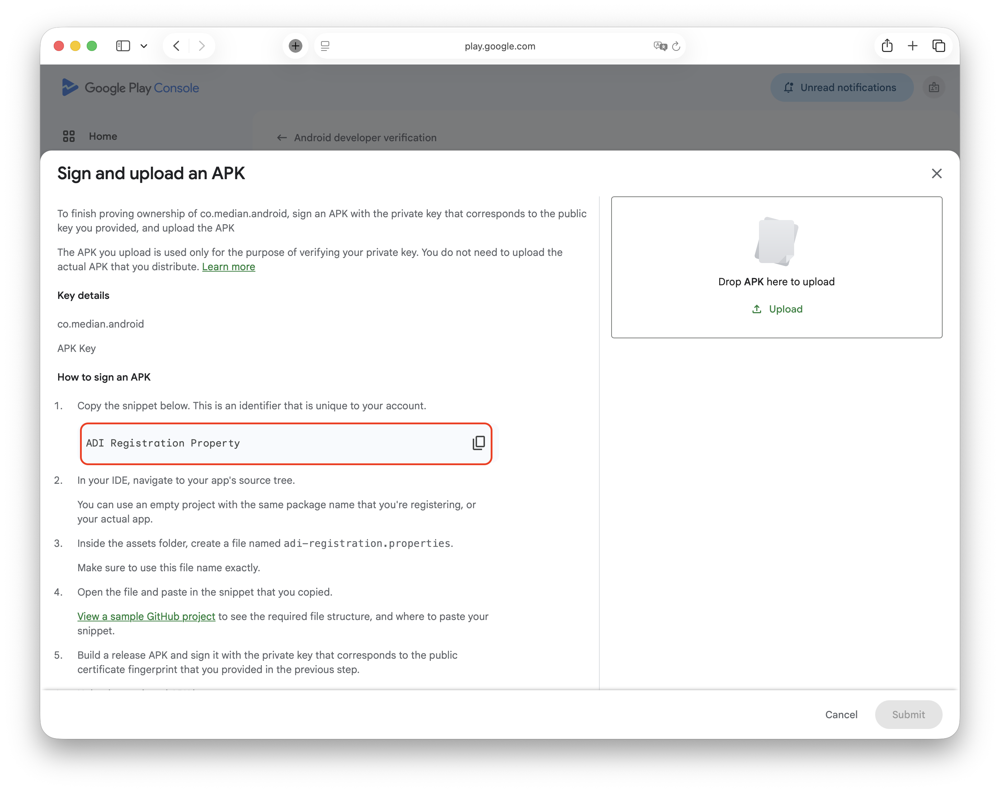
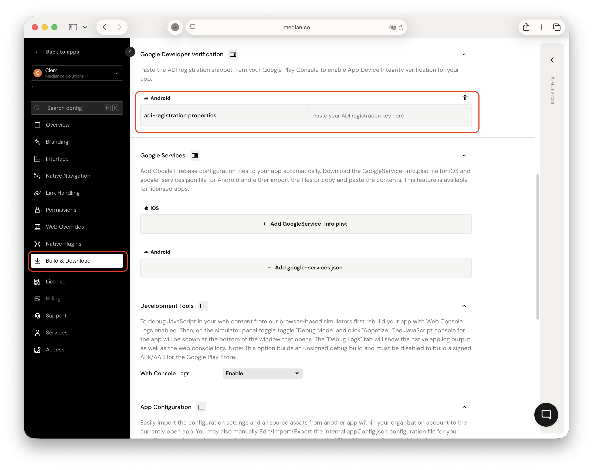

This guide explains how to upload the `adi-registration.properties` value required for App Device Integrity (ADI) verification and including it in future app builds.

## Understanding app device integrity (ADI)

App Device Integrity is a security framework powered by the Google Play Integrity API. Its primary purpose is to ensure that your app is running in a secure, untampered environment.

- **What it does**: It verifies whether the app interaction originates from a legitimate app binary (anti-tampering) running on an authentic Android device. This prevents malicious actors from using modified versions of your app or running it on compromised/emulated devices.
- **The .properties file**: The `adi-registration.properties` file acts as a configuration handshake between your app and the Google Play Integrity services. It contains a value that allows the API to recognize your specific application during the attestation process.

## Uploading the ADI property value

**In Google Play Console**

Follow the steps in [Google's guide to registering your package name](https://support.google.com/googleplay/android-developer/answer/16761053?hl=en) to register your Android package name.

- The ADI property value is available on **step 3**, on the **Sign and upload an APK** page.

<Frame caption="Google Play Console: Sign and upload an APK">
  
</Frame>

**In Median App Studio**

1. Navigate to the **Build and Download** section > **Google Developer Verification**.
2. Paste the **ADI property value**.

<Frame caption="App Studio Google Developer Verification">
  
</Frame>

## Additional resources

For more in-depth technical details, refer to the official Google Developer documentation:

- [Google Play Integrity API overview](https://developer.android.com/google/play/integrity)
- [Setup and integration guide](https://developer.android.com/google/play/integrity/setup)
- [Understanding integrity verdicts](https://developer.android.com/google/play/integrity/verdicts)
