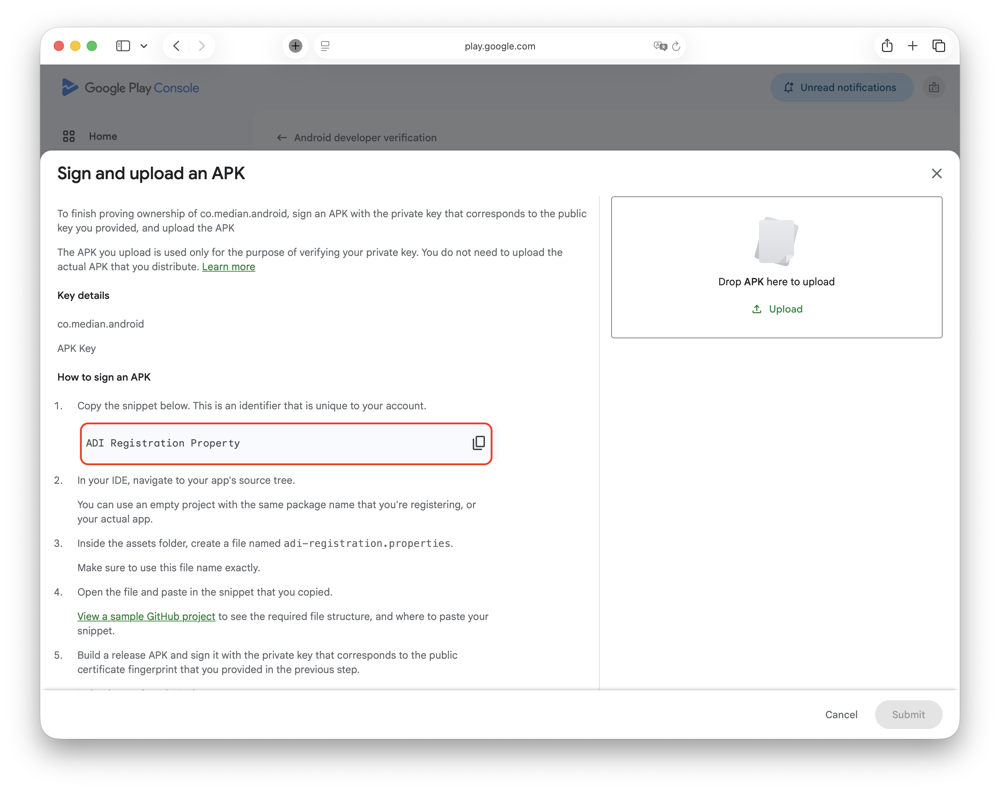
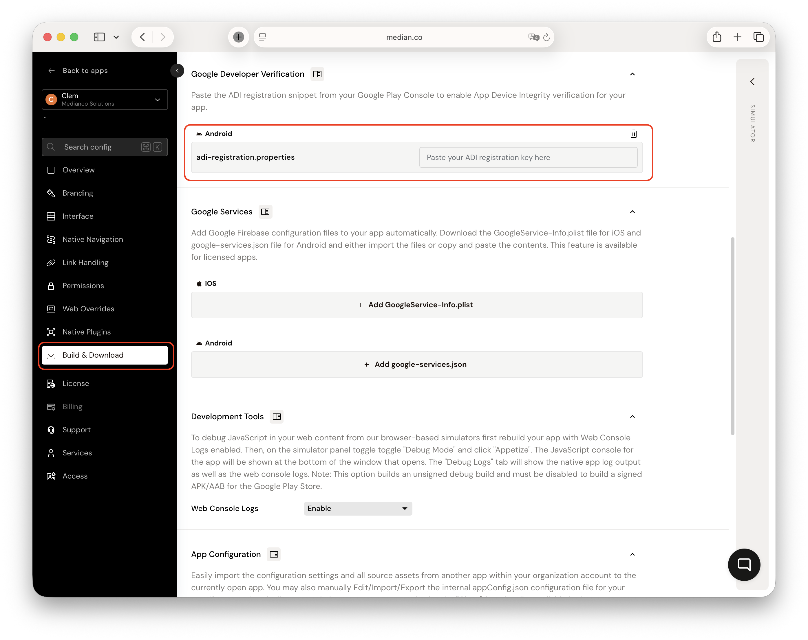

## What is Android developer verification?

Android developer verification links every Android app to a verified individual or organization. Google enforces it on certified Android devices (devices that ship with Google Play Protect), **regardless of where the app was downloaded**. That includes Google Play, other app stores, MDM distribution and direct APK downloads.

Verification confirms who the developer is. It is not a review of your app's content.

### Timeline

| Date               | Milestone                                                                                                                       |
| ------------------ | ------------------------------------------------------------------------------------------------------------------------------- |
| March 2026         | Verification opened to all developers in Play Console and the Android Developer Console                                         |
| August 2026        | Limited distribution accounts (students and hobbyists) and the "advanced flow" for installing unverified apps launched globally |
| September 30, 2026 | Enforcement began in Brazil, Indonesia, Singapore and Thailand                                                                  |
| 2027 and beyond    | Global enforcement                                                                                                              |

## What you need to do

There are two parts: verify your identity, then register your app's package name and signing key to that identity.

<Steps>
  <Step title="Verify your developer identity">
    - **Apps on Google Play:** complete verification in Play Console. 
    - **Apps distributed only outside Google Play:** create an account in the [Android Developer Console](https://developer.android.com/developer-verification/guides) and verify there.
  </Step>
  <Step title="Check whether your package name is already registered">
    Google attempted to register Play apps automatically in March 2026. In Play
    Console, open the **Android developer verification** page and check the
    **Package names** tab. If your app's status is **Registered**, you're done.
  </Step>
  <Step title="Register your package name if it isn't">
    How you register depends on whether the package name has been used before: 
    | Your situation | What Google asks for | Median build needed? | 
    | --- | --- | --- | 
    | New package name (never installed on Android) | The public certificate of your signing key | No | 
    | Existing package name (has installs) | Proof that you own the private signing key: a signed APK that contains an `adi-registration.properties` file | **Yes**, see below | 
    | Existing package name, and the same key is already verified for another app in your account | Nothing more, the upload step is skipped | No |
  </Step>
</Steps>

## Prove key ownership with a Median build
 
Use this when Google asks you to upload an APK to prove you own the signing key for an existing package name.
 
### In Google Play Console
 
1. Go to **Android developer verification** > **Package names** and select **Register package name**.
2. Enter your app's package name and select **Next**.
3. Select the signing key you are registering, then select **Upload APK**.
4. Copy the **ADI property value** (the snippet) shown on the **Sign and upload an APK** page.
See [Google's guide to registering your package name](https://support.google.com/googleplay/android-developer/answer/16761053) for full details.
 
<Frame caption="Google Play Console: Sign and upload an APK">
  
</Frame>

### In Median App Studio
 
1. Go to **Build & Deploy** > **Google Developer Verification**.
2. Paste the **ADI property value**. Median adds it to your app as `assets/adi-registration.properties`.
3. Rebuild your app and download the signed binary. 

<Frame caption="App Studio Google Developer Verification">
  
</Frame>

### Upload the APK
 
Return to Play Console, select **Upload**, and upload the signed APK. Google checks the signature and registers your ownership. You'll receive an email when registration completes, and you can follow the status on the **Packages** page.
 
<Warning>
The APK must be signed with the **private key that matches the key you are registering**. A build signed with a different key fails verification.
</Warning>
 
## Agencies and white-label apps
 
The verified developer should be the organization that publishes and is accountable for the app, which is usually the end client rather than the agency that built it.
 
Agencies managing many apps can automate package name and key registration with the [Android Developer Console API](https://developer.android.com/developer-verification/guides/developer-console-api).
 
## What users see for unverified apps

On affected devices, users can still install apps that aren't registered to a verified developer. To do so, they need ADB or an "advanced flow," which includes restarting the device and waiting 24 hours. For a business app this friction is usually unacceptable, so register before enforcement reaches your users' countries.

## FAQ

<AccordionGroup>
  <Accordion title="Is this related to the Play Integrity API?">
    No. The `adi-registration.properties` file is only used by Android developer
    verification to prove you own your signing key. It does not enable or
    configure the Play Integrity API.
  </Accordion>
  <Accordion title="My app is only on Google Play. Am I affected?">
    Yes. Play developers verify through Play Console. Google attempted to
    register existing Play apps automatically, so check your package name status
    first.
  </Accordion>
  <Accordion title="Do I need a new Median build?">
    Only if Google asks you to prove ownership of the signing key for an
    existing package name. Otherwise, verification is tied to your developer
    account, package name and key, not your Median version.
  </Accordion>
</AccordionGroup>

## Official resources

- [Android developer verification guides](https://developer.android.com/developer-verification/guides)
- [Play Console Help: Register your package name](https://support.google.com/googleplay/android-developer/answer/16761053)
- [Android Developer Console API](https://developer.android.com/developer-verification/guides/developer-console-api)
