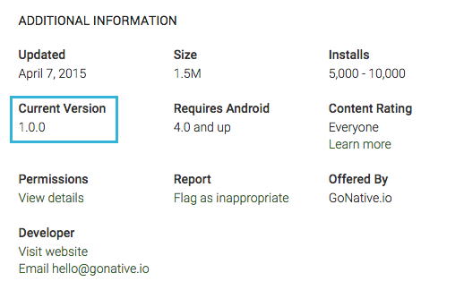

Developers can download the complete source code for their app and publish it using standard methods. Median also provides configuration, consulting, and publishing services. For assistance, please [contact us](https://median.co/contact?topic=publishing).

## Google Play Developer account

You must have a valid Google Play Developer Account in order to publish your app to Google Play.

Learn more at [https://play.google.com/apps/publish/signup](https://play.google.com/apps/publish/signup).

## Android package name

Unlike the iOS Bundle Id, your app's Android Package Name is visible to users in your app's Google Play Store URL. It is not possible to change your app's Package Name once your app is published.

Google recommends the Package Name follow reverse domain name service notation. For example, if your website is `example.com`, your Package Name might be `com.example.app`.

Note that dashes or spaces are not allowed. Also, it's not permitted to start any section of the package name with a number.

## Android version name

Your app's Android Version Name will be visible to users when they view your app on Google Play. We recommend the first version number for your app to be 1.0.0 or 1.0, and you may then increment thereafter.

<Frame caption="Google Play Android">
  
</Frame>

More info about software versioning available on [Semantic Versioning](https://semver.org/).

## Screenshot sizes for Google Play

Google has no specific screenshot sizes. The only requirements are:

- JPEG or PNG without transparency
- Minimum size of 320 px
- Maximum size of 3840 px
- Maximum size should be no more of two times the minimum size

<Check>
  **Play Store Screenshot Templates**

Median provides a collection of over 500 free screenshot templates designed for both Android and iOS applications. These templates offer a variety of design options to align with different branding requirements.

To browse and download the templates, visit the following link:

[App store screenshot templates](https://www.figma.com/community/file/1471925742378558731/500-app-store-screenshot-templates-for-android-and-ios-apps)

</Check>

### Recommended screenshot sizes for smartphones

| Device                 | Screenshot size |
| ---------------------- | --------------- |
| **Pixel XL, Nexus 6P** | 1440 x 2560 px  |
| **Pixel, Nexus 5X**    | 1080 x 1920 px  |

### Recommended screenshot sizes for tablets

| Device             | Screenshot size                            |
| ------------------ | ------------------------------------------ |
| **7-inch/10-inch** | 1920 x 1200 px2048 x 1536 px2560 x 1600 px |

### Recommended sizes for Google Play listing images

| Image               | Image size                          |
| ------------------- | ----------------------------------- |
| **Hi-res icon**     | 512 x 512 px (without transparency) |
| **Feature graphic** | 1024 x 500 px                       |

## Submitting your build

You may take the Android APK file generated by Median and available on your Median app's manage page, and upload it directly to Google as part of your app store submission. You may also download the complete Android source code and generate the APK yourself.

Similar to Apple, you will have to fill out an assortment of data regarding your app store listing, including app name, description, screenshots, several image assets, a content rating, and more.

Once submitted, your Android app should be live in the Google Play app store within a few hours.
