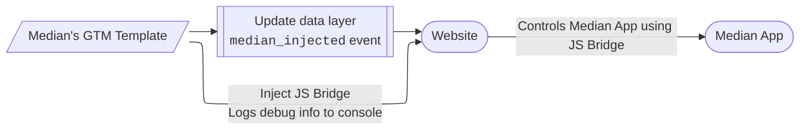

[Google Tag Manager](https://support.google.com/tagmanager/answer/6102821?hl=en) (GTM) is a free platform by Google used to deploy and update code(tags) on your website instead of updating the website's code. Use Median's GTM Template, to connect your website to the Javascript Bridge and trigger Bridge commands using GTM tags. The template injects the Median JavaScript Bridge (`median.min.js`) into the website using a sandboxed environment. It provides robust error handling, debugging logs, and [`dataLayer`](https://developers.google.com/tag-platform/tag-manager/datalayer) pushes to track the status of the bridge injection.



The template pushes this object to the data layer:

<CodeGroup>
```JSON JSON
{
  event: "median_injected",
  median_injected: "yes",
  device_info: "[Value from userAgentValue field]"
}
```
</CodeGroup>

## Required Permissions

For security reasons, this template is sandboxed and utilizes the following permissions:

- **Injects Scripts:** Allows the injection of scripts specifically from [https://unpkg.com/](https://unpkg.com/) where the javascript bridge is hosted
- **Accesses Global Variables:** Allows pushing data into the `dataLayer` array.
- **Logs to Console:** Allows the template to print debugging and status messages to the browser console.

## Configuration Fields (optional)

- **Bridge Version (bridgeVersion)**
  - Enter the [version number](https://www.npmjs.com/package/median-js-bridge?activeTab=versions) of the JavaScript bridge that will be injected.
  - If left blank, defaults to the latest version

- **User Agent Variable (userAgentValue)**
  - Enter the name of your [user-defined variable](https://support.google.com/tagmanager/answer/7683362?hl=en) that stores the [device user agent](https://docs.median.co/docs/custom-user-agent) string
  - This value is included in console logs and passed into the `dataLayer` payload to provide the following device information: Browser, Operating, and Device type

## How It Works

1. **Debugging Initialization:** The template reads the `userAgentValue` field and logs the user agent to the GTM preview console to confirm the Median app was detected.
2. **Dynamic URL Construction:** The template pulls the version number from the `bridgeVersion` field and constructs the CDN URL: `https://unpkg.com/median-js-bridge@[version]/dist/median.min.js`
3. **Script Injection:** Using GTM's sandboxed `injectScript` API, it attempts to load the constructed URL into the document.
4. **State Handling:** Depending on the outcome of the script injection, a specific event is pushed to the `dataLayer` and the tag successfully resolves or fails.

## DataLayer Events

The template automatically pushes an event named `median_injected` to the `dataLayer` upon completion. You can use this event to trigger subsequent tags.

### On Success

If the script successfully loads from the CDN, the following payload is pushed:

<CodeGroup>
  ```JavaScript JavaScript
  {
    event: 'median_injected',
    median_injected: 'yes',
    device_info: '[Value from userAgentValue field]'
  }
  ```
</CodeGroup>

### On Failure

If the script fails to load, the tag signals a failure to GTM and pushes the following payload:

<CodeGroup>
  ```JavaScript JavaScript
  {
    event: 'median_injected',
    median_injected: 'no',
    device_info: '[Value from userAgentValue field]'
  }
  ```
</CodeGroup>
