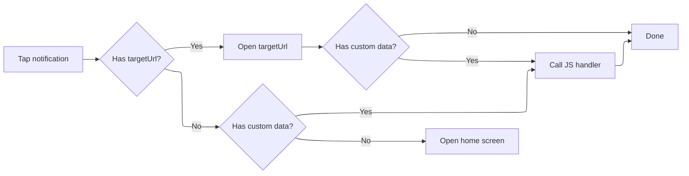
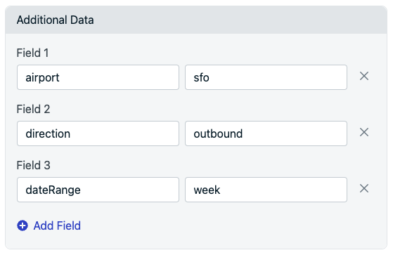

import { MedianLogo } from "/snippets/median-logo.jsx";

When a user taps a notification you can route them to a specific page, pass custom data to trigger JavaScript logic, or combine both. This guide covers the two main patterns and the key distinction that trips most developers up.

## How it works

Notifications can include additional data. If you've included a `targetUrl` in the notification data, the app navigates to that URL. If you've included custom key-value pairs, it calls your JavaScript handler function with that data.

You configure both of these in the **Additional Data** section of any notification, whether you're sending from the OneSignal dashboard or the REST API.

### Diagram: Notification tap decision flow



## Handling notification taps (deep linking)

To deep-link a user to a specific page when they tap a notification, add `targetUrl` to the **Additional Data** section of your notification:

<CodeGroup>
```JSON JSON
{
  Key: targetUrl,
  Value: https://yourapp.com/inbox/thread/482
}
```
</CodeGroup>

<Frame caption="Add Additional Data to send to your app">
  
</Frame>

Note: `targetUrl` is a reserved key. As soon as Median sees it in the payload, it navigates the app to that URL automatically.

### targetUrl vs. Launch URL

OneSignal has two different URL fields, and they behave very differently:

| Field       | Where to set it                  | Behavior                                                                                                               |
| ----------- | -------------------------------- | ---------------------------------------------------------------------------------------------------------------------- |
| `targetUrl` | Additional Data section          | Opens the URL **inside your app** with full Median JavaScript Bridge support; the correct choice for in-app navigation |
| Launch URL  | Launch URL field in the composer | Opens the URL in a **popup browser window** inside the app; limited functionality, no JavaScript Bridge access         |

**Always use** `targetUrl` **in Additional Data for deep-linking.** The Launch URL field is designed for opening external web pages in a browser-like pop-up; it doesn't support in-app navigation features, JavaScript Bridge calls, or native plugin interactions.

## Sending custom data to JavaScript

Separately from navigation, you can attach any custom key-value pairs to Additional Data and read them in JavaScript once the notification is tapped and the app opens. This is the mechanism to use when the tap needs to trigger app logic rather than (or in addition to) a page change — for example, updating app state, firing an analytics event, or pre-filling a search based on the notification content.

Define a handler function on your page. Median calls it automatically when a notification is opened:

<MedianLogo />
<CodeGroup>
```JavaScript JavaScript
  // Define this function on your page — Median calls it automatically when the app >opens from a tap
  function median_onesignal_push_opened(data) {
    console.log(JSON.stringify(data));
  }

  // Example payload passed to the handler
  {
    "airport": "sfo",
    "direction": "outbound",
    "dateRange": "week"
  }
```
</CodeGroup>

## Combining navigation and data

A single notification tap can both navigate and trigger your handler. Include targetUrl alongside your custom keys in Additional Data:

<CodeGroup>
```
  targetUrl: https://yourapp.com/inbox/thread/482
  airport: sfo
  direction: outbound
```
</CodeGroup>

Median navigates to `targetUrl` first, then calls `median_onesignal_push_opened` with the full data payload so your page can react after the navigation completes.

## Frequently Asked Questions

### Do I need to write code to make targetUrl work?

No - `targetUrl` is handled natively by Median and the app navigates automatically.

### Can I use targetUrl and custom data in the same notification?

Median navigates to `targetUrl` and then calls `median_onesignal_push_opened` with the complete payload.

### Why isn't my Launch URL opening inside my app the way I expect?

`Launch URL` opens in a separate popup browser window without JavaScript Bridge or native plugin access. For in-app navigation, use `targetUrl` in Additional Data instead.

### What happens if I use

`targetUrl`is a reserved key in Additional Data; including it automatically triggers in-app URL navigation when the notification is tapped. If you want to conditionally navigate to a URL based on your own JavaScript logic instead, use a different key name (e.g.,`openUrl`, `deepLink`) and handle the navigation yourself inside `median_onesignal_push_opened`.
