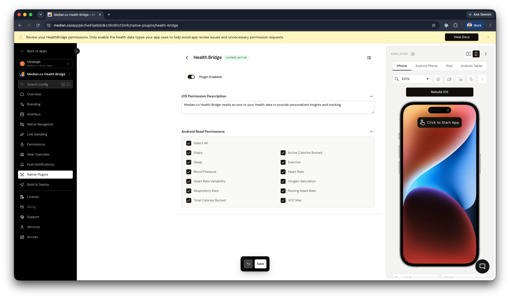
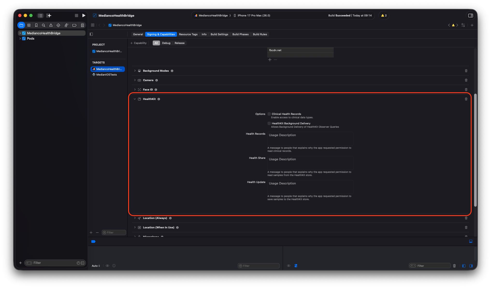
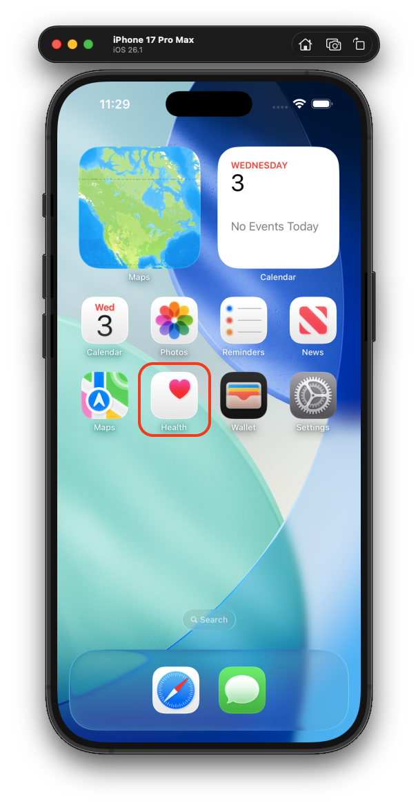
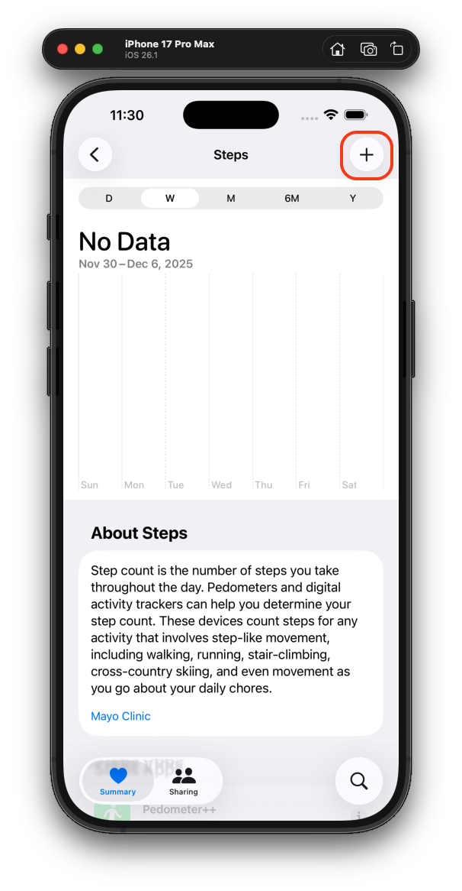
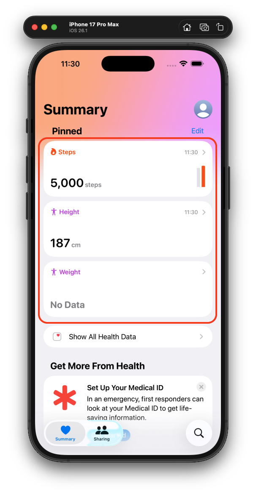
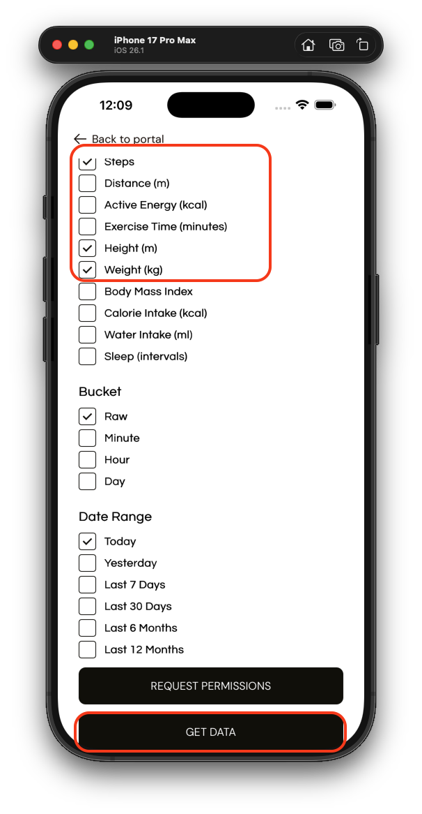
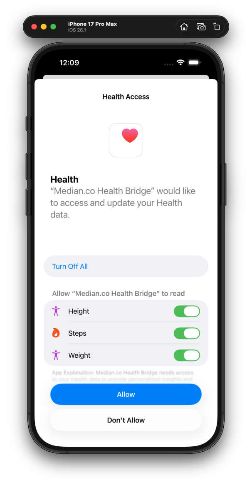
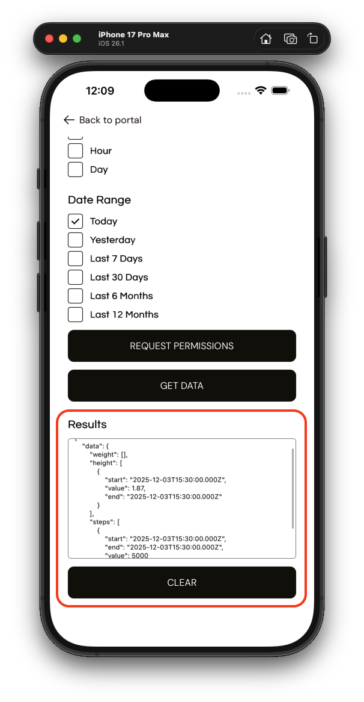

import { MedianLogo } from "/snippets/median-logo.jsx";

Health Bridge provides a unified interface to access and sync health data from users' devices using **Apple HealthKit** (iOS) and **Google Health Connect** (Android). The plugin enables you to fetch health metrics such as steps, heart rate, calories, and sleep data - allowing you to build powerful wellness and fitness features in your app.

<Check>
**Developer Demo**

Display our demo page in your app to test during development [https://median.dev/health-bridge/](https://median.dev/health-bridge/)

</Check>

## Why use Health Bridge?

Health Bridge takes care of handling platform-specific details like permissions, data sources, and user consent, so you can focus on delivering value to your users. The plugin abstracts away the complexity of working with different health platforms while maintaining full access to rich health data.

- **Unified Interface**: Single API that works seamlessly across iOS (Apple HealthKit) and Android (Google Health Connect)
- **Platform Handling**: Automatically manages platform-specific permissions, data sources, and user consent flows
- **Wellness Features**: Access comprehensive health metrics including steps, heart rate, calories, sleep, and more
- **Data Accessibility**: Retrieve historical health data with flexible date ranges and grouping options

## Before you start

**Prerequisites**

- [ ] A Median.co app with JavaScript Bridge enabled
- [ ] The plugin activated in your app

## Key concepts

The following concepts will help you implement Health Bridge:

**Quick Reference**: Health Bridge supports 6 main categories of health data to help you build comprehensive wellness features:

- **Activity** - Track physical movement and exercise metrics (steps, distance, calories, exercise time)
- **Body Measurements** - Monitor physical characteristics and body composition (height, weight, BMI, body fat, temperature)
- **Cycle Tracking** - Access menstrual cycle data for reproductive health monitoring
- **Nutrition** - Track dietary intake and hydration (calorie intake, water intake, nutrition data)
- **Sleep** - Monitor sleep patterns and duration for recovery and wellness insights
- **Vitals** - Access critical health indicators (heart rate, blood pressure, oxygen saturation, glucose)

**Supported Data Types**: Health Bridge supports a comprehensive set of health metrics organized by category, all returned in **metric units only**. Click the icons below to view the complete metric details:

<AccordionGroup>
  <Accordion title="Activity features" icon="person-running">
    | Data Type | Description | Unit | | --------------------- |
    ---------------------- | ----------------------- | | `steps` | Number of
    steps taken | count | | `distance` | Distance walked or run | meters (m) | |
    `activeEnergy` | Active calories burned | kilocalories (kcal) | |
    `totalCaloriesBurned` | Total Calories Burned | kilocalories (kcal) | |
    `exerciseTime` | Time spent exercising | minutes (min) | | `elevationGain` |
    Elevation Gain | meters (m) | | `speed` | Speed | meters per second (m/s) |
  </Accordion>
  <Accordion title="Body measurements" icon="weight-scale">
    | Data Type | Description | Unit | | ----------------- | ---------------- |
    ------------------ | | `height` | User's height | meters (m) | | `weight` |
    User's weight | kilograms (kg) | | `bmi` | Body Mass Index | unitless | |
    `bodyFat` | Body Fat | percent (%) | | `bodyTemperature` | Body Temperature
    | degree celsius (C) |
  </Accordion>
  <Accordion title="Cycle tracking" icon="calendar-days">
    | Data Type | Description | Unit | | -------------- | ------------ | ---- |
    | `menstruation` | Menstruation | |
  </Accordion>
  <Accordion title="Nutrition" icon="apple-whole">
    | Data Type | Description | Unit | | --------------- |
    ---------------------- | ------------------- | | `calorieIntake` | Dietary
    calorie intake | kilocalories (kcal) | | `waterIntake` | Water consumed |
    milliliters (ml) | | `nutrition` | Nutrition | |
  </Accordion>
  <Accordion title="Sleep" icon="moon">
    | Data Type | Description | Unit | | --------- | -------------- |
    ------------- | | `sleep` | Sleep duration | minutes (min) |
  </Accordion>
  <Accordion title="Vitals" icon="heart-pulse">
    | Data Type | Description | Unit | | ---------------------- |
    ---------------------- | ----------------------------------------------- | |
    `heartRate` | Heart Rate | beats per minute (bpm) | | `restingHeartRate` |
    Resting Heart Rate | beats per minute (bpm) | | `heartRateVariability` |
    Heart Rate Variability | milliseconds (ms) | | `bloodPressure` | Blood
    Pressure | millimetres of mercury (mmHg) | | `bloodGlucose` | Blood Glucose
    | millimoles per litre (mmol/L) | | `oxygenSaturation` | Oxygen Saturation |
    percent (%) | | `bodyTemperature` | Body Temperature | degree celsius (C) |
    | `respiratoryRate` | Respiratory Rate | breaths per minute | | `vo2Max` |
    VO2 Max | milliliters per minute per kilogram (ml/kg/min) |
  </Accordion>
</AccordionGroup>

**Platform Permissions Model**: Permissions work differently on each platform:

- **Android**: Returns a list of granted and declined data types when requesting permissions
- **iOS**: Does not return any information about permission status. The OS will prompt the user when data is first requested, and you won't get confirmation about which permissions were granted

**Important Considerations**

- All health data values are returned in metric units only
- Our team can add support for additional data types if required
- Some data types (like sleep) may only be available for recent timeframes
- Date range limitations vary by platform and data type

## Integration guide

Follow the steps below to navigate the App Configuration and JavaScript Bridge Functions.

### App configuration

#### Enable the plugin

1. **Navigate to Plugins**: In your Median dashboard, go to **Native Plugins** and select **Health Bridge**
2. **Enable Health Bridge**: Toggle **Plugin Enabled** on
3. **Configure the iOS Permission Description**: Explain to users why your app needs access to their Health data (see below)
4. **Select Android Read Permissions**: Enable only the health data types your app uses (see below)
5. **Save and Rebuild**: Click **Save** and rebuild your app for the changes to take effect

<Frame caption="Health Bridge Plugin Configuration">
  
</Frame>

### JavaScript Bridge functions

Follow these steps to start using the Health Bridge plugin in your app:

#### Step 1: Request permissions

Although not required, we recommend calling `requestPermissions()` upfront as it improves user transparency and experience. This prompts users to grant access to the specific health data types your app will use.

<MedianLogo />
<CodeGroup>
  ```JavaScript JavaScript 
  await median.healthBridge.requestPermissions([
  "steps", "sleep", "calorieIntake", ]); 
  ```
</CodeGroup>

This method accepts an array of data types and returns an object indicating which permissions were granted or declined.

<Warning>
  **Platform caveats**

- **Android**: Returns a list of granted and declined data types.
- **iOS**: Does not return any information about permission status. The OS will prompt the user when data is first requested, and you won't get confirmation about which permissions were granted.
</Warning>

You can optionally skip requestPermissions() and directly call getData() (next step) and the OS will handle permissions automatically.

#### Step 2: Fetch health data

After permissions are granted (or requested implicitly), use the `getData()` method to retrieve health data. You can define the following parameters:

- The specific `dataTypes` to fetch (from the supported list)
- A `startDate` and `endDate` in ISO 8601 format
- An optional `bucket` to group data (e.g., by day or hour)

**Parameters:**

| Parameter   | Type            | Required | Description                                                |
| ----------- | --------------- | -------- | ---------------------------------------------------------- |
| `dataTypes` | `Array<string>` | Yes      | The specific data types to fetch (from the supported list) |
| `startDate` | `string`        | Yes      | Start date in ISO 8601 format                              |
| `endDate`   | `string`        | Yes      | End date in ISO 8601 format                                |
| `bucket`    | `string`        | No       | Optional grouping for data (default: 'raw')                |

**Bucket Options:**

| Bucket   | Description                        |
| -------- | ---------------------------------- |
| `raw`    | Raw, ungrouped data points         |
| `minute` | Data grouped per minute            |
| `hour`   | Data grouped per hour              |
| `day`    | Data grouped per day (recommended) |

<MedianLogo />
<CodeGroup>
  ```JavaScript JavaScript
  const result = await median.healthBridge.getData({
    dataTypes: granted, // list of granted permissions from previous step
    startDate: "2025-05-01T00:00:00Z",
    endDate: "2025-05-08T00:00:00Z",
    bucket: "day",
  });

  console.log(result.data.steps);
  // [
  // { timestamp: '2025-05-01T00:00:00Z', value: 8123 },
  // { timestamp: '2025-05-02T00:00:00Z', value: 7890 },
  // ...
  // ]

  ```
</CodeGroup>

Want to show a daily step chart for the past week? Just fetch steps with bucket: 'day' and map the values to your chart component.

**💡Tip:** Make sure your date range doesn't exceed platform limitations - some data types (like sleep) may only be available for recent timeframes.

**Example response**

<CodeGroup>
```JSON JSON
{
  "data": {
    "height": [
      {
        "start": "2025-12-03T15:30:00.000Z",
        "end": "2025-12-03T15:30:00.000Z",
        "value": 1.87
      }
    ],
    "weight": [],
    "steps": [
      {
        "start": "2025-12-03T15:30:00.000Z",
        "end": "2025-12-03T15:30:00.000Z",
        "value": 5000
      },
      {
        "end": "2025-12-02T15:30:00.000Z",
        "start": "2025-12-02T15:30:00.000Z",
        "value": 4500
      }
    ]
  }
}
```
</CodeGroup>

## Integration testing

<Warning>
  **Testing requirements**

Due to callouts to Apple services, the Health Bridge integration cannot be tested in the App Studio virtual simulator. Instead, any integration tests must be run on a physical device or on Xcode or Android Studio simulators.

</Warning>

### Testing on iOS

#### Step 1: Install your app

Based on your test setup, you can install the app on a physical device via TestFlight or [iOS Binary](/docs/build-ios-binary). If you install the app using TestFlight or iOS Binary the app will come fully built including the necessary capabilities.

**Build locally with Xcode**

If you want to build and test the app locally on a MacOS system, follow the steps below to build your iOS app [from source](/docs/build-ios-from-source) and add the Health Kit capability.

You can reference the following to confirm that the capability has been added as expected:

<Frame caption="Xcode App with HealthKit capability">
  
</Frame>

#### Step 2: Add test data

Follow the steps below to add test data to your iOS simulator using the Health app:

|                                                          Step 1                                                          |                                                          Step 2                                                          |                                                          Step 3                                                          |
| :----------------------------------------------------------------------------------------------------------------------: | :----------------------------------------------------------------------------------------------------------------------: | :----------------------------------------------------------------------------------------------------------------------: |
|  |  |  |
|                              Suspend the app and find the 'Health' app on your home screen.                              |                             Select a metric and manually add test data using the '+' button                              |                               Confirm that your test data has been added in the Health app                               |

#### Step 3: Access your data

After adding test data to your account, follow the steps below to access the data through the Health Bridge:

|                                                          Step 1                                                          |                                                          Step 2                                                          |                                                          Step 3                                                          |
| :----------------------------------------------------------------------------------------------------------------------: | :----------------------------------------------------------------------------------------------------------------------: | :----------------------------------------------------------------------------------------------------------------------: |
|  |  |  |
|                              Select the data points, bucket and date range for the request                               |                                                    Confirm the access                                                    |                                       Access the returned data in the JSON object                                        |
