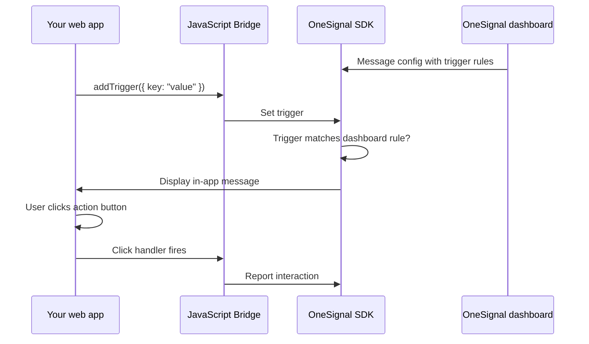

import { MedianLogo } from "/snippets/median-logo.jsx";
import { AppetizeEmbed } from "/snippets/appetize-embed.jsx";

In-app messages (IAM) are rich, customizable UI panels that appear inside your app without requiring push notification permission. They're ideal for onboarding flows, feature announcements, promotions, and the iOS soft prompt pattern covered in [Managing permissions & consent](/docs/user-consent-management).

Unlike push notifications, in-app messages only display while the user is actively using your app. You control when they appear with a trigger system and **design them with OneSignal's HTML Composer**.

<Info>
  **Official documentation**

For comprehensive use cases and configuration details, refer to the [OneSignal In-App Messages documentation](https://documentation.onesignal.com/docs/in-app-messages).

</Info>

## JavaScript Bridge API reference

Median exposes OneSignal's IAM SDK methods through the JavaScript Bridge. Use these to control when messages appear and handle user interactions.

### Trigger management

Triggers are conditions you set in your app that cause an in-app message to display. When you add a trigger that matches the conditions set up in OneSignal's dashboard, the message appears.

<MedianLogo />
<CodeGroup>
  ```javascript JavaScript
  // Add a single trigger
  median.onesignal.iam.addTrigger({ key: "value" });

  // Add multiple triggers at once
  median.onesignal.iam.addTriggers({ key1: "value1", key2: "value2" });

  // Remove a trigger by key
  median.onesignal.iam.removeTriggerForKey("key");

  // Retrieve the current value of a trigger
  median.onesignal.iam.getTriggerValueForKey("key");
  ```
</CodeGroup>

### Pause and resume

Temporarily suppress in-app messages. This is useful during checkout flows, video playback, or any experience where an interruption would hurt:

<MedianLogo />
<CodeGroup>
  ```javascript JavaScript
  // Stop showing in-app messages
  median.onesignal.iam.pauseInAppMessages();

  // Resume showing in-app messages
  median.onesignal.iam.resumeInAppMessages();
  ```
</CodeGroup>

### Click handler

Define a JavaScript function to run when a user clicks an action button inside an in-app message:

<MedianLogo />
<CodeGroup>
  ```javascript JavaScript
  median.onesignal.iam.setInAppMessageClickHandler("yourHandlerFunctionName");
  ```
</CodeGroup>

Your handler is called with click event data. Use it to handle the iOS soft prompt pattern (see [Managing permissions & consent](/docs/user-consent-management)), navigate to a page, or execute any in-app logic.

## Building your first in-app message

The following diagram shows how your app, the OneSignal SDK, and the dashboard work together to display and handle in-app messages.



In-app messages are designed and configured entirely in the OneSignal dashboard using the **HTML Composer**. You control the layout, copy, buttons, and behavior. The JavaScript Bridge methods above let you control the trigger conditions and interactions from your app.

### Fire triggers from your app

When the conditions for your message are met, fire the corresponding trigger from your app:

<MedianLogo />
<CodeGroup>
  ```javascript JavaScript
  median.onesignal.iam.addTrigger({ key: "value" });
  ```
</CodeGroup>

When the trigger matches what's configured in the OneSignal dashboard, the message displays automatically.

### Templates in the OneSignal dashboard

OneSignal provides **quickstart designs** you can choose when creating an in-app message (**Messages → In-App → New In-App**), plus **copy-paste HTML templates** for the HTML Composer, such as surveys, promos, and onboarding-style layouts. Use their guides to pick a starting point, customize copy and styling, and follow HTML Composer rules (Liquid, click tracking, safe areas):

- [In-app message templates & quickstarts](https://documentation.onesignal.com/docs/in-app-html-templates)
- [Design in-app messages with HTML](https://documentation.onesignal.com/docs/design-your-in-app-message-with-html)

Median documents the **JavaScript Bridge** (triggers and click handlers above); message HTML comes from OneSignal's composer and template library.

## Testing in-app messages

Android testing requires a **physical device**. In-app messages can't be tested on Android emulators. iOS testing works on both physical devices and the iOS simulator.

**On device or simulator:**

1. Launch the app.
2. Either wait 3+ seconds (if your message is configured with a time-based trigger), or fire the trigger manually using the JavaScript Bridge.
3. The message should appear.

### Live demo

<AppetizeEmbed iosEmbedCode="prdsmda6exea576i4mrazi3dgi" />

### Demo recording

<Frame caption="In-app message">
  
</Frame>