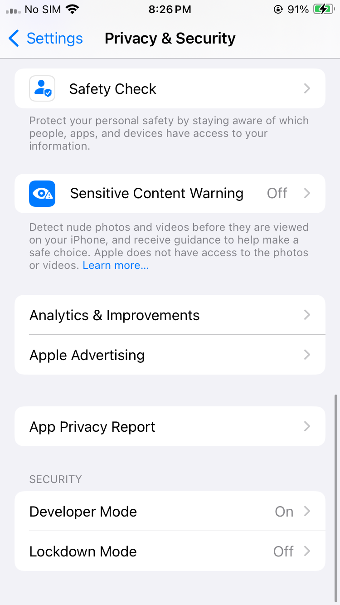
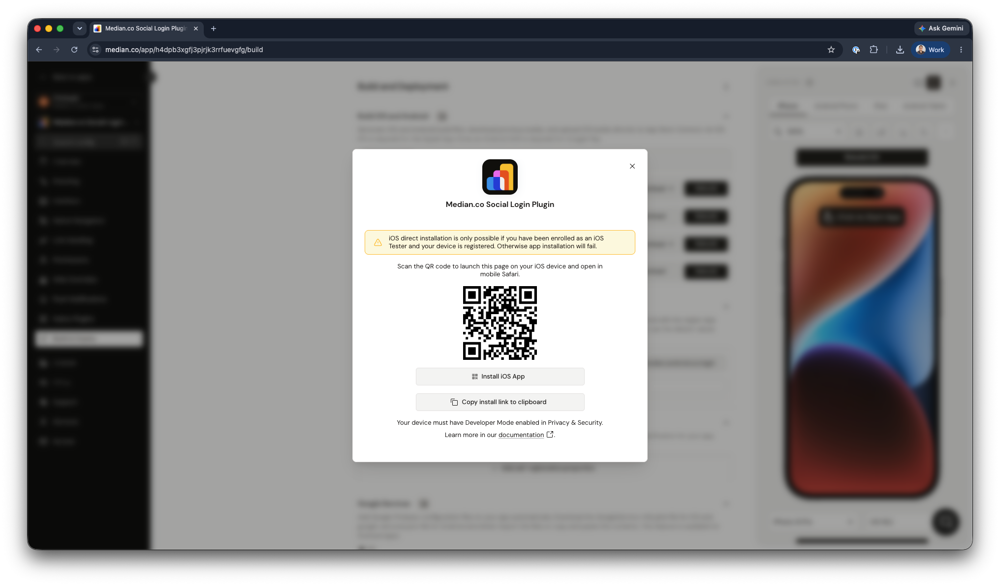

This direct-install workflow is useful for development profile builds and quick early testing. For App Store release testing, use a distribution profile with **Upload to App Store Connect** set to **Automatic**, then test the processed build through TestFlight.

<Info>
  **Device must be registered**

This guide assumes your device is enrolled as an iOS tester, as covered in Registering Testing Devices, and that signing is complete per Configure Signing for Your App. Installation will fail on a device that hasn't been registered.

</Info>

## Step-by-step

### Step 1: Enable developer mode

On the test device, go to Settings → Privacy & Security → Developer Mode and turn it on. The device will restart and prompt you to confirm.

<Frame caption="iOS Privacy & Security Settings">
  
</Frame>

iOS blocks installation of apps signed outside the App Store unless Developer Mode is explicitly enabled. This is an Apple-level requirement, not a Median-specific setting.

### Step 2: Get the install link or QR code

If you are a member of the development team, open the app in App Studio, go to **Build & Deploy**, then click **Install on iPhone/iPad** for the iOS IPA build. **If the app is built with a deployment profile the 'Install on iPhone/iPad' will be disabled.**

If you are not a member of the development team you will need to be provided with the public sharing link for the app where you can click **Install IPA on device**. In either case you will open a modal with a QR code.

<Frame caption="Installation QR Code">
  
</Frame>

### Step 3: Scan the QR code

Scan the QR code using your iOS device to open the installation page in your browser (must be mobile Safari).

### Step 4: Install the app

Once the installation page is displayed, click the **Install iOS App** button and confirm. The app will be installed on your device.

## Frequently asked questions

<AccordionGroup>
<Accordion title="Why do I need to enable Developer Mode before installing?" id="why-do-i-need-to-enable-developer-mode-before-installing">

iOS only installs apps from outside the App Store when Developer Mode is turned on. This applies to every ad hoc install, not only apps built with Median. To turn it on, go to **Settings → Privacy & Security → Developer Mode**.

</Accordion>
<Accordion title="Why won't the QR code scan or the install page load?" id="why-wont-the-qr-code-scan-or-the-install-page-load">

Scan the code with the iPhone's built-in Camera app and open the link in Safari. Other browsers and QR code apps may not support app installs. If the page still doesn't load, check that the device is connected to the internet and that the device is registered for the build. Ad hoc builds only install on registered devices.

</Accordion>
</AccordionGroup>
