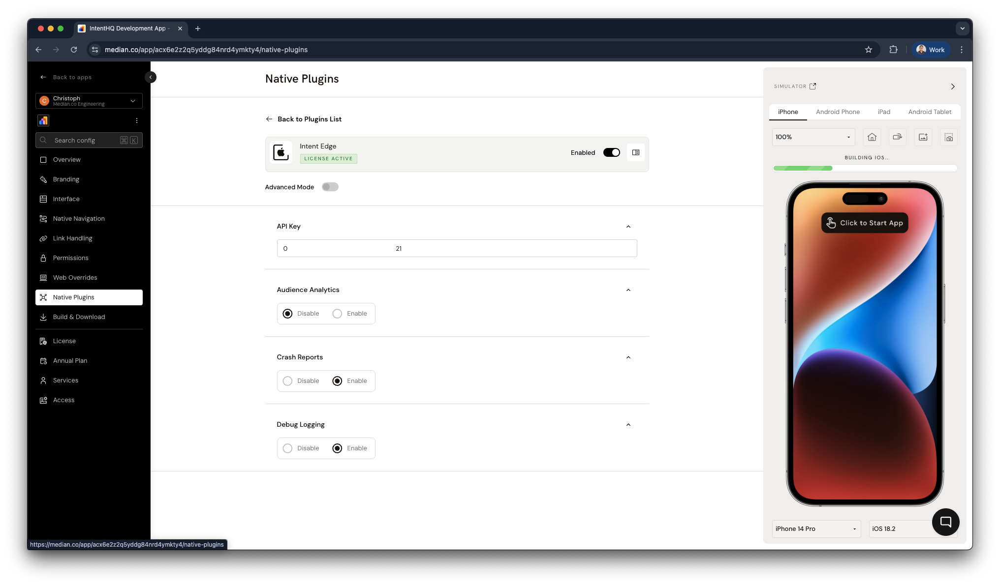

import { MedianLogo } from "/snippets/median-logo.jsx";

The Intent Edge plugin adds the native Intent Edge SDKs for iOS and Android to your app. Intent Edge is a marketing and data science platform from Intent HQ that processes behavioral data on the user's device instead of sending it to cloud servers, so you get real-time insights and targeted campaigns while sensitive data stays on the device.

You control Intent Edge entirely from your website through the [Median JavaScript Bridge](/docs/javascript-bridge). No native code is required.

<Check>
  **Developer Demo**

Display our demo page in your app to test during development [https://median.dev/intent-edge <Icon icon="arrow-up-right-from-square" size={12} />](https://median.dev/intent-edge)

</Check>

## Overview

With Intent Edge, you can:

- **Segment your audience** based on behavior analyzed on the user's device, combined with your own custom segments.
- **Trigger personalized campaigns** in real time when a user's on-device profile matches your targeting rules.
- **Track behavior privately,** because data is processed on the device, which reduces privacy risks and helps you comply with data protection regulations.
- **Enrich user profiles** with first-party and third-party data for more precise targeting.
- **Analyze engagement** with micro-moments, page visits, and custom segments.

### How it works

1. The Intent Edge SDK starts automatically when users open your app.
2. The SDK analyzes app usage and the custom attributes you set, and builds a profile on the device.
3. Campaign rules you configure in the Intent Edge Console are sent to the device and checked against that profile.
4. When a user matches a campaign, it activates immediately and calls your campaign handlers, so you can show the right message at the right moment.

### Use cases

| Industry           | Example                                                                                                                              |
| ------------------ | ------------------------------------------------------------------------------------------------------------------------------------ |
| E-commerce         | Show product recommendations or abandoned-cart offers when a user views a category several times or adds items without checking out. |
| Subscriptions      | Identify power users and at-risk subscribers from feature usage, then show upgrade prompts or retention offers.                      |
| Content            | Build segments from reading or viewing habits, then recommend content or show subscription prompts to highly engaged users.          |
| Financial services | Target relevant products or educational content based on app usage, while sensitive financial data stays on the device.              |

## Set up the plugin

### Prerequisites

- A Median app with the Intent Edge plugin available on your plan
- An Intent Edge API key from Intent HQ. Intent HQ provisions the key based on your app's Android Package Name and iOS Bundle ID, which you can find under [App Identifiers](/docs/app-identifiers#ios-bundle-id).

### Configure the plugin

In App Studio, go to **Native Plugins → Intent Edge** and set the following options:

<Frame caption="Intent Edge plugin configuration">
  
</Frame>

| Setting                | Description                                                                                                              | Recommendation                                                                                  |
| ---------------------- | ------------------------------------------------------------------------------------------------------------------------ | ----------------------------------------------------------------------------------------------- |
| **API Key** (required) | Authenticates your app with Intent Edge.                                                                                 | Use the key Intent HQ provisioned for your Package Name and Bundle ID.                          |
| **Audience Analytics** | Sends anonymized, aggregated insights to the Intent Edge Analytics Dashboard so marketers can analyze audience patterns. | Turn on if you want audience insights. Turn off if you don't want to share any aggregated data. |
| **Crash Reports**      | Reports SDK crashes to Bugsnag so Intent HQ can monitor and fix SDK issues.                                              | Turn on in production.                                                                          |
| **Debug Logging**      | Shows detailed Intent Edge activity in your console logs, including on-device processing and campaign triggers.          | Turn on during development. Turn off in production for better performance.                      |

Save your changes and rebuild your app.

### Verify your setup

1. Open the [developer demo page](https://median.dev/intent-edge) in your app and test the features. The demo confirms that your API key and configuration work.
2. In your own website, report a test page visit:

   <MedianLogo />

   <CodeGroup>

   ```javascript JavaScript
   median.intentedge.pageTracker.enterPage("home-screen");
   ```

   </CodeGroup>

3. Open the [Debug Screen](#debugging) and confirm the page visit appears. With **Debug Logging** turned on, you can also check your console for Intent Edge messages.

## Features and implementation

### SDK lifecycle

The SDK starts automatically when your app opens, so you don't need to start it yourself. Use these methods to stop the SDK, for example when a user opts out of tracking, and to start it again later.

<MedianLogo />

<CodeGroup>

```javascript JavaScript
// Stop the SDK and delete its data
median.intentedge.stop(true);

// Stop the SDK and keep its data
median.intentedge.stop(false);

// Start the SDK again after stopping it
median.intentedge.start();
```

</CodeGroup>

### Debugging

Intent Edge includes a Debug Screen that shows the SDK's status and configuration. You can also export logs to review them or share them with Intent HQ.

<MedianLogo />

<CodeGroup>

```javascript JavaScript
// Open the Debug Screen
median.intentedge.launchDebugScreen();

// Export the debug logs
median.intentedge.exportLogs();
```

</CodeGroup>

### Micro-segments

Create your own micro-segments, such as plan type or number of purchases, to use alongside the micro-segments Intent Edge provides.

<MedianLogo />

<CodeGroup>

```javascript Set
// Integer value (defaults to 0 if the value isn't a number)
median.intentedge.microSegments.setInteger(name, parseInt(value) || 0);

// Float value (defaults to 0 if the value isn't a number)
median.intentedge.microSegments.setFloat(name, parseFloat(value) || 0);

// String value
median.intentedge.microSegments.setString(name, value);
```

```javascript Get
median.intentedge.microSegments.getInteger(name);
median.intentedge.microSegments.getFloat(name);
median.intentedge.microSegments.getString(name);
```

</CodeGroup>

### Page visits

Report each page the user visits. The page name appears in the Intent Edge Analytics Dashboard and on the Page Visits micro-segment configuration page.

<MedianLogo />

<CodeGroup>

```javascript JavaScript
median.intentedge.pageTracker.enterPage("your-page-name");
```

</CodeGroup>

### Micro-moments

Fire your own micro-moments to track specific actions, such as starting a checkout or watching a video.

<MedianLogo />

<CodeGroup>

```javascript JavaScript
const parameters = { app: "Your App Name", timestamp: Date.now() };
median.intentedge.events.fireMicromoment("your-event-name", parameters);
```

</CodeGroup>

### User interactions

Report how a user responded to a campaign.

<MedianLogo />

<CodeGroup>

```javascript JavaScript
median.intentedge.events.sendUserInteraction("campaign-id", interactionType);
```

</CodeGroup>

| Interaction type    | When to send it                          |
| ------------------- | ---------------------------------------- |
| `acceptedTrigger`   | The user accepted a campaign trigger.    |
| `notificationClick` | The user tapped a campaign notification. |
| `conversion`        | The user completed the campaign's goal.  |

### Onboarding status

Track when a user starts and finishes your app's onboarding flow.

<MedianLogo />

<CodeGroup>

```javascript JavaScript
// When the user starts onboarding
median.intentedge.onboarding.start();

// When the user finishes onboarding
median.intentedge.onboarding.complete();
```

</CodeGroup>

### Campaigns

Campaigns activate based on the conditions you set in the Intent Edge Console. Register handlers to respond when a campaign is triggered and when a user taps it.

<MedianLogo />

<CodeGroup>

```javascript JavaScript
// Called when a campaign is triggered
median.intentedge.campaigns.setCampaignTriggerHandler((data) => {
  // Replace with your own UI, such as a banner or offer
  console.log("Campaign triggered:", data);
});

// Called when the user taps a campaign
median.intentedge.campaigns.setCampaignClickHandler((data) => {
  console.log("Campaign clicked:", data);
});
```

</CodeGroup>

### Data enrichment

Export a map of all segments for the current user.

<MedianLogo />

<CodeGroup>

```javascript JavaScript
median.intentedge.dataEnrichment.exportData();
```

</CodeGroup>

## Troubleshooting

<Steps>
  <Step title="Check your configuration">
    In App Studio, go to **Native Plugins → Intent Edge** and confirm that:

    - The API key is entered correctly, with no extra spaces.
    - The API key was provisioned for your app's Package Name and Bundle ID.
    - You rebuilt the app after changing the settings.

  </Step>
  <Step title="Test with the demo page">
    Open the [developer demo page](https://median.dev/intent-edge) in your app. If features work in the demo but not on your website, the problem is likely in your implementation rather than the plugin configuration.
  </Step>
  <Step title="Open the Debug Screen">
    Call `median.intentedge.launchDebugScreen()` to see the SDK's status and configuration. This often shows initialization or configuration problems.
  </Step>
  <Step title="Export the logs">
    Turn on **Debug Logging**, reproduce the problem, then call `median.intentedge.exportLogs()`. Include the logs when you contact support.
  </Step>
</Steps>
