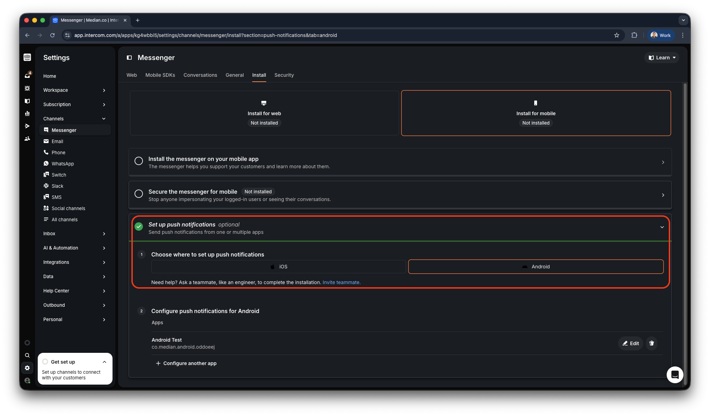
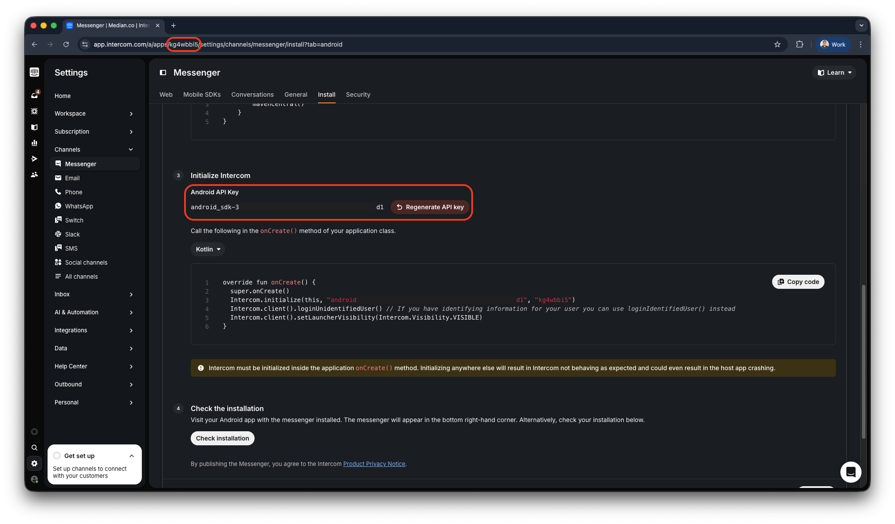
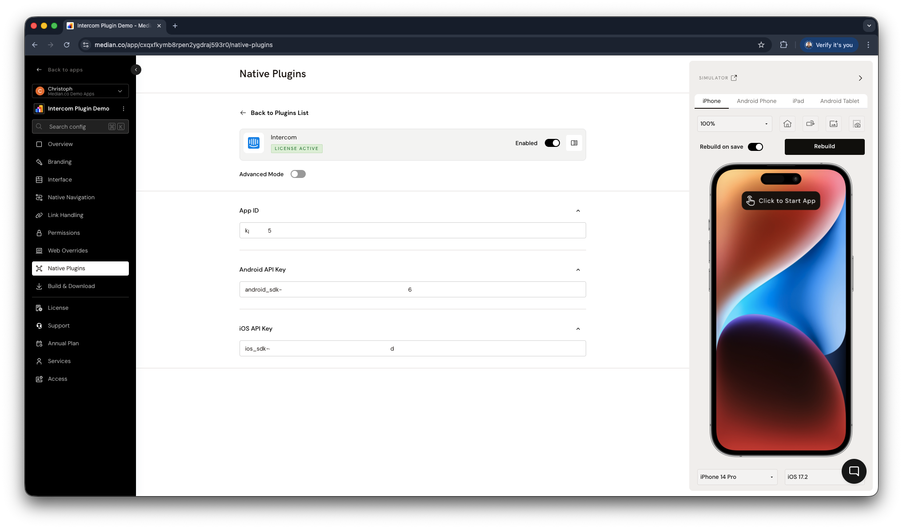
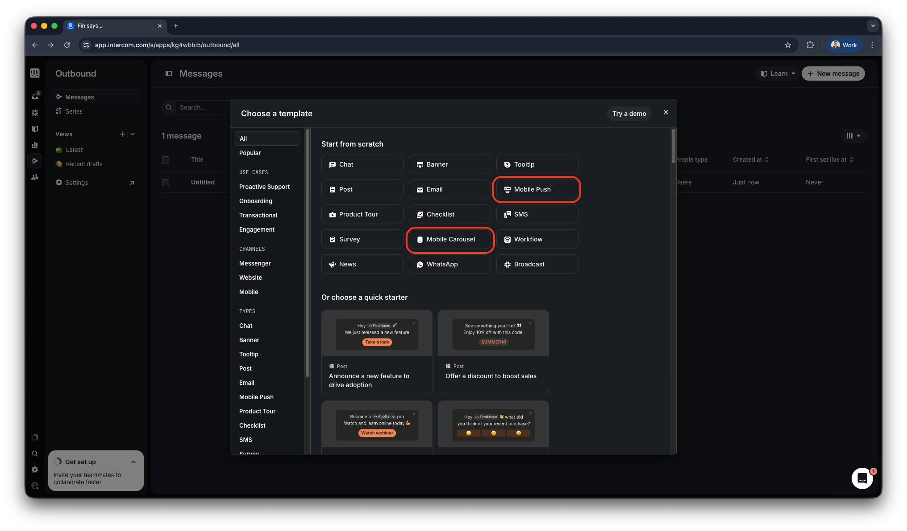

import { DeveloperDemo } from "/snippets/developer-demo.jsx";

import { MedianLogo } from "/snippets/median-logo.jsx";

The Intercom plugin enables mobile push notifications and event tracking in your Median app to increase user engagement. It integrates directly with the official Intercom SDK for Android and Intercom SDK for iOS.

## Why use Intercom?

- **Mobile push notifications**: Send targeted push notifications to engage users and drive app retention
- **Event tracking**: Log custom events to track user behavior and create personalized experiences
- **Deep linking support**: The Intercom plugin supports [deep linking](/docs/deep-linking). When deep links are configured, tapping on a push notification will open the corresponding screen in your app rather than the mobile device browser.
- **Official SDK integration**: Built on Intercom's official Android and iOS SDKs for reliability and feature completeness

## Prerequisites

- [ ] A Median app with the JavaScript Bridge enabled
- [ ] Intercom workspace with App ID and API keys configured
- [ ] Access to your App Identifiers for iOS and Android setup
- [ ] Apple Developer Account details (for iOS push notifications)
- [ ] Google Service Account details (for Android push notifications)

<DeveloperDemo path="intercom" />

## Implementation guide

The sections below cover Intercom setup, app configuration, and JavaScript Bridge functions.

### Intercom setup

Before configuring the plugin in Median, complete the following steps in your Intercom workspace:

- [ ] Add your **iOS app** and **Android app** to Intercom
- [ ] Retrieve your Intercom **App ID**
- [ ] Retrieve your Intercom **iOS API Key** and **Android API Key**

#### Add your iOS and Android apps

Follow Step 1 of Intercom's official mobile installation guides. Median automatically injects the required native SDK code, so you only need to complete the configuration steps in Intercom.

- [iOS - Install Intercom](https://developers.intercom.com/installing-intercom/ios/installation#step-1---install-intercom)
- [Android - Install Intercom](https://developers.intercom.com/installing-intercom/android/installation#step-1---install-intercom)

During the setup you will need access to your [App Identifiers](/docs/app-identifiers), as well as details for your Apple Developer Account and Google Service Account.

Use the screenshots below as an example of how to set up your Android and iOS apps in Intercom.

<Frame caption="Intercom: set up the Messenger for mobile push">
  
</Frame>

<Frame caption="Intercom: retrieve your App ID and API keys">
  
</Frame>

### App configuration

#### Plugin setup

Once your app is set up in Intercom, configure the Intercom plugin in Median App Studio and upload the required Google Services or iOS files.

#### Enable the plugin

1. **Navigate to Native Plugins**: In App Studio, go to **Native Plugins → Intercom**.
2. **Enable Intercom**: Toggle the plugin to enabled status.
3. **Configure settings**: Enter your Intercom App ID, iOS API Key, and Android API Key.

#### Configuration options

<Frame caption="Intercom plugin configuration">
  
</Frame>

| Setting             | Description                                  | Default | Recommended                   |
| ------------------- | -------------------------------------------- | ------- | ----------------------------- |
| **App ID**          | Your Intercom App ID from workspace settings | None    | Use your Intercom App ID      |
| **iOS API Key**     | iOS SDK API key from Intercom                | None    | Use your iOS-specific key     |
| **Android API Key** | Android SDK API key from Intercom            | None    | Use your Android-specific key |

#### Example plugin configuration

You can reference this JSON snippet as an example, but you'll need to replace the parameters with your own Intercom App ID and API keys.

<CodeGroup>
  ```json JSON
  {
    "androidApiKey": "android_sdk-xxxd6",
    "iosApiKey": "ios_sdk-xxxad",
    "appId": "kg4wbbi5"
  }
  ```
</CodeGroup>

## JavaScript Bridge functions

The Intercom plugin exposes several methods via the [Median JavaScript Bridge](/docs/javascript-bridge), allowing you to interact with Intercom from your web code.

### Register push

Request push notification permission, which will show a dialog for users to confirm permission. For Android, the dialog is only shown on Android 13 and above. On Android 12 and below, permission will always be granted without user intervention.

<MedianLogo />
<CodeGroup>
  ```javascript JavaScript
  median.intercom.registerPush({
    callback: function (result) {
      // result.granted is true or false
      console.log(result.granted);
    }
  });
  ```
</CodeGroup>

**Parameters:**

| Parameter  | Type       | Required | Description                            |
| ---------- | ---------- | -------- | -------------------------------------- |
| `callback` | `function` | No       | Callback function to handle the result |

### Update user

Creates or updates a user in Intercom using arbitrary key/value pairs such as `name`, `email`, or custom attributes.

<MedianLogo />
<CodeGroup>
  ```javascript JavaScript
  // Example usage
  median.intercom.updateUser({
    name: "Bob",
    email: "user@example.com",
  });
  ```
</CodeGroup>

**Parameters:**

| Parameter        | Type     | Required | Description                                 |
| ---------------- | -------- | -------- | ------------------------------------------- |
| `userAttributes` | `object` | Yes      | Object containing user attributes to update |

### Log event

Logs a custom event in Intercom for tracking user behavior.

<MedianLogo />
<CodeGroup>
  ```javascript JavaScript
  // Example usage
  median.intercom.logEvent({
    eventName: "completed_purchase",
  });
  ```
</CodeGroup>

**Parameters:**

| Parameter   | Type     | Required | Description              |
| ----------- | -------- | -------- | ------------------------ |
| `eventName` | `string` | Yes      | Name of the event to log |

### Present carousel

Displays an Intercom Mobile Carousel using its `carouselID` from your Intercom workspace.

<MedianLogo />
<CodeGroup>
  ```javascript JavaScript
  // Example usage
  median.intercom.presentCarousel({
    carouselID: "your-carousel-id",
  });
  ```
</CodeGroup>

**Parameters:**

| Parameter    | Type     | Required | Description                       |
| ------------ | -------- | -------- | --------------------------------- |
| `carouselID` | `string` | Yes      | The ID of the carousel to display |

## Sending push notifications and mobile carousels

Intercom push notifications and mobile carousels are created and sent through the Intercom Dashboard.

To manually create your messages, navigate to **Outbound > Messages** and create a new message using the **+ New message** button.

<Frame caption="Intercom outbound messages">
  
</Frame>

For detailed guidance, refer to Intercom's official documentation:

- [Intercom - Get started with Mobile Push](https://www.intercom.com/help/en/articles/3292847-get-started-with-mobile-push)
- [Intercom - Design and build a Mobile Carousel](https://www.intercom.com/help/en/articles/4164612-design-and-build-a-mobile-carousel)

### Programmatic push notifications

Sending push notifications programmatically via the Intercom API is not supported. This limitation is confirmed in Intercom’s official documentation.

[Intercom - Can I send push notifications through the API?](https://www.intercom.com/help/en/articles/5053702-can-i-send-push-notifications-through-intercom-s-api)

## Testing checklist

Use this checklist to ensure Intercom is working correctly in your app:

**Basic functionality**

- [ ] Push notification registration works as expected
- [ ] User information updates successfully in the Intercom dashboard
- [ ] Custom events appear in Intercom event tracking
- [ ] Mobile carousels display correctly when triggered

**Platform testing**

- [ ] Push notifications work on Android devices
- [ ] Push notifications work on iOS devices
- [ ] Permission dialog appears correctly on Android 13+
- [ ] Deep linking works from notification taps

**Configuration testing**

- [ ] App ID is correctly configured in plugin settings
- [ ] iOS API key is valid and working
- [ ] Android API key is valid and working
- [ ] Google Services files are properly uploaded

**User experience**

- [ ] Push permission request appears at the appropriate time
- [ ] Notification content displays correctly
- [ ] Mobile carousels are visually appealing and functional
- [ ] User data appears correctly in the Intercom dashboard

<Info>
  **Still having trouble?**

For issues related to Intercom's own configuration, permissions, or platform-specific behavior outside of Median, refer to [Intercom's integration documentation](https://developers.intercom.com/installing-intercom/docs).

</Info>
