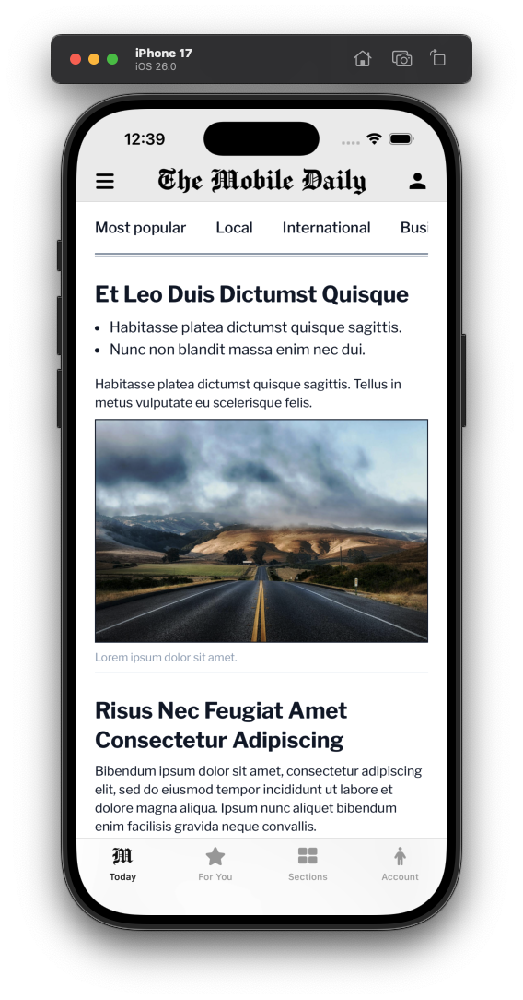
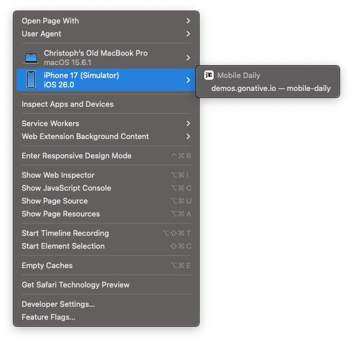
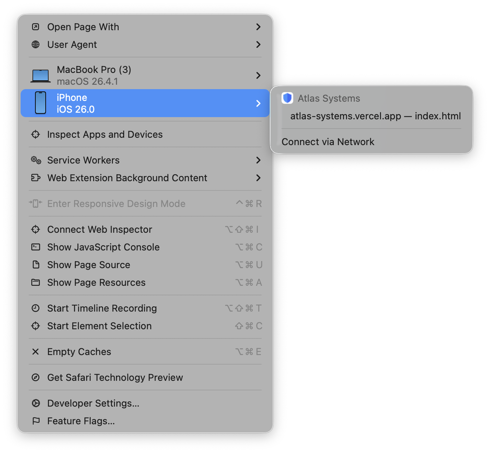

Learn how to debug with Xcode and Safari using a simulator or physical device. Enable console logging, inspect network activity, and troubleshoot JavaScript errors.

## Xcode & Safari (simulator)

1. Follow the steps in [Build iOS from source](/docs/build-ios-from-source) to build your iOS app.

2. Launch the app in the Xcode simulator (example: iPhone 17).

   <Frame caption="Xcode Simulator">
     
   </Frame>

3. Open Safari, then go to **Develop > iPhone 17 (Simulator) > \[Website Name]** to open the Safari Developer Tools.

   <Frame caption="Safari: Develop menu">
     
   </Frame>

4. You can now use the Elements and Console panels to inspect and debug the website, with changes reflected in real time in the Xcode simulator.

## Safari remote debugging (physical device)

1. Follow the steps in [Build iOS from source](/docs/build-ios-from-source) to build your iOS app in Xcode.

2. Trust the app on your device:
   - Go to **Settings > General**
   - Tap on **VPN & Device Management** _(on older iOS versions, this may be called Profiles or Profiles & Device Management)_
   - Under the **Developer App** section, tap your email address or Team Name
   - Tap the blue **Trust "\[Your Name/Email]"** button
   - Confirm by tapping **Trust** again in the popup

3. On your iOS device:
   - Go to **Settings > Safari > Advanced**
   - Toggle **Web Inspector** to **On**

4. On your Mac:
   - Open **Safari**
   - Go to **Safari > Settings (or Preferences)**
   - Select the **Advanced** tab
   - Check **Show features for web developers** _(or "Show Develop menu")_

5. Open your app on the device.

6. In Safari on your Mac:
   - Click the **Develop** menu in the top bar

7. Hover over your device name and select your domain.

<Frame caption="Safari: Develop menu">
  
</Frame>

## What you can do while debugging

- Execute JavaScript commands or view errors and logs generated by your app
- Monitor API calls and resource loading in real-time
- Modify CSS and HTML on the fly to test UI changes
- Inspect cookies, LocalStorage, and IndexedDB data to verify sessions and caching
