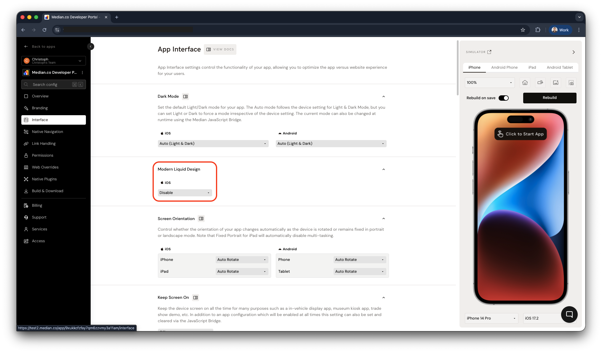

## Liquid Glass support

[Liquid Glass on iOS](https://developer.apple.com/documentation/technologyoverviews/liquid-glass) is a visual design effect introduced in iOS 26. It creates a frosted-glass appearance using dynamic blur and vibrancy, improving visual hierarchy and depth across the app interface.

Median apps automatically support Liquid Glass on compatible iOS devices. The effect is applied natively by iOS and integrates with web content that uses CSS properties such as `backdrop-filter`. It may also be applied to native UI components within the app.

<Warning>
  **iOS 27 compatibility:** On iOS 27.0, a known bug can cause visual
  distortions in Liquid Glass rendering. This is resolved in iOS 27.1 and later,
  where Apple enables Liquid Glass automatically for all apps and it renders
  correctly.
</Warning>

<Frame caption="Liquid Glass design: scrolling example">
  <video
    autoPlay
    muted
    loop
    playsInline
    className="mx-auto rounded-lg"
    style={{ width: "60%" }}
    src="https://cdn.median.co/docs/liquid-design/demo.webm"
  />
</Frame>

## App configuration

To enable Liquid Glass support, turn on **Modern Liquid Design** in **App Studio → Interface**.

<Frame caption="App Studio: Interface, Liquid Glass design">
  
</Frame>

## Additional resources

Developers implementing or designing with Liquid Glass may find the following resources helpful:

**Apple Liquid Glass overview**: Learn about the design goals, system behavior, and platform integration of Liquid Glass across Apple operating systems. See [Liquid Glass](https://developer.apple.com/documentation/technologyoverviews/liquid-glass)

**Apple Human Interface Guidelines**: Describes the design philosophy behind layered, translucent UI elements and spatial hierarchy. See [Human Interface Guidelines](https://developer.apple.com/design/human-interface-guidelines/)

**CSS `backdrop-filter` reference**: Documentation for the CSS property most commonly used to enable glass-style visual effects in web content. See [MDN: backdrop-filter](https://developer.mozilla.org/en-US/docs/Web/CSS/backdrop-filter)
