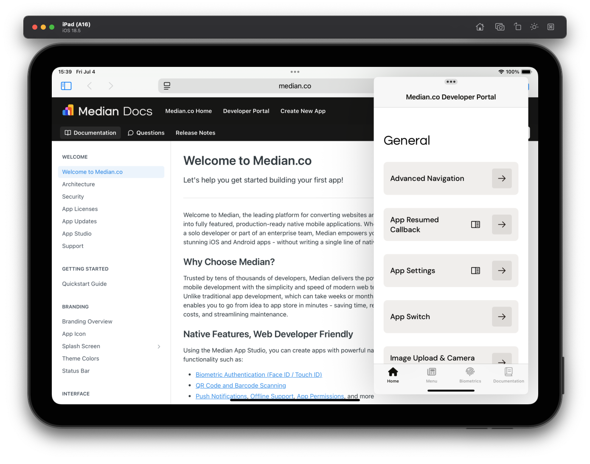

Your Median-powered app supports Split View multitasking by default on iPadOS. This feature enhances productivity by allowing users to view and interact with your app alongside other apps - perfect for referencing documents, copying information, or multi-app workflows.

## What is Split View?

Split View is a multitasking feature on iPads that lets users open two apps side-by-side. It’s especially useful when working with content across apps. For example, viewing a document in Safari while entering data in your app.

This feature works automatically on supported iPads with your Median app and there is no additional configuration needed.

<Frame caption="iPad using Split View - Safari with Median Docs on the left, a Median-powered app on the right">
  
</Frame>

## How to Use Split View

Your users can enable Split View by:

1. Opening your app on an iPad.
2. Swiping up from the bottom of the screen to reveal the Dock.
3. Dragging a second app icon (like Safari or Notes) into the right or left side of the screen.

📖 Learn more: [Use multitasking on your iPad](https://support.apple.com/en-us/HT207582)
