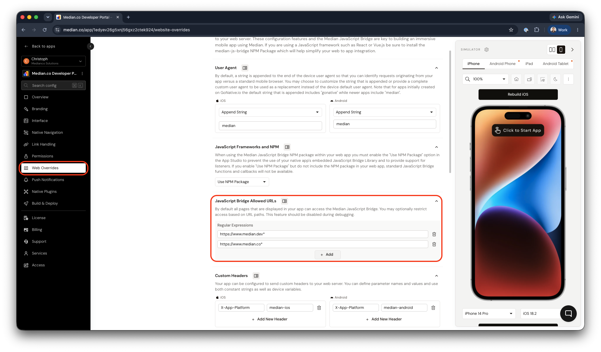

import { MedianLogo } from "/snippets/median-logo.jsx";

The Median JavaScript Bridge is an API embedded in your app that lets your website control and configure the app and access native device functionality and hardware. Your web code can call the bridge to trigger native actions, read device info, manage navigation, and integrate with native plugins.

There are two ways to use the JavaScript Bridge: the [JavaScript Bridge Library](https://docs.median.co/docs/javascript-bridge#javascript-bridge-library), which provides helper functions and an abstraction layer, or the [Median Protocol](https://docs.median.co/docs/javascript-bridge#median-protocol) (`median://`) for direct, lower-level access without the library.

<Check>
  **Legacy GoNative Namespace**

For existing apps that were last updated on the GoNative.io platform you must use `gonative` rather than `median`. For example `gonative.statusbar.set()` or `gonative://statusbar/set`.

For apps that have been updated on Median.co you may use either `gonative` or `median`.

</Check>

## Related Documentation

<Columns cols={2}>
  <Card
    title="Detecting App Usage"
    icon="mobile-alt"
    href="https://docs.median.co/docs/detecting-app-usage"
  >
    Detect when your website is running inside the Median app so you can adapt
    UI, analytics, or behavior for the in-app experience.
  </Card>
  <Card
    title="NPM Package"
    icon="npm"
    href="https://docs.median.co/docs/npm-package"
  >
    Use the median-js-bridge NPM package in React, Vue, or other frameworks.
    Basic usage, listeners, and SPA navigation support.
  </Card>
  <Card
    title="Device Info"
    icon="info-circle"
    href="https://docs.median.co/docs/device-info"
  >
    Retrieve device information such as platform, OS version, and app version
    from the JavaScript Bridge.
  </Card>
  <Card
    title="Clipboard"
    icon="clipboard"
    href="https://docs.median.co/docs/clipboard"
  >
    Read from and write to the device clipboard via the JavaScript Bridge.
  </Card>
  <Card
    title="Prompt Share Dialogue"
    icon="share-alt"
    href="https://docs.median.co/docs/prompt-share-dialogue"
  >
    Trigger the native share sheet to share URLs or content from your web app.
  </Card>
  <Card
    title="App Resumed Callback"
    icon="play-circle"
    href="https://docs.median.co/docs/app-resumed-callback"
  >
    Run code when the user returns to your app from the background. Handle app
    resume events from your web code.
  </Card>
  <Card
    title="Keyboard State Tracking"
    icon="keyboard"
    href="https://docs.median.co/docs/keyboard-state-tracking"
  >
    Track when the device keyboard is shown or hidden and respond to keyboard
    state changes.
  </Card>
  <Card
    title="Download File"
    icon="download"
    href="https://docs.median.co/docs/download-file"
  >
    Download files from your web app to the device using the native download
    manager.
  </Card>
  <Card
    title="Clear Webview Cache"
    icon="broom"
    href="https://docs.median.co/docs/clear-webview-cache"
  >
    TrClear the app webview cache programmatically from your web code.
  </Card>
  <Card
    title="Accessing callbacks in an iframe"
    icon="code"
    href="https://docs.median.co/docs/iframe-callbacks"
  >
    Use JavaScript Bridge callbacks when your content runs inside an iframe.
    Expose functions and handle cross-frame communication.
  </Card>
</Columns>

## JavaScript Bridge Library

The JavaScript Bridge Library is injected into your webpage DOM at runtime and is available on any page displayed in the app. You can call `median.module.function()` once the library is ready.

<Check>
**Developer Demo**

Display our demo page in your app to test during development [https://median.dev/library-ready/](https://median.dev/library-ready/)

</Check>

When using frameworks like React, Vue, or Angular, the `median` object may not be in scope. Options:

1. Expose callbacks globally: `window.callback_function = () => {}`
2. Use the [NPM Package](https://docs.median.co/docs/npm-package) and toggle off library injection in App Studio → Website Overrides
3. Use the Median Protocol (`median://`) which does not require the library

<Check>
  ### `Median` not `median` when using NPM package

When using the NPM Package make note to use capitalized `Median` to call functions rather than lowercase `median` which is reserved for the the injected JavaScript library. Your IDE should be configured to help with code hinting to help with completion and avoid semantic errors.

</Check>

### Calling Commands on Page Load

The library is not available until it initializes. For commands that must run on page load, define `median_library_ready()` on your page; it is called after initialization. Or use the Median Protocol so you are not dependent on the library.

If `median_library_ready()` is not called (e.g. the library initializes before your page defines it), call it manually when the library is ready:

<MedianLogo />
<CodeGroup>
  ```JavaScript JavaScript
  function median_library_ready() {
    // Your code here
  }
  if (window.median) {
    window.median_library_ready();
  }
  ```
</CodeGroup>

### Promises

Some bridge commands return JavaScript promises. Handle them with `async/await` or `.then()/.catch()` :

<MedianLogo />
<CodeGroup>
  ```JavaScript JavaScript
  median.iap.purchase({ productID: 'product_id' })
    .then(function(data) { /* handle success */ })
    .catch(function(error) { /* handle error */ });
  ```
</CodeGroup>

## Median Protocol

You can call bridge commands via the `median://` protocol without the JavaScript Bridge Library. Use an HTML anchor `href` for simple commands, or set `window.location.href` in JavaScript for complex ones. Parameters with JSON or special characters must be encoded with `encodeURIComponent()`.

To chain multiple commands, use `median://nativebridge/multi` with an array of URLs instead of making sequential calls (which can cause only the last command to run).

## Restricting Bridge Access by URL

By default, the Median JavaScript Bridge is available on every page loaded in your app. You can restrict Bridge access to specific URL paths in App Studio using the Allowed URLs field.

When URLs are specified, only matching pages can execute JavaScript Bridge commands or access native device functionality. All other pages have Bridge access disabled.

Important Considerations

- **App Store updates:** Changes to Allowed URLs require a new app version. Users must install the updated version from the Apple App Store or Google Play Store for the changes to take effect.

- **Testing:** Because non-matching pages cannot access the Bridge, an incorrect configuration can cause Bridge commands to stop working during development. We recommend leaving Allowed URLs empty during development and enabling restrictions when preparing your production app.

<Frame caption="Median App Studio - Restricting Bridge Access">
  
</Frame>

## Frequently Asked Questions

### Why do I see 'median is not defined' in the console?

The library is injected at runtime by the app and is not available in a desktop browser. Use the [NPM Package](https://docs.median.co/docs/npm-package) if you need to develop or test outside the app, and disable library injection in App Studio → Website Overrides when using the package.
