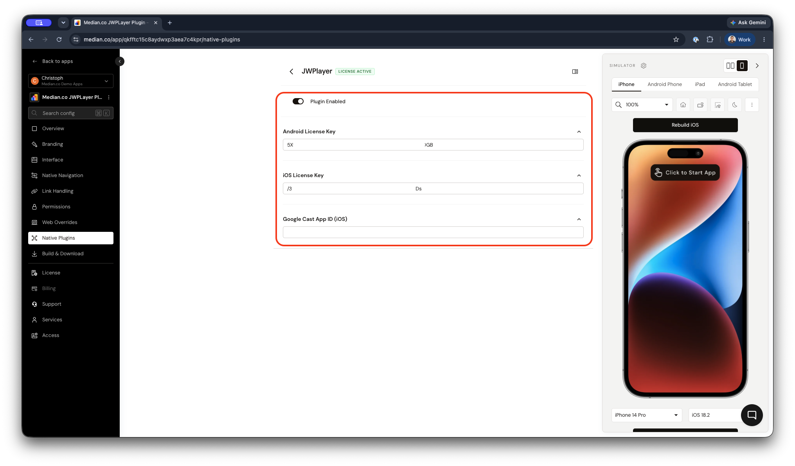

import { DeveloperDemo } from "/snippets/developer-demo.jsx";

import { MedianLogo } from "/snippets/median-logo.jsx";

JW Player is a video platform for hosting and playing video. Median's JW Player plugin integrates the [JW Player iOS SDK](https://docs.jwplayer.com/players/docs/ios-overview) and [Android SDK](https://docs.jwplayer.com/players/docs/android-overview) into your app to provide native video playback with support for single videos, playlists, and adaptive streaming.

<DeveloperDemo path="jwplayer" />

## Why use JW Player?

- **Native SDK playback**: The plugin uses JW Player's native iOS and Android SDKs for video playback.
- **Flexible input formats**: Play a single video file, an array of video files as a playlist, or load a playlist directly from a JW Player playlist URL.
- **Cross-platform support**: One Median JavaScript Bridge API works across iOS and Android with platform-appropriate behavior.
- **Chromecast on iOS**: When you configure an App ID, Chromecast initializes automatically at app launch on iOS.

## Prerequisites

Before you begin, ensure you have the following:

- A Median app with the JavaScript Bridge enabled.
- A valid JW Player license key (`licenseKey` is a required configuration field).
- Access to **App Studio** to configure the plugin in the **Native Plugins** section.

## Implementation guide

### App configuration

1. Open **App Studio** and navigate to the **Native Plugins** section.
2. Locate the JW Player plugin and enable it.
3. Enter your JW Player Android and iOS License Keys.
4. If you want to enable Chromecast on iOS, enter your Google Cast App ID in the `appId` field.
5. Save your configuration.

<Frame caption="JW Player plugin configuration">
  
</Frame>

#### Plugin configuration options

| Setting                  | Description                                                                                                                                                                                                                                                                                                        | Required                 |
| ------------------------ | ------------------------------------------------------------------------------------------------------------------------------------------------------------------------------------------------------------------------------------------------------------------------------------------------------------------ | ------------------------ |
| Android License Key      | The license key connects your Android app to your JW Player account. To get your key, open your [JW Player dashboard](https://dashboard.jwplayer.com/login). On the Properties page, click the name of a property. Under Network & setup files, click Player setup files. Under Android SDK, copy the License key. | Yes, for Android support |
| iOS License Key          | The license key connects your iOS app to your JW Player account. To get your key, open your [JW Player dashboard](https://dashboard.jwplayer.com/login). On the Properties page, click the name of a property. Under Network & setup files, click Player setup files. Under iOS SDK, copy the License key.         | Yes, for iOS support     |
| Google Cast App ID (iOS) | This key enables your iOS app to cast media to Google Chrome Cast compatible devices. You can obtain this key in your [Google Cast SDK Developer Console](https://cast.google.com/publish).                                                                                                                        | Optional                 |

<Info>
  **Rebuild after configuration**

Plugin settings take effect only in new builds. After changing credentials or uploading new Firebase configuration files, rebuild your app and test on a real device or simulator before releasing.

</Info>

### JavaScript Bridge functions

#### Initialize the JW Player SDK

<Info>
  **Auto-initialization**

On iOS and Android, the JW Player plugin auto-initializes at runtime using the license key uploaded in the app configuration. Alternatively, you can manually initialize the SDK using the `median.jwplayer.initialize()` command.

</Info>

<MedianLogo />
<CodeGroup>
  ```javascript JavaScript
  const result = await median.jwplayer.initialize({
    licenseKey: 'YOUR_JW_PLAYER_LICENSE_KEY'
  });

// result.success is true or false
// On failure only, result.error is set, for example:
// { code: "NOT_INITIALIZED", message: "Invalid license key" }
console.log(result);

````
</CodeGroup>

##### Parameters

| Parameter  | Type     | Description                               |
| ---------- | -------- | ----------------------------------------- |
| licenseKey | `string` | **Required**. Your JW Player license key. |

#### Play a video

Present a full-screen native player and begin video playback. You can provide a single video file, an array of video files (playlist), or a JW Player playlist URL.

To play a video:

<MedianLogo />
<CodeGroup>
```javascript JavaScript
// Play a single video
const singleResult = await median.jwplayer.play({
  file: 'https://example.com/video.mp4',
  startTime: 30             // optional: start at 30 seconds
});

// Play a playlist
const playlistResult = await median.jwplayer.play({
  files: [
    'https://example.com/video1.mp4',
    'https://example.com/video2.mp4'
  ]
});

// Play from a JW Player playlist URL
const playlistUrlResult = await median.jwplayer.play({
  playlistUrl: 'https://cdn.jwplayer.com/v2/playlists/abc123'
});
````

</CodeGroup>

<MedianLogo />
<CodeGroup>
  ```javascript JavaScript
  // Callback example
  median.jwplayer.play({
    file: 'https://example.com/video.mp4',
    callback: function(result) {
      if (result.success) {
        console.log('Playback started');
      }
    }
  });
  ```
</CodeGroup>

##### Optional parameters

| Parameter   | Type       | Description                                              |
| ----------- | ---------- | -------------------------------------------------------- |
| file        | `string`   | URL of a single video file. Takes priority over `files`. |
| files       | `string[]` | Array of video URLs played as a playlist.                |
| playlistUrl | `string`   | URL to a JW Player JSON playlist feed.                   |
| startTime   | `number`   | Starting position in seconds (default: `0`).             |

**At least one of `file`, `files`, or `playlistUrl` must be provided.**

##### Return values

The callback data differs between platforms:

**iOS** returns when the player has been configured:

<CodeGroup>
  ```javascript iOS
  {
    success: true
  }
  ```
</CodeGroup>

**Android** returns when the player is closed, including playback state:

<CodeGroup>
  ```javascript Android
  {
    success: true,
    position: 120,            // playback position in seconds at close time
    state: "playing",         // "playing", "paused", "idle", or "complete"
    file: "https://...",      // URL of the current playlist item
    isMute: false,            // whether the player was muted
    currentQuality: {},       // current video quality
    currentAudioTrack: {},    // current audio track
    currentCaptions: {}       // current captions track
  }
  ```
</CodeGroup>

##### Error response

<CodeGroup>
  ```javascript Error
  {
    success: false,
    error: {
      code: "NOT_INITIALIZED", // or "INTERNAL_ERROR"
      message: "..."
    }
  }
  ```
</CodeGroup>

#### Chromecast support (iOS)

On iOS, Chromecast support is automatically initialized at app launch when the `appId` is configured in the server configuration. No additional JavaScript calls are required.

To enable Chromecast, add your Google Cast application ID to the JW Player configuration in App Studio as shown in [App configuration](#app-configuration).

## Testing checklist

Use this checklist to ensure JW Player is working correctly in your iOS or Android app:

- [ ] The SDK auto-initializes or manually initializes using `median.jwplayer.initialize()`

- [ ] Using `median.jwplayer.play()` launches the player

- [ ] Chromecast works using an iOS appID or Android Google Cast application ID.

## Troubleshooting

### JW Player JavaScript Bridge functions do nothing or throw errors

Ensure the JavaScript Bridge is enabled in App Studio. Manually initialize the SDK or enter license keys in the plugin configuration in App Studio.

### `initialize()` returns `NOT_INITIALIZED` or `INTERNAL_ERROR`

Check that the `licenseKey` value in your plugin configuration is valid and matches the key from JW Player.
