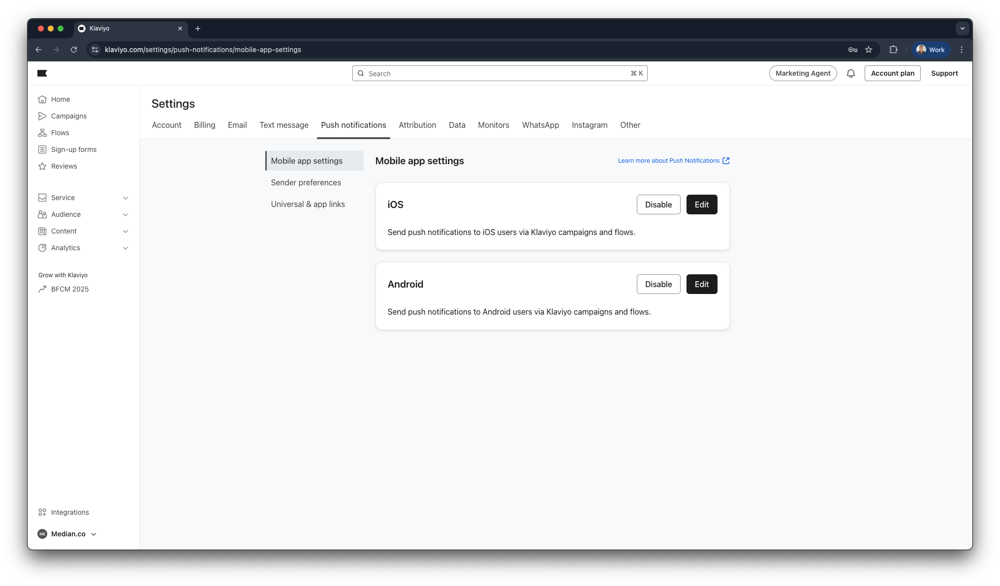
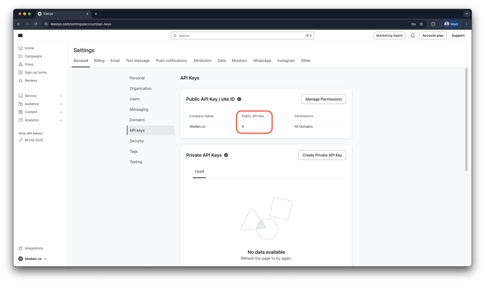
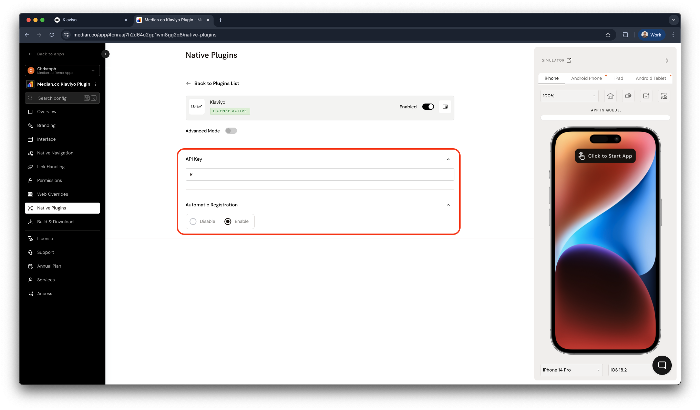

import { DeveloperDemo } from "/snippets/developer-demo.jsx";

import { MedianLogo } from "/snippets/median-logo.jsx";

The Klaviyo plugin enables mobile push notifications to increase engagement and audience insight. It integrates the official [Klaviyo Swift SDK](https://github.com/klaviyo/klaviyo-swift-sdk) on iOS and the [Klaviyo Kotlin SDK](https://github.com/klaviyo/klaviyo-android-sdk) on Android. This guide covers Klaviyo account setup, Median App Studio configuration, and [Median JavaScript Bridge](/docs/javascript-bridge) APIs for permissions and profiles.

## Why use Klaviyo

- **Native push on both platforms**: Reach users with iOS and Android push using Klaviyo’s SDKs inside the Median shell.
- **Segmentation and profiles**: Tie `externalId`, email, and phone to Klaviyo profiles for targeting and personalization.
- **Deep linking**: When [deep linking](/docs/deep-linking) is configured, notification taps can open the right screen in-app instead of the device browser.

## Prerequisites

- A Median app with the [JavaScript Bridge](/docs/javascript-bridge) enabled
- Klaviyo account with iOS and Android mobile apps configured for push
- **Klaviyo Public API Key** (mobile SDK initialization)
- `GoogleService-Info.plist` and `google-services.json` uploaded in your Median app configuration (required for Firebase-backed delivery on Android and proper SDK initialization; see [Google Services](/docs/google-services))
- Familiarity with Klaviyo push setup and, as needed, your [App Identifiers](/docs/app-identifiers), Apple Developer account, and Google Cloud / Firebase project

<DeveloperDemo path="klaviyo" />

## Key terms

**Public API Key**: The non-secret key from Klaviyo (**Settings → Account → API Keys**) used to initialize the mobile SDKs in your Median build. It is required in the Klaviyo plugin configuration.

**Automatic Registration**: When **Enabled**, Median requests push permission (and related registration) around app startup. When **Disabled**, you request permission later via `median.klaviyo.promptNotification` (or rely on system behavior where applicable).

**Deep linking**: Median configuration that maps URLs or URI schemes so a notification’s open action can load a specific in-app destination instead of Safari or Chrome.

**Important considerations**

- Klaviyo’s Android path depends on **Google Services** (Firebase). Missing `GoogleService-Info.plist` / `google-services.json` commonly causes SDK initialization failures. See [Troubleshooting](#troubleshooting).
- On **Android 13+**, users must explicitly grant notification permission; on older Android versions, behavior may differ. **iOS** always uses an explicit permission prompt when you request authorization.
- Align **Bundle ID** (iOS) and **package name** (Android) between Klaviyo, your app identifiers in Median, and store listings to avoid token or delivery mismatches.

## Implementation guide

### Klaviyo setup

Before configuring the plugin in Median, complete the following setup steps in your Klaviyo account:

- [ ] Add your iOS and Android apps to Klaviyo
- [ ] Retrieve your Klaviyo **Public API Key**

#### Add your iOS and Android apps

In Klaviyo, you will need to add and configure both (iOS and Android) mobile apps for push. Follow Klaviyo’s official setup guides for each platform:

- [How to set up iOS push notifications](https://help.klaviyo.com/hc/en-us/articles/360023213971)
- [How to set up Android push notifications](https://help.klaviyo.com/hc/en-us/articles/14750928993307)

<Frame caption="Klaviyo: mobile app settings">
  
</Frame>

#### Retrieve your public API key

1. In Klaviyo, go to **Settings → Account → API Keys**.
2. Copy the **Public API Key** (not private keys). You will paste it into the Klaviyo plugin field in Median App Studio.

<Frame caption="Klaviyo: Public API Key">
  
</Frame>

### App configuration

Klaviyo’s stack expects Firebase / Google Services files in the native mobile app build.

1. Follow Median’s [Google Services](/docs/google-services) guide to obtain `GoogleService-Info.plist` (iOS) and `google-services.json` (Android).
2. Upload both files in your Median **app configuration** / build settings as documented for your project so they ship inside the binary.

Without these files, the SDK may fail to initialize; see the Firebase error in [Troubleshooting](#troubleshooting).

### Plugin setup

#### Enable the plugin

1. **Open Median App Studio** for your app.
2. **Enable the Klaviyo** native plugin.
3. Enter your **Klaviyo Public API Key**.
4. Set **Automatic Registration** to match your product flow (**Enabled** for startup permission, **Disabled** to drive prompts from JavaScript).

<Frame caption="Klaviyo plugin configuration">
  
</Frame>

#### Configuration options

| Setting                    | Description                                                                                                                      | Default | Recommended                                                                                        |
| -------------------------- | -------------------------------------------------------------------------------------------------------------------------------- | ------- | -------------------------------------------------------------------------------------------------- |
| **API Key**                | Klaviyo **Public API Key** used to initialize the Klaviyo SDKs.                                                                  | None    | Required. Copy from Klaviyo **Settings → Account → API Keys**.                                     |
| **Automatic Registration** | **Enabled**: requests push permissions on app startup. **Disabled**: you request later with `median.klaviyo.promptNotification`. | Enabled | Use **Disabled** for contextual prompts; **Enabled** only if you want an immediate startup prompt. |

**Note**: Plugin settings take effect in new builds. After changing keys or Google Services files, create a fresh build and test on a device or simulator.

#### Deep linking

The Klaviyo plugin works with Median [deep linking](/docs/deep-linking). When deep links are configured, tapping a push can open the corresponding in-app destination instead of the mobile browser. Configure URL schemes, universal links, and app links in App Studio to match the URLs your Klaviyo campaigns use.

### JavaScript Bridge functions

Call these after the `median_library_ready()` event (or equivalent) with the JavaScript Bridge loaded. The official Median examples use **callbacks**; use the same shape in production unless your integration layer wraps them in promises.

#### Request push notification permission

Displays the system dialog to enable push notifications. On **Android 13 and above**, explicit permission is required; on **Android 12 and below**, behavior may be automatic depending on OS version and policy.

<MedianLogo />
<CodeGroup>
  ```javascript JavaScript
  median.klaviyo.promptNotification({
    callback: function (result) {
      console.log(result.granted); // true or false
    },
  });
  ```
</CodeGroup>

**Parameters:**

| Parameter  | Type       | Required | Description                                                                             |
| ---------- | ---------- | -------- | --------------------------------------------------------------------------------------- |
| `callback` | `function` | No       | Called with `{ granted: boolean }` (or equivalent) when the permission result is known. |

**Return value:**

Delivered to `callback` as an object with:

| Field     | Type      | Description                                      |
| --------- | --------- | ------------------------------------------------ |
| `granted` | `boolean` | Whether push notification permission is granted. |

#### Check push notification permission status

Returns whether notifications are currently allowed for your app.

<MedianLogo />
<CodeGroup>
  ```javascript JavaScript
  median.klaviyo.notificationEnabled({
    callback: function (result) {
      console.log(result.granted); // true or false
    },
  });
  ```
</CodeGroup>

**Parameters:**

| Parameter  | Type       | Required | Description                               |
| ---------- | ---------- | -------- | ----------------------------------------- |
| `callback` | `function` | No       | Called with the current permission state. |

**Return value:**

| Field     | Type      | Description                |
| --------- | --------- | -------------------------- |
| `granted` | `boolean` | Current permission status. |

#### User profile management

Identify users and attach fields Klaviyo uses for segmentation and personalization.

<MedianLogo />
<CodeGroup>
  ```javascript JavaScript
  // Get the current user profile
  median.klaviyo.getProfile();

// Set user profile attributes
median.klaviyo.setProfile({
externalId: "USER_ID",
email: "user@example.com",
phoneNumber: "+1234567890",
});

// Clear the stored user profile
median.klaviyo.resetProfile();

```
</CodeGroup>

`setProfile` **parameters:**

| Parameter     | Type     | Required | Description                                          |
| ------------- | -------- | -------- | ---------------------------------------------------- |
| `externalId`  | `string` | No       | Your primary user ID in your backend or auth system. |
| `email`       | `string` | No       | User email for Klaviyo profiles.                     |
| `phoneNumber` | `string` | No       | E.164 or format accepted by your Klaviyo setup.      |

**Return value:**

Profile getters and setters follow the JavaScript Bridge's usual pattern. Callbacks or synchronous returns may vary by Median build, so test in your app alongside [median.dev/klaviyo](https://median.dev/klaviyo/).

## Testing checklist

Use this checklist to ensure Klaviyo is working correctly in your app:

**Basic functionality**

* [ ] Klaviyo **Public API Key** is set in the plugin configuration.
* [ ] `median.klaviyo.promptNotification` runs without errors and reflects user choice in `result.granted`.
* [ ] `median.klaviyo.notificationEnabled` reports expected state after allow/deny.
* [ ] `getProfile`, `setProfile`, and `resetProfile` run without JavaScript errors.

**Platform testing**

* [ ] iOS: permission prompt and token path behave as expected on a physical device.
* [ ] Android: behavior verified on Android 13+ (runtime permission) and a representative older version if you support it.
* [ ] Deep link targets from Klaviyo open **in app** when configured (not only in the browser).

**Configuration and delivery**

* [ ] `GoogleService-Info.plist` and `google-services.json` are present in the shipped build (per Median [Google Services](/docs/google-services)).
* [ ] Klaviyo app entries use the same bundle ID / package name as the Median build.
* [ ] Test sends from Klaviyo reach the device when profiles and consent allow.

**User experience**

* [ ] Permission prompts appear at an appropriate moment (startup vs contextual) per **Automatic Registration** choice.
* [ ] Logout calls `resetProfile` if you require a clean SDK identity for the next user.

## Troubleshooting

### Klaviyo JavaScript Bridge functions are undefined or not working

Ensure the **JavaScript Bridge** is enabled, the **Klaviyo** plugin is enabled, and your code runs after the `median_library_ready()` event. Confirm you are testing on a Median build that includes the plugin, not a plain mobile browser tab.

### IllegalStateException: Default FirebaseApp is not initialized in this process

Upload **`GoogleService-Info.plist`** and **`google-services.json`** through your Median app configuration following [Google Services](/docs/google-services). Rebuild and reinstall; Klaviyo requires Firebase initialization for notification delivery on Android and for a valid native setup.

### Push permission returns denied even though I expect it to work

On **iOS**, check that the user has not disabled notifications for the app in Settings. On **Android 13+**, ensure you triggered a runtime permission request (`promptNotification` or startup flow). If **Automatic Registration** is **Disabled**, you must prompt explicitly before expecting tokens.

### Deep links open in the browser instead of the app

Configure Median [deep linking](/docs/deep-linking) (URL scheme, Universal Links, App Links) so the URL Klaviyo uses matches routes handled inside the app. Test with Klaviyo’s open action set to that URL.

### Profile or campaign data looks wrong in Klaviyo

Verify `setProfile` is called with correct `externalId` / email / phone after login, and that you call `resetProfile` on logout if multiple accounts share one device. Confirm the same Klaviyo account and app keys are used in App Studio as in your Klaviyo push configuration.

<Info>
**Still having trouble?**

For issues related to Klaviyo's own configuration, permissions, or platform-specific behavior outside of Median, refer to [Klaviyo's integration documentation](https://developers.klaviyo.com/en/docs/get_started).
</Info>
```
