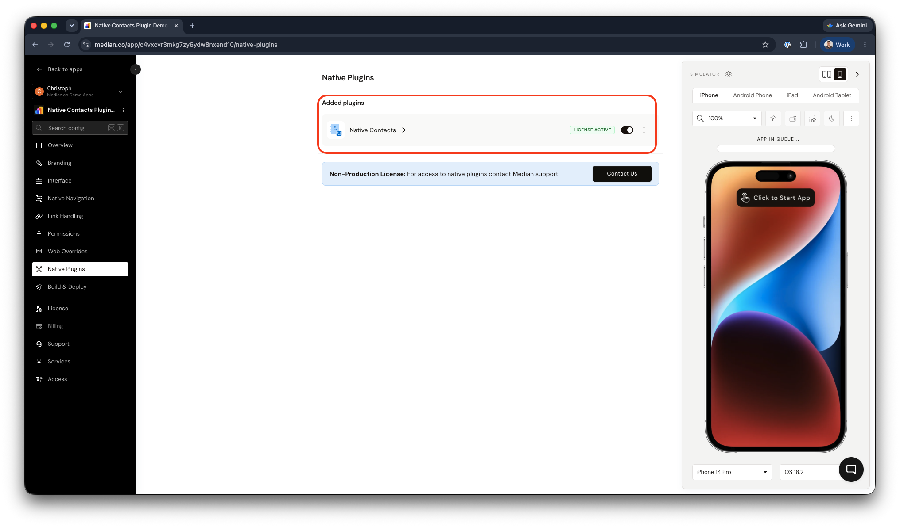

import { DeveloperDemo } from "/snippets/developer-demo.jsx";

import { AppetizeEmbed } from "/snippets/appetize-embed.jsx";
import { MedianLogo } from "/snippets/median-logo.jsx";

The Native Contacts plugin lets users sync their device contacts with your app, enabling form completion and data enrichment based on lookup fields such as email or phone number. You can retrieve all contacts in bulk or prompt the user to select specific contacts through a native UI without building any contact infrastructure yourself.

Common use cases include CRM data entry, field service lookups, social connection suggestions, and eCommerce address autofill.

<DeveloperDemo path="native-contacts" />

## Why use native contacts

- **CRM integration**: Sync device contacts directly into your app's workflow, eliminating manual data entry for sales and support teams.
- **Field service and operations**: Look up and act on contact data in real time for scheduling, dispatch, and on-site workflows.
- **Social and eCommerce features**: Enable social networking platforms and eCommerce shipping solutions to access contact data natively for connection recommendations or address autofill.

## Implementation guide

### App configuration

1. **Navigate to Native Plugins**: In Median App Studio, go to the Native Plugins section.
2. **Enable Native Contacts**: Toggle the plugin to enabled status.

<Frame caption="Native Contacts plugin enablement">
  
</Frame>

### JavaScript Bridge implementation

All contact functionality is accessed through the [Median JavaScript Bridge](/docs/javascript-bridge). Each method accepts either a callback function or returns a Promise. See [Promises](/docs/javascript-bridge#promises) for `async`/`await` patterns.

#### Check contact permission status

Before accessing contacts, check whether the user has already granted permission. The app will automatically prompt for permission on first access, but this method lets you check current status without triggering a prompt.

<MedianLogo />
<CodeGroup>
  ```javascript JavaScript
  // Callback style
  median.contacts.getPermissionStatus({ callback: myCallback });

// Promise style
const result = await median.contacts.getPermissionStatus({});
console.log(result.status); // for example, "granted"

````
</CodeGroup>

#### Permission status values

Given the differences between both iOS and Android you can expect slightly different permission values based on the operating system.

**iOS**

| Status          | Description                                                                                       |
| --------------- | ------------------------------------------------------------------------------------------------- |
| `granted`       | User has granted access                                                                           |
| `denied`        | User has explicitly denied access                                                                 |
| `restricted`    | Access is administratively prohibited (e.g. parental controls or mobile device management policy) |
| `notDetermined` | User has not yet been prompted                                                                    |

**Android**

| Status    | Description                                                  |
| --------- | ------------------------------------------------------------ |
| `granted` | User has granted access                                      |
| `denied`  | User has not yet been asked, or has explicitly denied access |

#### Retrieve all contacts

Fetch the complete contacts list stored on the device.

<MedianLogo />
<CodeGroup>
```javascript JavaScript
// Callback style
median.contacts.getAll({ callback: myCallback });

// Promise style
const result = await median.contacts.getAll({});
````

</CodeGroup>

**Note**: On iOS the `note` field is not returned by `getAll()` by default. Accessing it requires the `com.apple.developer.contacts.notes` entitlement, which requires approval by Apple.

#### Present a native contact picker

Display the device's native contact selection UI, allowing the user to choose one or multiple contacts. This is the recommended approach when you need explicit user selection rather than bulk access.

<MedianLogo />
<CodeGroup>
  ```javascript JavaScript
  // Callback style
  median.contacts.pickContact({
    callback: myCallback,
    multiple: true  // true = allow multi-select; false = single contact only
  });

// Promise style
const result = await median.contacts.pickContact({ multiple: false });

````
</CodeGroup>

**Note**: The `note` field is available when using `pickContact()` on iOS, without any additional entitlement.

#### Response format

When permission is granted, all contact methods return an object in the following shape:

<CodeGroup>
```javascript JavaScript
{
  success: true,
  contacts: [] // array of contact objects
}
````

</CodeGroup>

`contacts` is an array of contact objects. Available fields depend on the platform.

#### Contact fields

**iOS**

| Field                | Type                                     |
| -------------------- | ---------------------------------------- |
| `birthday`           | String                                   |
| `namePrefix`         | String                                   |
| `givenName`          | String                                   |
| `middleName`         | String                                   |
| `familyName`         | String                                   |
| `previousFamilyName` | String                                   |
| `nameSuffix`         | String                                   |
| `nickname`           | String                                   |
| `phoneticGivenName`  | String                                   |
| `phoneticMiddleName` | String                                   |
| `phoneticFamilyName` | String                                   |
| `organizationName`   | String                                   |
| `departmentName`     | String                                   |
| `jobTitle`           | String                                   |
| `note`               | String (`pickContact()` only; see above) |
| `phoneNumbers`       | Array                                    |
| `emailAddresses`     | Array                                    |
| `postalAddresses`    | Array                                    |

**Android**

| Field             | Type   |
| ----------------- | ------ |
| `birthday`        | String |
| `givenName`       | String |
| `familyName`      | String |
| `companyName`     | String |
| `companyTitle`    | String |
| `note`            | String |
| `phoneNumbers`    | Array  |
| `emailAddresses`  | Array  |
| `postalAddresses` | Array  |

#### Array field schemas

`phoneNumbers`, `emailAddresses`, and `postalAddresses` are arrays of objects. All other fields are strings.

**Phone numbers**

<CodeGroup>
  ```json JSON
  {
    "label": "STRING",
    "phoneNumber": "STRING"
  }
  ```
</CodeGroup>

**Email addresses**

<CodeGroup>
  ```json JSON
  {
    "label": "STRING",
    "emailAddress": "STRING"
  }
  ```
</CodeGroup>

**Postal addresses**

<CodeGroup>
  ```jsonc JSON
  {
    "label": "STRING",
    "street": "STRING",
    "city": "STRING",
    "state": "STRING",             // iOS only
    "region": "STRING",            // Android only
    "postalCode": "STRING",
    "country": "STRING",
    "isoCountryCode": "STRING",    // iOS only
    "subAdministrativeArea": "STRING", // iOS only
    "subLocality": "STRING"        // iOS only
  }
  ```
</CodeGroup>

## Demo app

You can test the native contact features using our virtual demo app on iOS and Android simulators.

<AppetizeEmbed
  iosEmbedCode="g4amgfwnwgjfw2totlew5e5sju"
  androidEmbedCode="bdxzacqu5khe5yglru3gxkx4ay"
/>
