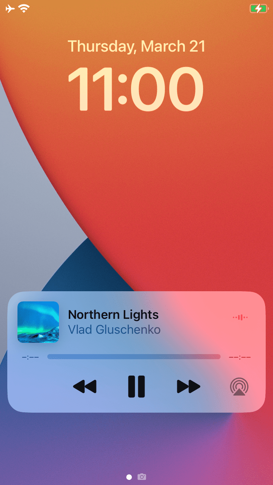
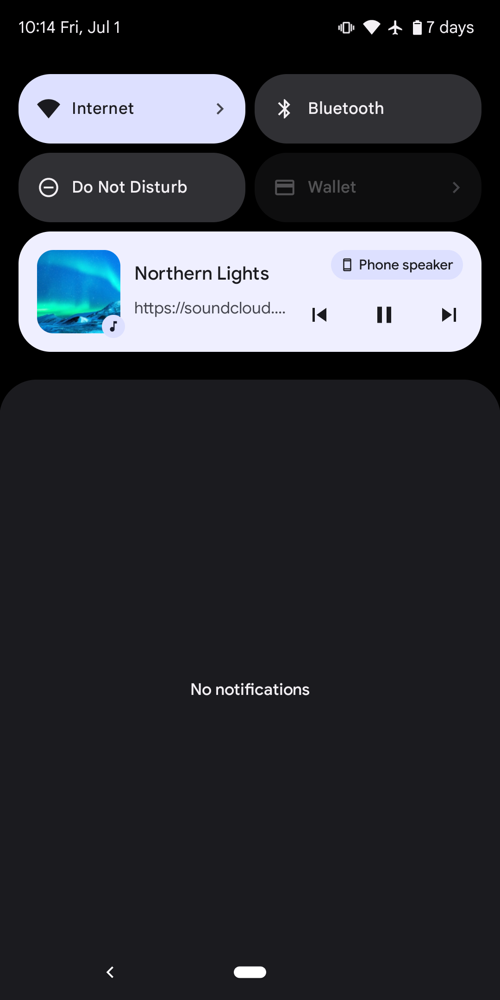
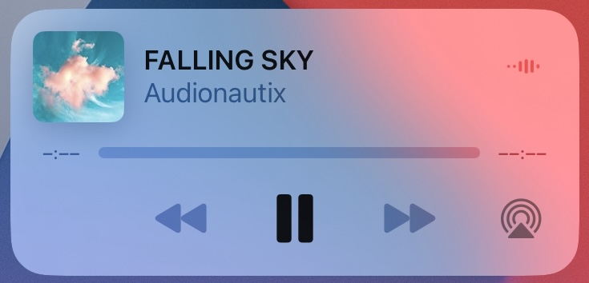
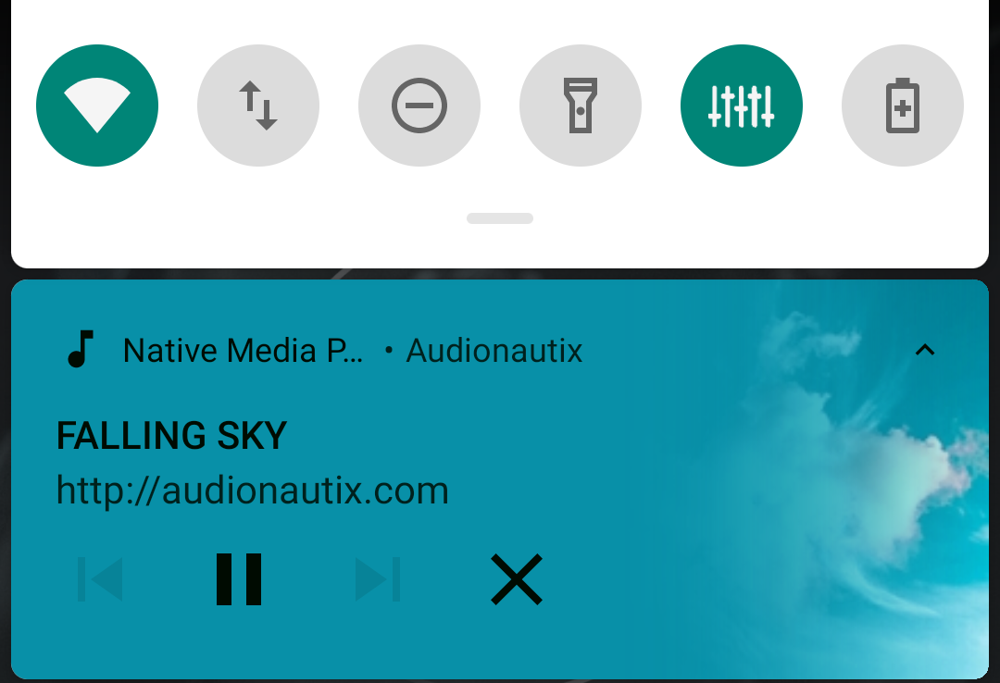
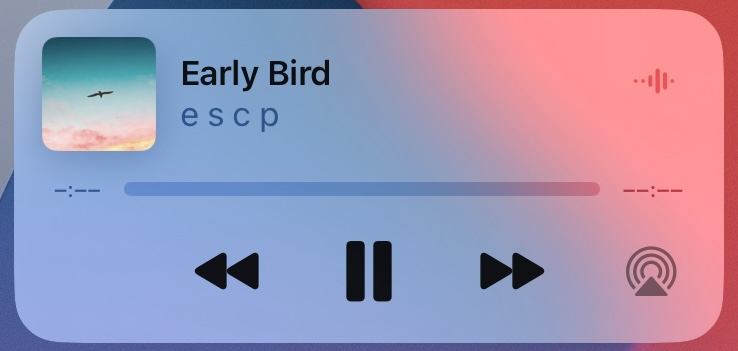
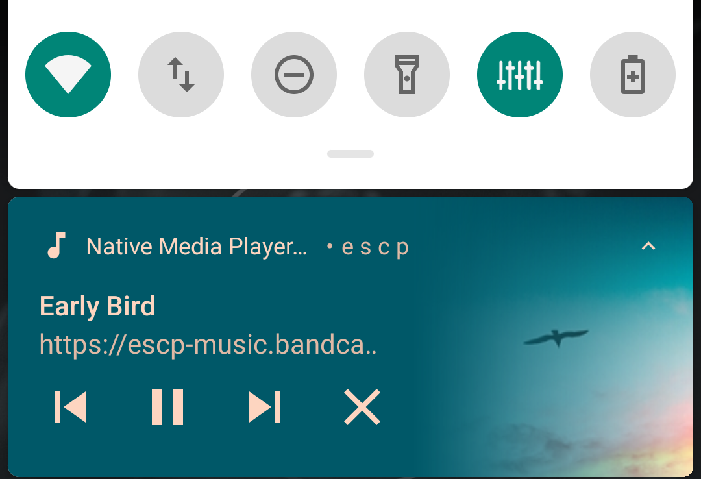
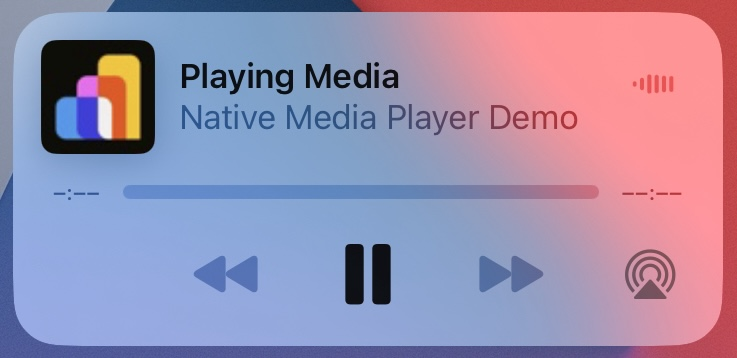
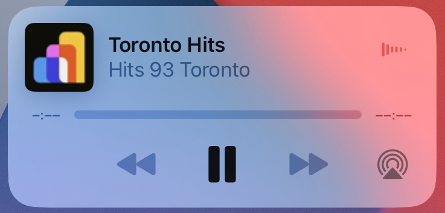
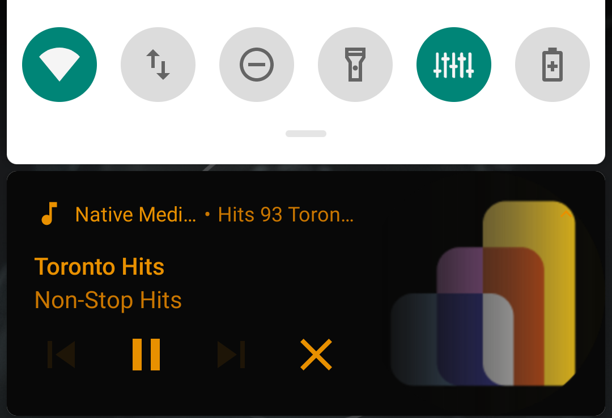

import { DeveloperDemo } from "/snippets/developer-demo.jsx";

import { MedianLogo } from "/snippets/median-logo.jsx";
import { AppetizeEmbed } from "/snippets/appetize-embed.jsx";

The Native Media Player plugin enables background audio playback in your Median app by adding a native media player UI to the lock screen and notification area on iOS and Android. This allows users to continue listening while the app is backgrounded or the device is locked.

Example use cases include:

- Podcast players
- Radio streaming apps
- Audiobooks
- E-learning platforms
- News and media apps
- Corporate training tools

The player supports play, pause, previous, and next controls and can display metadata such as the track title, artist, album, and artwork.

<DeveloperDemo path="native-media-player" />

## Native media player UI

|                                                              iOS                                                               |                                                                     Android                                                                      |
| :----------------------------------------------------------------------------------------------------------------------------: | :----------------------------------------------------------------------------------------------------------------------------------------------: |
|  |  |

## Implementation guide

### Play a single track

Create an object with the URL of the track:

<MedianLogo />
<CodeGroup>
  ```javascript JavaScript
  var track = {
        "url": "https://Your_Audio_URL"
  }
  ```
</CodeGroup>

**OR**
Create an object with the URL of the track and custom metadata (if your audio does not include already):

<MedianLogo />
<CodeGroup>
  ```javascript JavaScript
  // track with metadata
  var track = {
       "url": "https://Your_Audio_Url",
       "title": "Example Title",
       "album": "Example Album",
       "artist": "Example Artist"
  }
  ```
</CodeGroup>

**THEN**
Call `playTrack` function with the `track` object

<MedianLogo />
<CodeGroup>
  ```javascript JavaScript
  // Optional: show a spinner

// Start the player
const { success } = await median.backgroundMedia.playTrack(track);

// Optional: hide the spinner

if(success) {
// Track started playing successfully.
}

````
</CodeGroup>

HTML (with `track` defined as global variable):

<MedianLogo />
<CodeGroup>
```html HTML
<button type="button" onclick="median.backgroundMedia.playTrack(track)">Play Track</button>
````

</CodeGroup>

The player UI will display Play/Pause and Close controls for a single track.

|                                                              iOS: single track                                                               |                                                                  Android: single track                                                                   |
| :------------------------------------------------------------------------------------------------------------------------------------------: | :------------------------------------------------------------------------------------------------------------------------------------------------------: |
|  |  |

### Media controls

#### Pause playback

<MedianLogo />
<CodeGroup>
  ```html HTML
  <button onclick="median.backgroundMedia.pause()">Pause</button>
  ```
</CodeGroup>

#### Stop playback

<MedianLogo />
<CodeGroup>
  ```html HTML
  <button onclick="median.backgroundMedia.stop()">Stop</button>
  ```
</CodeGroup>

**Note**: On Android, this stops playback and removes the notification. On iOS, it only pauses.

### Get player status

Retrieve player status including current track time, `isPaused` status, album, artist, title, artwork, and track URL.

#### Option 1: Using a callback

<MedianLogo />
<CodeGroup>
  ```html HTML
  <button onclick="median.backgroundMedia.getPlayerStatus({ callback: playerStatusCallback })">Get Player Status</button>

  <script>
  // Declare a callback function to get player status
  function playerStatusCallback(status) {
    console.log(status);
  }
  </script>

````
</CodeGroup>

#### Option 2: Using a promise

<MedianLogo />
<CodeGroup>
```html HTML
<button onclick="getInfo()">Get Player Status</button>

<script>
// Declare an async function to wait for player status
async function getInfo() {
  const status = await median.backgroundMedia.getPlayerStatus();
  console.log(JSON.stringify(status));
}
</script>
````

</CodeGroup>

#### Status example

<MedianLogo />
<CodeGroup>
  ```javascript JavaScript
  {
    "currentTime": 50000, // time in ms
    "isPaused": false,
    "album": "Example Album",
    "artist": "Example Artist",
    "title": "Example Title",
    "artwork": "https://example.com/artwork.jpg",
    "url": "https://example.com/audio.mp3"
  }
  ```
</CodeGroup>

### Seeking in a track

#### Seek to specific time

To seek to a particular position of the currently playing media, pass any float value (in seconds) as an argument for the method given below.

<MedianLogo />
<CodeGroup>
  ```html HTML
  <button onclick="median.backgroundMedia.playTrack(50)">Seek to 50s</button>
  ```
</CodeGroup>

#### Start playback from specific position

To start a track from a particular position, pass a parameter named "time" inside the track object with a float value (in seconds). For example, the track given below will directly start from 50 seconds.

Create an object with the URL of the track and desired initial seek position:

<MedianLogo />
<CodeGroup>
  ```javascript JavaScript
  var track = {
        "url": "https://Your_Audio_URL",
        "time": 50 // Start at 50 seconds
  }
  ```
</CodeGroup>

<MedianLogo />
<CodeGroup>
  ```html HTML
  <button onclick="median.backgroundMedia.playTrack(track)">
    Start Track from 50s
  </button>
  ```
</CodeGroup>

### Streaming a playlist

#### JavaScript playlist object

Create an object with any number of audio tracks to send to the device as one playlist along with the starting track number in **currentTrackNumber**. For example, to start the playlist with the 3rd song in the playlist, set the **currentTrackNumber: 2**.

<MedianLogo />
<CodeGroup>
  ```javascript JavaScript
  var playlist = {
       "currentTrackNumber": 0,
       "tracks": [
                 {
                     "url": "https://Your_Audio_URL_1",
                     "title": "Example 1 Title",
                     "album": "Example 1 Album",
                     "artist": "Example 1 Artist"
                 },
                 {
                     "url": "https://Your_Audio_URL_2",
                 },
                 {
                     "url": "https://Your_Audio_URL_3",
                     "title": "Example 2 Title",
                     "album": "Example 2 Album",
                     "artist": "Example 2 Artist"
                 }
         ]
  }
  ```
</CodeGroup>

#### Start playlist

<MedianLogo />
<CodeGroup>
  ```html HTML
  <button
    type="button"
    onclick="median.backgroundMedia.streamPlaylist(playlist)"
  >
    Start Playlist
  </button>
  ```
</CodeGroup>

#### Move through playlist

When the currently playing track finishes playing, the player will automatically switch to the next track in the playlist. The user can also step through the playlist using the Next and Previous buttons.

|                                                               iOS: playlist                                                                |                                                                   Android: playlist                                                                    |
| :----------------------------------------------------------------------------------------------------------------------------------------: | :----------------------------------------------------------------------------------------------------------------------------------------------------: |
|  |  |

### Metadata display

The player will display the embedded metadata of the playing track, including the audio icon image. If your audio file does not include any metadata, you can include the metadata in the **track** object, as shown in the examples above. **Note:** If metadata is embedded in the track but also provided manually, the manual metadata will be selected.

If no metadata is available, the metadata will be set as: **Title**: Playing Media **Album**: APP_NAME **Artist**: APP_NAME

|                                                      iOS: default metadata                                                      |                                                          Android: default metadata                                                          |
| :-----------------------------------------------------------------------------------------------------------------------------: | :-----------------------------------------------------------------------------------------------------------------------------------------: |
|  |  |

Audio icons can only be retrieved directly from the audio URL. If none is available, the media player uses the app icon as the audio icon. Examples of the default audio icon are shown below.

|                                                       iOS: default audio icon                                                       |                                                           Android: default audio icon                                                           |
| :---------------------------------------------------------------------------------------------------------------------------------: | :---------------------------------------------------------------------------------------------------------------------------------------------: |
|  |  |

### Background mode

<Info>
  **Background mode**

Use this mode to sync the native media player with your in-app web player, for example when resuming or pausing.

</Info>

import { DeveloperDemo } from "/snippets/developer-demo.jsx";

<DeveloperDemo path="native-media-player-switch" />

Define these functions in your web app:

- `getPlayerStatus()`: Gets the current status of the web player to pass to the native media player. (Called when the app is paused/backgrounded).
- `updatePlayerStatus(mediaPlayerStatus)`: Passes the native media player status to the web player when the app is resumed. (Called when the app is resumed/foregrounded).

#### Example implementation

<MedianLogo />
<CodeGroup>
  ```javascript JavaScript
  // Called when the app is paused
  function getPlayerStatus() {
    return {
      currentTime: webPlayer.currentTime,
      isPaused: webPlayer.paused,
      album: 'Kennedy',
      artist: 'JFK',
      title: 'JFK Speech',
      artwork: 'https://path_to_thumbnail.jpeg',
      url: webPlayer.currentSrc
    };
  }

// Called when app is resumed
function updatePlayerStatus(mediaPlayerStatus) {
if (mediaPlayerStatus.currentTime) {
webPlayer.currentTime = mediaPlayerStatus.currentTime / 1000;
}

    if (mediaPlayerStatus.isPaused && !webPlayer.paused) {
      webPlayer.pause();
    } else if (!mediaPlayerStatus.isPaused && webPlayer.paused) {
      webPlayer.play();
    }

}

```
</CodeGroup>

## Demo apps

### Native media player

<AppetizeEmbed
iosEmbedCode="txbitfsxzcknbrooowhm3rmccy"
androidEmbedCode="wgzr7a26ejsrphxkh4euitqauy"
/>

### Native media player background

**Demo instructions**

1. Start playing an audio or video file.
2. Press the Home button. Playback continues in the background.
3. To confirm background playback, swipe down the notification overlay on iOS or Android.

The demo also includes metadata (for example, branding) to show possible customization options as highlighted above. When you return to the app, playback resumes smoothly.

*Note: The demo temporarily pauses playback to show debug info about the media state*.

<AppetizeEmbed
iosEmbedCode="kwyaub7jkkpusqfm2feysetsje"
androidEmbedCode="cgb5ofrgsa73mpn3szfpwsnpzi"
/>
```
