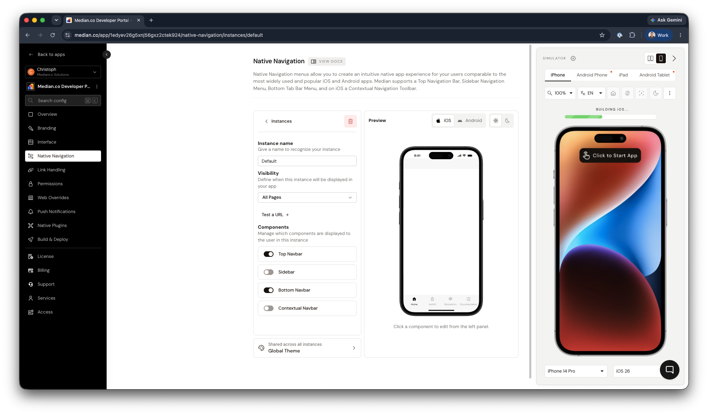

import { MedianLogo } from "/snippets/median-logo.jsx";

<Info>
  **Looking for the earlier navigation settings?**

Native navigation used to be set up on a separate tab for each component. See [What changed in native navigation](/docs/native-navigation-changes) to find where those settings are now.

</Info>

Native navigation in your app is organized into **instances**. An instance is a set of navigation components together with the pages it appears on. For example, your app can show a top bar and a sidebar on most pages, and a bottom tab bar without a sidebar in a checkout flow.

Every app has at least one instance, which is shown on **All Pages**. Add more instances to change the navigation on specific pages.

<Frame caption="App Studio: Native Navigation">
  
</Frame>

## Components

Each instance turns these components on or off and has its own items for each one:

| Component             | What it shows                                                                                                                                                                          |
| --------------------- | -------------------------------------------------------------------------------------------------------------------------------------------------------------------------------------- |
| **Top Navbar**        | The bar at the top of the screen, with the page title, menu button, and action buttons such as refresh, share, and custom buttons. See [Top navigation bar](/docs/top-navigation-bar). |
| **Sidebar**           | A menu that slides in from the side, with links and groups of links. See [Sidebar navigation menu](/docs/sidebar-navigation-menu).                                                     |
| **Bottom Navbar**     | Tabs along the bottom of the screen for the main sections of your app. See [Bottom tab bar](/docs/bottom-tab-bar).                                                                     |
| **Contextual Navbar** | iOS only. A toolbar with back, forward, and refresh buttons. See [iOS contextual navigation toolbar](/docs/contextual-navigation-toolbar).                                             |

When an instance turns a component off, that component is hidden on the instance's pages.

### Global Theme

Colors, fonts, and images for each component are set once in **Global Theme** and shared by all instances. Instances control what each component shows. The Global Theme controls how it looks.

---

## Create an instance

<Steps>
  <Step title="Add the instance">
    In App Studio, open **Native Navigation** and select **New instance**. Give it a name you'll recognize.
  </Step>
  <Step title="Choose its pages">
    Under **Visibility**, choose the pages that show this instance:

    - **All Pages**: every page that no other instance matches.
    - **Single Page**: one URL.
    - **Multiple Pages**: every page under a URL path, such as everything under `example.com/shop`.

    Turn on **Include subdomains** to also match the same pages on subdomains, such as `shop.example.com`.

  </Step>
  <Step title="Choose its components">
    Under **Components**, turn on the components this instance shows, then add their items.
  </Step>
</Steps>

App Studio saves the pages as a URL pattern. See [Matching pages](#matching-pages) for how patterns work. An instance whose pattern isn't a single page or a path is listed as **Custom Pages**.

## How the app chooses an instance

Each time a page loads, the app checks the instances in the order they're listed in App Studio and uses the first one whose pages match. The **All Pages** instance is only used when no other instance matches, wherever it appears in the list.

Put the most specific instances first. To change the order, select **Reorder** and drag the instances.

When the user moves to a page that belongs to a different instance, the navigation switches to that instance.

## Matching pages

Instances and [link handling rules](/docs/internal-vs-external-links) match pages with URL patterns. Patterns use wildcards instead of regular expressions, and they work the same way on iOS and Android.

| Pattern                     | Matches                                                                            | Doesn't match                                    |
| --------------------------- | ---------------------------------------------------------------------------------- | ------------------------------------------------ |
| `example.com`               | `https://example.com` (the home page)                                              | `https://example.com/about`                      |
| `example.com/about`         | `https://example.com/about`                                                        | `https://example.com/about/team`                 |
| `example.com/shop/**`       | `https://example.com/shop`, `https://example.com/shop/shoes/42`                    | `https://example.com/blog`                       |
| `example.com/shop/*`        | `https://example.com/shop/shoes`                                                   | `https://example.com/shop/shoes/42`              |
| `example.com/*/settings`    | `https://example.com/alice/settings`                                               | `https://example.com/settings`                   |
| `**.example.com/**`         | `https://example.com/a`, `https://www.example.com/a`, `https://shop.example.com/a` | `https://example.org/a`                          |
| `*.example.com`             | `https://shop.example.com`                                                         | `https://example.com`, `https://a.b.example.com` |
| `https://example.com/**`    | `https://example.com/a`                                                            | `http://example.com/a`                           |
| `example.com/**?tab=orders` | `https://example.com/account?tab=orders&sort=new`                                  | `https://example.com/account?tab=profile`        |
| `**`                        | Every URL                                                                          |                                                  |

### Pattern rules

| Rule                         | Behavior                                                                                                                                                                                      |
| ---------------------------- | --------------------------------------------------------------------------------------------------------------------------------------------------------------------------------------------- |
| **Scheme**                   | A pattern without `https://` or `http://` matches both.                                                                                                                                       |
| `*`                          | Matches exactly one part: one segment of the path, or one part of the host name.                                                                                                              |
| `**` at the end of a path    | Matches the path itself and everything under it.                                                                                                                                              |
| `**.` at the start of a host | Matches the domain and all of its subdomains.                                                                                                                                                 |
| **Query parameters**         | Ignored unless the pattern includes them. A pattern ending in `?key=value` matches URLs that have that parameter with that value, in any position. Use `?key` or `?key=*` to match any value. |
| **Trailing slashes and `#`** | Trailing slashes and anything after `#` are ignored.                                                                                                                                          |

## Change navigation at runtime

JavaScript Bridge methods that change navigation, such as [`median.sidebar.setItems()`](/docs/sidebar-navigation-menu), [`median.tabNavigation.setTabs()`](/docs/bottom-tab-bar), and [`median.navigationTitles.set()`](/docs/top-navigation-bar), change the items of the instance that matches the current page.

The change stays in place while the user navigates, including on pages that belong to other instances, until another call replaces it or the app restarts.

<Warning>
  **Runtime changes reset when the app restarts**

  The `persist` option doesn't restore runtime changes when the app restarts. To
  keep your changes, apply them each time the app starts.
</Warning>

<MedianLogo />

<CodeGroup>

```javascript JavaScript
function median_library_ready() {
  median.sidebar.setItems({
    items: [
      { label: "Home", url: "https://example.com" },
      { label: "Orders", url: "https://example.com/account?tab=orders" },
    ],
  });
}
```

</CodeGroup>
