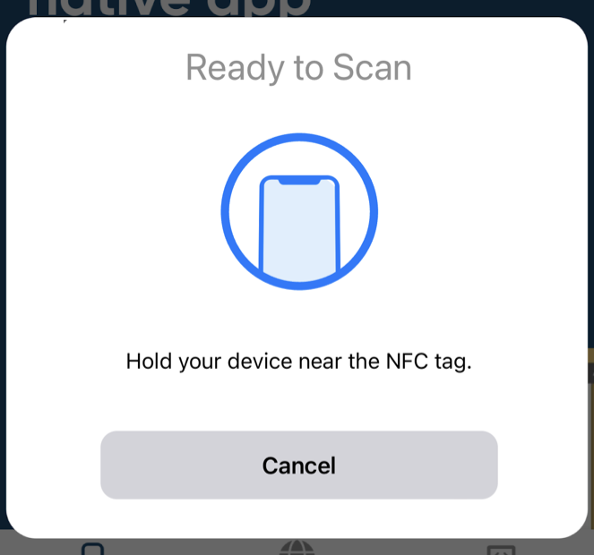
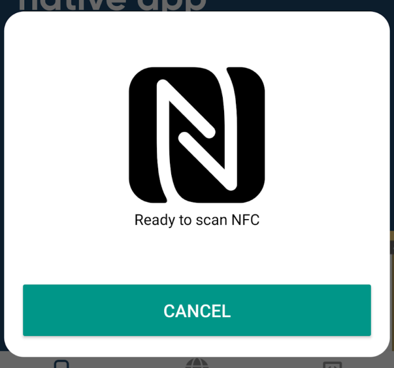

import { MedianLogo } from "/snippets/median-logo.jsx";

<Columns cols={2}>
<Frame caption="iOS Default UI">
  
</Frame>

<Frame caption="Android Custom UI">
  
</Frame>
</Columns>

<Warning>
  **iOS Near-field Communications Capability**

Enable the NFC Tag Scanner plugin in App Studio before rebuilding your app. If you build from downloaded iOS source or manually manage Apple signing assets, confirm the Near Field Communication Tag Reading capability is enabled in Xcode and in your Apple Developer account.

</Warning>

## Implementation Guide

### Check for NFC availability

<MedianLogo />
<CodeGroup>
  ```JavaScript JavaScript
  // Promise method
  median.nfc.status().then(function (data) {
  // process the data here. In this example, we are just logging it 
    if (data.available) {
       // show user NFC-related functionality, e.g. a button to start scanning
    }
  });

// Callback method function nfcStatusCallback() is defined on page
median.nfc.status({'callback': nfcStatusCallback});

````
</CodeGroup>

### Initiate tag reading

<MedianLogo />
<CodeGroup>
```JavaScript JavaScript
// Promise method
median.nfc.readTag({
  'message': STRING, // Android only, shown in the prompt when scanning for tags
  'openUrl': BOOLEAN // if set to TRUE and an http or https url is returned the URL will automatically be opened
}).then(function (data) {
  // data.success: BOOLEAN, true if scanning was successful
  // data.cancel: BOOLEAN, true if user canceled the NFC scan prompt
  // data.error: STRING, included if error may be “SystemIsBusy”, “SessionTimeout”, “SessionTerminatedUnexpectedly”, or “Error”
  // data.type: NFC tag type
  // data.prefix: the NDEF tag prefix, e.g. 'https://'
  // data.content: the rest of the tag payload after the prefix
  // data.uri: the concatenation of the prefix and the content
});

// Callback method function readTagCallback() is defined on page
median.nfc.readTag({
  'callback': readTagCallback,
  'message': STRING
});
````

</CodeGroup>

#### Scan Tag Basic Example

<MedianLogo />
<CodeGroup>
  ```JavaScript JavaScript
  median.nfc.readTag({
    'message': 'Hold your device near the storage bin'
  }).then(function (data) {
      if (data && data.error) {
          console.log('There was an error scanning for NFC tags');
          return;
      }
      if (data && data.uri) {
          // do something with data.uri
      }
  });
  ```
</CodeGroup>

#### Scan Tag and Open URL Directly

<MedianLogo />
<CodeGroup>
  ```JavaScript JavaScript
  median.nfc.readTag({
    'openUrl': true,
    'message': 'Hold your device near the exhibit sign'
  });
  ```
</CodeGroup>
