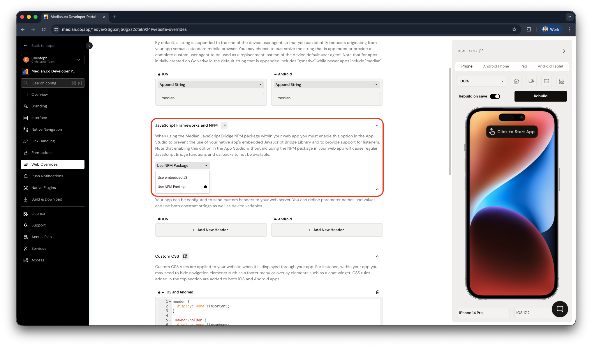

## Median JavaScript Bridge NPM package

Simplify the integration of your Single-Page Applications (SPAs) with the Median JavaScript Bridge NPM Package. Designed to work across popular JavaScript frameworks such as React, Angular, Vue.js, and more, this framework-agnostic library simplifies the use of Median JavaScript Bridge methods in your web apps.

Follow the steps below to install the package and start using within your web app.

**Explore our GitHub repository**

<GitHub.Repo repo="gonativeio/median-javascript-bridge" />

**Explore the Package on NPM**

[https://www.npmjs.com/package/median-js-bridge](https://www.npmjs.com/package/median-js-bridge)

## Implementation guide

### App configuration

When utilizing the Median JavaScript Bridge NPM package in your web application, remember to enable the corresponding option in the App Studio (_Website Overrides > JavaScript Frameworks and NPM_).

This step prevents conflicts with the native app's embedded JavaScript Bridge Library and activates required listener support. Omitting the package while enabling the option may result in unresponsive JavaScript Bridge functions and callbacks.

<Frame caption="Median App Studio - JavaScript Frameworks and NPM">
  
</Frame>

### Web app installation instructions

#### Using a package manager

Install the package via **npm** or **yarn** for seamless integration into your project.

**With npm**:

```bash bash
npm install median-js-bridge --save
```

**With yarn**

```bash bash
yarn add median-js-bridge
```

#### Using a script tag

If you prefer to add the library directly to your web page, include the following script tag in your HTML:

<CodeGroup>
  ```JavaScript JavaScript
  <script
    type="text/javascript"
    src="https://unpkg.com/median-js-bridge@latest/dist/median.min.js"
  ></script>
  ```
</CodeGroup>

<Warning>
  **Avoid @latest in production**

When loading the library via a `<script>` tag, using **@latest** means you will receive every new release as soon as it is available. This can lead to unintended regressions in production as potential breaking changes are applied instantly.

**Recommendation**: Pin to a specific version (e.g. @1.12.3) and upgrade deliberately.

</Warning>

## Next steps

After a successful installation of the package you can explore dedicated use cases and examples to implement callbacks, set up event listeners and implement an optimized Navigation for your SPA.

<CardGroup cols={1}>
  <Card title="Example commands" icon="code" href="/docs/basic-usage">
    See implementation examples for common features across the app lifecycle,
    with integration steps for each.
  </Card>
  <Card
    title="Using listeners"
    icon="ear-listen"
    href="/docs/npm-package-usage-with-listeners"
  >
    Register and manage listeners for app events such as deep links and push
    notifications.
  </Card>
  <Card
    title="SPA navigation"
    icon="route"
    href="/docs/npm-package-spa-navigation"
  >
    Handle navigation in a single-page application (SPA) with the Median NPM
    package.
  </Card>
</CardGroup>
