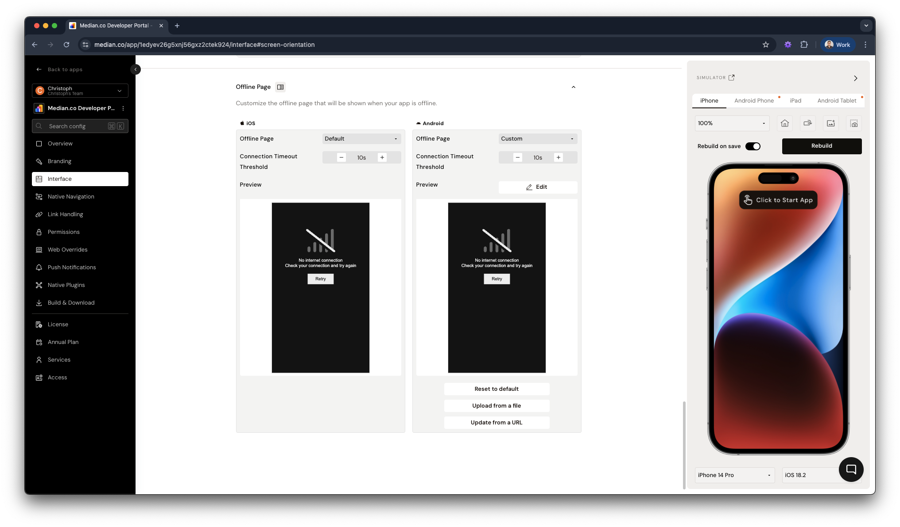

import { MedianLogo } from "/snippets/median-logo.jsx";

By default, the offline timeout is set to 10 seconds, but you can customize this value to suit your needs. However, increasing the timeout duration may degrade user experience, as it will delay visual feedback when the app is trying to establish a connection.

<Frame caption="App Studio: offline page configuration">
  
</Frame>

## Offline page behavior

- **Enabled (Default)**: After the timeout, an offline page is shown.
- **Disabled**: The app displays the last cached version of the webpage. If no cached page exists (e.g., for new users), the app will show a default browser error (iOS WKWebView or Android WebView).

## Custom offline pages

Instead of using the default offline page, you can configure a custom offline page for both iOS and Android platforms. Since this page is shown without internet access, all assets must be self-contained:

- Inline all CSS and JavaScript
- Use Base64-encoded or SVG images

## Custom offline page as initial URL

To use a custom offline page as the app's initial launch screen, please set the `initialURL` in the [App Configuration](/docs/app-configuration-appconfigjson) to `file:///offline.html`.

## Manual page reload

You may also wish to include a button to manually attempt to reload the page, for instance after the user connects to WiFi or VPN. This can be implemented using the following JavaScript Bridge command:

<MedianLogo />
<CodeGroup>
```javascript JavaScript 
median.webview.reload(); 
```
</CodeGroup>

## Example offline pages

### Default offline page

<iframe
  src="https://codepen.io/gonative/embed/LYrpOKz?default-tab=result"
  title="Default offline page"
  height="450"
  loading="lazy"
  allowFullScreen
  style={{ width: "100%", border: 0, borderRadius: "8px" }}
/>

### Custom offline page example

The following example outlines how to include PNG and SVG encoded images in the offline page.

<iframe
  src="https://codepen.io/gonative/embed/poWbXPN?default-tab=result"
  title="Custom offline page"
  height="450"
  loading="lazy"
  allowFullScreen
  style={{ width: "100%", border: 0, borderRadius: "8px" }}
/>

### Localized offline page example

The following example translates the text and buttons of the default offline page to French, Spanish, or Korean based on the device language. Any other languages will default to the English offline page.

<iframe
  src="https://codepen.io/gonative/embed/OPNNxbw?default-tab=result"
  title="Localized offline page"
  height="450"
  loading="lazy"
  allowFullScreen
  style={{ width: "100%", border: 0, borderRadius: "8px" }}
/>

## Advanced strategies

<CardGroup cols={1}>
  <Card title="Service workers" icon="gears" href="/docs/service-workers">
    Use service workers on your website to cache content, so users can access it
    in your app while offline.
  </Card>
  <Card
    title="Native Datastore"
    icon="database"
    href="/docs/native-datastore-offline"
  >
    Save data in App Storage while the device is offline, then sync it with your
    backend when the user is back online. Use App Storage for this, because
    Cloud Storage isn't available offline.
  </Card>
  <Card
    title="Offline download manager"
    icon="download"
    href="/docs/offline-download-manager"
  >
    Download documents and media files to the user's device for offline access.
    Users can browse them in a built-in file manager, or you can access them
    programmatically.
  </Card>
  <Card
    title="OfflineSync"
    icon="arrows-rotate"
    href="https://median.co/contact?topic=sales-inquiry"
  >
    For apps that work entirely without internet access, such as sales catalogs
    or in-store kiosks. Contact us to learn more.
  </Card>
</CardGroup>
